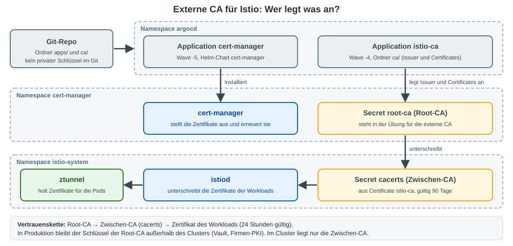
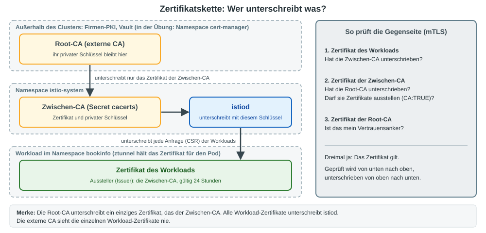

# Externe CA für Istio mit ArgoCD ausliefern (cert-manager, Secret `cacerts`)

## Worum geht es?

Ohne weiteres Zutun erzeugt istiod beim ersten Start eine eigene, selbstsignierte CA (Secret `istio-ca-secret`).
In Firmen soll das Mesh meist an der vorhandenen PKI hängen. Dafür liest istiod eine **Zwischen-CA** aus dem
Secret `cacerts` im Namespace `istio-system`.

Der private Schlüssel gehört nicht ins Git. Über ArgoCD wird deshalb nicht das Secret ausgeliefert,
sondern ein `Certificate` für cert-manager. cert-manager erzeugt daraus das Secret im Cluster und erneuert es.



> **Merkkasten: Die Root-CA ist in der Übung nur ein Platzhalter**
>
> In der Übung erzeugt cert-manager eine selbstsignierte Root-CA im Cluster. Sie steht für die externe CA.
> In Produktion ersetzt du genau diese Stelle durch den Issuer eurer PKI (z. B. Vault). Alles danach bleibt gleich.

## Wer unterschreibt was? Die Zertifikatskette

Die externe CA unterschreibt **nicht** die Zertifikate der Workloads. Sie unterschreibt nur ein einziges Zertifikat:
das der Zwischen-CA. Alle Workload-Zertifikate unterschreibt weiterhin istiod, jetzt mit dem Schlüssel der Zwischen-CA.



Mit ihrer Unterschrift sagt die Root-CA: "Diese Zwischen-CA darf in meinem Namen Zertifikate ausstellen."
Im Zertifikat der Zwischen-CA steht das als `CA:TRUE`.

### Was bedeutet `CA:TRUE`?

`CA:TRUE` ist X.509-Standard (Erweiterung **Basic Constraints**, RFC 5280) und keine Besonderheit von cert-manager.
`isCA: true` im `Certificate` ist nur der Schalter dafür: cert-manager schreibt den Wunsch in die Zertifikatsanfrage,
die Root-CA übernimmt ihn ins Zertifikat.

  * Mit `CA:TRUE` darf der **private Schlüssel** zu diesem Zertifikat andere Zertifikate unterschreiben.
    Das Zertifikat ist der öffentliche Nachweis dafür.
  * Mit `CA:FALSE` (oder ohne die Erweiterung) ist es ein Endzertifikat, z. B. das Zertifikat eines Workloads.
  * Durchgesetzt wird die Regel **beim Prüfen**, nicht beim Ausstellen: Die Gegenseite verlangt bei jedem
    ausstellenden Zertifikat in der Kette `CA:TRUE`, sonst lehnt sie ab.

`CA:TRUE` allein reicht nicht. Damit ein ausgestelltes Zertifikat gilt, muss außerdem stimmen:

| Bedingung | Bedeutung |
|-----------|-----------|
| Kette | Das CA-Zertifikat ist selbst von einer vertrauten CA unterschrieben, bis hoch zur Root-CA |
| Key Usage | Ist die Erweiterung gesetzt, muss `Certificate Sign` enthalten sein (cert-manager setzt das bei `isCA: true` mit) |
| Gültigkeit | Das CA-Zertifikat ist nicht abgelaufen |
| Pfadlänge | Ein `pathlen` weiter oben in der Kette wird nicht überschritten (`pathlen:0` = nur Endzertifikate, keine weiteren CAs darunter) |

Ein selbst gebautes Zertifikat mit `CA:TRUE` nützt also nichts, solange keine vertraute CA es unterschrieben hat.
Einzige Ausnahme ist die Root-CA: Sie unterschreibt sich selbst, und man vertraut ihr, weil sie als Vertrauensanker hinterlegt ist.

Ob die Zwischen-CA `CA:TRUE` bekommt, entscheidet die Root-CA. Eine Firmen-PKI kann das ablehnen oder mit `pathlen:0` begrenzen. Für Istio reicht `pathlen:0`.

### Was liegt im Secret `cacerts`?

Weil istiod selbst unterschreibt, liegt im Secret `cacerts` mehr als nur ein Zertifikat der externen CA:

| Feld | Inhalt | Wozu |
|------|--------|------|
| `tls.crt` | Zertifikat der Zwischen-CA | wird als Teil der Kette mit ausgeliefert |
| `tls.key` | **privater Schlüssel** der Zwischen-CA | damit unterschreibt istiod die Workload-Zertifikate |
| `ca.crt` | Zertifikat der Root-CA | Vertrauensanker, gegen den alle prüfen |

### Wie wird die Kette geprüft?

Wer ein Workload-Zertifikat prüft, geht die Kette von unten nach oben:

  1. Das Workload-Zertifikat ist von der Zwischen-CA unterschrieben (also von istiod).
  2. Das Zertifikat der Zwischen-CA ist von der Root-CA unterschrieben.
  3. Der Root-CA vertraue ich, also vertraue ich auch dem Workload-Zertifikat.

Es wird dabei nichts vorgetäuscht: Als Aussteller (Issuer) steht im Workload-Zertifikat die Zwischen-CA, nicht die Root-CA.
Die Kette siehst du in Schritt 6 mit `istioctl ztunnel-config certificates`.

> **Merkkasten: Woher kommt der Schlüssel der Zwischen-CA?**
>
> cert-manager erzeugt ihn im Cluster und legt ihn im Secret `cacerts` ab. Zur externen CA geht nur die
> Zertifikatsanfrage (CSR) mit dem öffentlichen Schlüssel, zurück kommt das unterschriebene Zertifikat.
> Der private Schlüssel der Root-CA kommt nie in den Cluster.

Getestet mit Istio 1.31.4 (Ambient), cert-manager v1.21.3, Kubernetes 1.37.

## Voraussetzungen

  * Istio Ambient und Bookinfo laufen (Namespace `bookinfo`).
  * ArgoCD ist installiert, siehe [istio ambient und bookinfo mit argocd ausrollen](argocd-istio-bookinfo.md), Abschnitt 4, Schritt 2.
  * Die Manifeste liegen fertig in diesem Repo unter [`istio/argocd/externe-ca/`](externe-ca/). Du brauchst kein eigenes Git-Repo.

## Schritt 1: Ausgangslage ansehen

```bash
kubectl -n istio-system get secret
```

Es gibt nur `istio-ca-secret`, also die eigene CA von istiod.

```bash
kubectl -n bookinfo get cm istio-ca-root-cert -o jsonpath='{.data.root-cert\.pem}' \
  | openssl x509 -noout -subject -issuer
```

```
subject=O = cluster.local
issuer=O = cluster.local
```

## Schritt 2: cert-manager per ArgoCD ausrollen

> Hast du cert-manager schon per Helm installiert (Übung Let's Encrypt)? Dann **überspringe** diesen Schritt.

```yaml
# externe-ca/apps/cert-manager-app.yaml
apiVersion: argoproj.io/v1alpha1
kind: Application
metadata:
  name: cert-manager
  namespace: argocd
  annotations:
    argocd.argoproj.io/sync-wave: "-5"
  finalizers:
    - resources-finalizer.argocd.argoproj.io
spec:
  project: default
  source:
    repoURL: https://charts.jetstack.io
    chart: cert-manager
    targetRevision: v1.21.3
    helm:
      releaseName: cert-manager
      values: |
        crds:
          enabled: true
        config:
          apiVersion: controller.config.cert-manager.io/v1alpha1
          kind: ControllerConfiguration
          enableGatewayAPI: true
  destination:
    server: https://kubernetes.default.svc
    namespace: cert-manager
  syncPolicy:
    automated:
      selfHeal: true
    syncOptions:
      - CreateNamespace=true
      - ServerSideApply=true
```

```bash
REPO=https://raw.githubusercontent.com/jmetzger/training-istio-kubernetes/main/istio/argocd/externe-ca
kubectl apply -f $REPO/apps/cert-manager-app.yaml
```

## Schritt 3: Die CA per ArgoCD ausrollen

Die Application zeigt auf den Ordner `externe-ca/ca/` in diesem Repo. Dort liegen vier Manifeste:

| Datei | Was | Wozu |
|-------|-----|------|
| `01-selfsigned-issuer.yaml` | `ClusterIssuer` `selfsigned` | Hilfs-Issuer, stellt nur die Root-CA aus |
| `02-root-ca.yaml` | `Certificate` `root-ca` (Namespace `cert-manager`) | Root-CA, steht für die externe CA |
| `03-root-ca-issuer.yaml` | `ClusterIssuer` `root-ca` | unterschreibt mit der Root-CA |
| `04-istio-ca.yaml` | `Certificate` `istio-ca` (Namespace `istio-system`) | Zwischen-CA, ergibt das Secret `cacerts` |

Das entscheidende Manifest:

```yaml
# externe-ca/ca/04-istio-ca.yaml
apiVersion: cert-manager.io/v1
kind: Certificate
metadata:
  name: istio-ca
  namespace: istio-system
spec:
  isCA: true
  commonName: Istio Intermediate CA
  subject:
    organizations:
      - Training
  secretName: cacerts     # diesen Namen erwartet istiod
  duration: 2160h         # 90 Tage
  renewBefore: 360h       # 15 Tage vorher erneuern
  privateKey:
    algorithm: RSA
    size: 4096
  issuerRef:
    kind: ClusterIssuer
    name: root-ca
```

Die Application dazu:

```yaml
# externe-ca/apps/istio-ca-app.yaml
apiVersion: argoproj.io/v1alpha1
kind: Application
metadata:
  name: istio-ca
  namespace: argocd
  annotations:
    argocd.argoproj.io/sync-wave: "-4"
  finalizers:
    - resources-finalizer.argocd.argoproj.io
spec:
  project: default
  source:
    repoURL: https://github.com/jmetzger/training-istio-kubernetes.git
    targetRevision: main
    path: istio/argocd/externe-ca/ca
  destination:
    server: https://kubernetes.default.svc
  syncPolicy:
    automated:
      selfHeal: true
    retry:
      limit: 5
      backoff:
        duration: 10s
        factor: 2
        maxDuration: 2m
```

```bash
kubectl apply -f $REPO/apps/istio-ca-app.yaml
```

> Mit eigenem Git-Repo: Ordner `externe-ca/` kopieren und in `istio-ca-app.yaml` die `repoURL` und den `path` anpassen.

## Schritt 4: Prüfen, was ArgoCD und cert-manager angelegt haben

```bash
kubectl -n argocd get applications
```

```
NAME           SYNC STATUS   HEALTH STATUS
cert-manager   Synced        Healthy
istio-ca       Synced        Healthy
```

Das dauert ein bis zwei Minuten. `istio-ca` steht zuerst auf `OutOfSync / Missing`, bis cert-manager läuft.

```bash
kubectl get clusterissuer
kubectl get certificate -A
```

```
NAMESPACE      NAME       READY   SECRET    AGE
cert-manager   root-ca    True    root-ca   10s
istio-system   istio-ca   True    cacerts   10s
```

```bash
kubectl -n istio-system describe secret cacerts
```

```
Type:  kubernetes.io/tls

Data
====
ca.crt:   1854 bytes
tls.crt:  1907 bytes
tls.key:  3243 bytes
```

`ca.crt` ist die Root-CA, `tls.crt` und `tls.key` sind die Zwischen-CA. istiod versteht dieses Format direkt.

Darf die Zwischen-CA Zertifikate ausstellen? Das steht in ihrem Zertifikat:

```bash
kubectl -n istio-system get secret cacerts -o jsonpath='{.data.tls\.crt}' \
  | base64 -d | openssl x509 -noout -text | grep -A1 -E "Basic Constraints|Key Usage"
```

Erwartet: unter `Basic Constraints` steht `CA:TRUE`, unter `Key Usage` steht `Certificate Sign`.

Das Mesh nutzt die neue CA **noch nicht**:

```bash
kubectl -n bookinfo get cm istio-ca-root-cert -o jsonpath='{.data.root-cert\.pem}' \
  | openssl x509 -noout -subject -issuer
```

```
subject=O = cluster.local
issuer=O = cluster.local
```

## Schritt 5: istiod auf die neue CA umstellen

istiod entscheidet **beim Start**, welche CA es nimmt. Deshalb neu starten:

```bash
kubectl -n istio-system rollout restart deployment istiod
kubectl -n istio-system rollout status deployment istiod
```

```bash
kubectl -n istio-system logs deploy/istiod | grep -E "cacerts|x509 cert -"
```

```
Added cacerts files watcher at ./etc/cacerts
Use root cert from etc/cacerts/ca.crt
x509 cert - Issuer: "CN=Training Root CA,O=Training", Subject: "CN=Istio Intermediate CA,O=Training", ...
x509 cert - Issuer: "CN=Training Root CA,O=Training", Subject: "CN=Training Root CA,O=Training", ...
```

Jetzt verteilt istiod die neue Root-CA in alle Namespaces:

```bash
kubectl -n bookinfo get cm istio-ca-root-cert -o jsonpath='{.data.root-cert\.pem}' \
  | openssl x509 -noout -subject -issuer
```

```
subject=O = Training, CN = Training Root CA
issuer=O = Training, CN = Training Root CA
```

## Schritt 6: Datenebene neu starten und prüfen

ztunnel, Waypoint und Gateway halten noch Zertifikate der alten CA. Neu starten, damit sie neue holen:

```bash
kubectl -n istio-system rollout restart daemonset ztunnel
kubectl -n istio-system rollout status daemonset ztunnel
kubectl -n bookinfo rollout restart deployment waypoint bookinfo-gateway-istio
kubectl -n bookinfo rollout status deployment waypoint
```

(Hast du keinen Waypoint oder ein anderes Gateway, passe die Namen an: `kubectl -n bookinfo get deploy`.)

```bash
NODE=$(kubectl -n bookinfo get pod -l app=productpage -o jsonpath='{.items[0].spec.nodeName}')
ZTUNNEL=$(kubectl -n istio-system get pod -l app=ztunnel --field-selector spec.nodeName=$NODE -o name)
istioctl ztunnel-config certificates -n istio-system $ZTUNNEL
```

```
CERTIFICATE NAME                                        TYPE           STATUS      VALID CERT   SERIAL NUMBER   NOT AFTER              NOT BEFORE
spiffe://cluster.local/ns/bookinfo/sa/bookinfo-details  Leaf           Available   true         ae97e7...       2026-11-11T20:02:36Z   2026-11-10T20:00:36Z
spiffe://cluster.local/ns/bookinfo/sa/bookinfo-details  Intermediate   Available   true         369dec...       2027-02-08T20:01:20Z   2026-11-10T20:01:20Z
spiffe://cluster.local/ns/bookinfo/sa/bookinfo-details  Intermediate   Available   true         2ae1fe...       2036-11-07T20:01:20Z   2026-11-10T20:01:20Z
spiffe://cluster.local/ns/bookinfo/sa/bookinfo-details  Root           Available   true         2ae1fe...       2036-11-07T20:01:20Z   2026-11-10T20:01:20Z
```

Vorher gab es pro Workload nur `Leaf` und `Root`. Jetzt siehst du die ganze Kette:
Zertifikat des Workloads (1 Tag), Zwischen-CA (90 Tage), Root-CA (10 Jahre).

Funktioniert die Anwendung noch?

```bash
kubectl -n bookinfo exec deploy/productpage-v1 -- \
  python3 -c "import urllib.request as u; print(u.urlopen('http://reviews:9080/reviews/1').status)"
```

Erwartet: `200`. Im ztunnel-Log steht die Verbindung mit beiden Identitäten (`src.identity`, `dst.identity`):

```bash
kubectl -n istio-system logs -l app=ztunnel --tail=20 | grep reviews
```

## Neuer Cluster: Reihenfolge mit Sync Waves

Rollst du Istio selbst mit ArgoCD aus (siehe [ArgoCD-Übung](argocd-istio-bookinfo.md)), muss `cacerts` da sein,
**bevor** istiod zum ersten Mal startet. Dann entfallen die Neustarts aus Schritt 5 und 6.
Die beiden Applications haben dafür schon die passenden Waves:

| Wave | Application | Inhalt |
|------|-------------|--------|
| -5 | `cert-manager` | Helm-Chart cert-manager |
| -4 | `istio-ca` | Issuer, Root-CA, Zwischen-CA (`cacerts`) |
| -3 | `gateway-api-crds` | Gateway API CRDs |
| -2 | `istio-base` | CRDs von Istio |
| -1 | `istiod` | liest `cacerts` beim Start |
| 0 bis 2 | `istio-cni`, `ztunnel`, `bookinfo` | wie gehabt |

Zwei Dinge sind dabei zu beachten (dieser Abschnitt ist **nicht** auf dem Trainings-Cluster getestet):

  * Der Namespace `istio-system` muss schon in Wave -4 existieren, weil das `Certificate` dort liegt.
    Lege dafür ein Namespace-Manifest mit in den Ordner `ca/`.
  * Kopiere beide Dateien aus `externe-ca/apps/` in den Ordner `apps/istio/` deines GitOps-Repos, dann rollt die Root-App sie mit aus.

## Gut zu wissen

| Thema | Hinweis |
|-------|---------|
| Erneuerung der Zwischen-CA | cert-manager erneuert `cacerts` 15 Tage vor Ablauf. istiod beobachtet die Dateien (`Added cacerts files watcher`) und lädt sie nach. Die Root-CA bleibt gleich, also bleibt das Vertrauen erhalten. |
| Wechsel der Root-CA | Das ist eine geplante Migration. Alte und neue Root müssen eine Zeit lang gemeinsam vertraut werden, sonst bricht mTLS zwischen alten und neuen Zertifikaten. |
| Umstellung im laufenden Betrieb | Wie in Schritt 5 und 6 wechselt die Root-CA. Plane dafür ein Wartungsfenster ein und starte alles zügig nacheinander neu. |
| Produktion | Ersetze `01` bis `03` im Ordner `ca/` durch den Issuer eurer PKI (z. B. Vault). `04-istio-ca.yaml` zeigt dann per `issuerRef` darauf. |
| Schlüssel der Zwischen-CA | Er liegt als Secret in `istio-system`. Wer dort Secrets lesen darf, kann Zertifikate für jeden Workload ausstellen. Zugriff per RBAC eng halten. |
| Gar kein CA-Schlüssel im Cluster | Mit `istio-csr` unterschreibt cert-manager jede Anfrage der Workloads selbst, istiod hat dann keine CA mehr. Siehe [Übung: cert-manager als CA für das Mesh mit istio-csr](../exercises/23-istio-csr-cert-manager-ambient.md). |

## Aufräumen

Zurück zur eigenen CA von istiod:

```bash
kubectl -n argocd delete application istio-ca
kubectl -n istio-system delete secret cacerts
```

(Das Löschen der Application entfernt Issuer und Certificates. Die Secrets bleiben liegen, deshalb `cacerts` von Hand löschen.)

```bash
kubectl -n istio-system rollout restart deployment istiod
kubectl -n istio-system rollout status deployment istiod
kubectl -n istio-system rollout restart daemonset ztunnel
kubectl -n istio-system rollout status daemonset ztunnel
kubectl -n bookinfo rollout restart deployment waypoint bookinfo-gateway-istio
```

```bash
kubectl -n bookinfo get cm istio-ca-root-cert -o jsonpath='{.data.root-cert\.pem}' \
  | openssl x509 -noout -subject -issuer
# subject=O = cluster.local
```

cert-manager entfernen (nur, wenn du es in Schritt 2 per ArgoCD ausgerollt hast):

```bash
kubectl -n argocd delete application cert-manager
kubectl delete namespace cert-manager
kubectl get crd -o name | grep cert-manager.io | xargs kubectl delete
```

## Quellen

  * Istio, eigene CA-Zertifikate einbinden (`cacerts`): https://istio.io/latest/docs/tasks/security/cert-management/plugin-ca-cert/
  * cert-manager, CA-Issuer: https://cert-manager.io/docs/configuration/ca/
  * cert-manager, SelfSigned-Issuer (Root-CA erzeugen): https://cert-manager.io/docs/configuration/selfsigned/
  * ArgoCD, Sync Waves: https://argo-cd.readthedocs.io/en/stable/user-guide/sync-waves/
