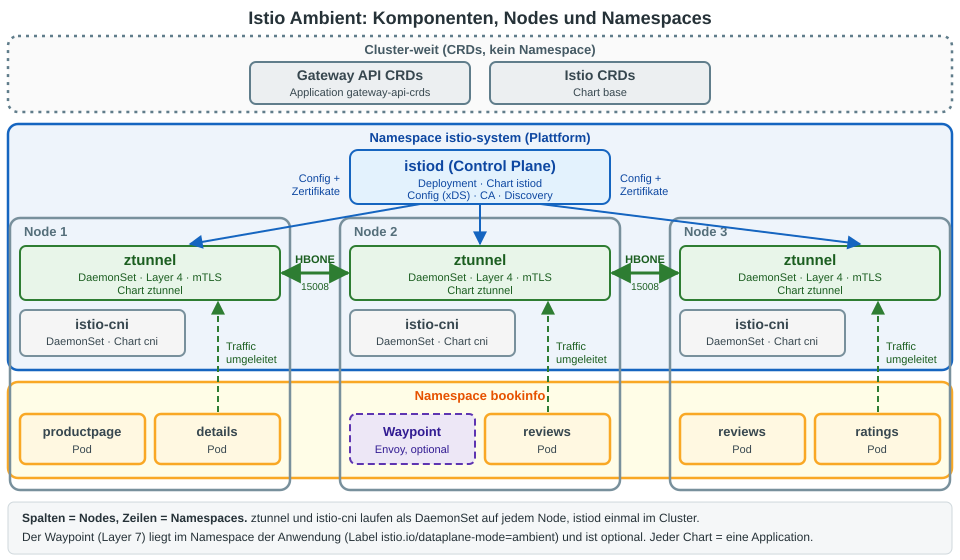
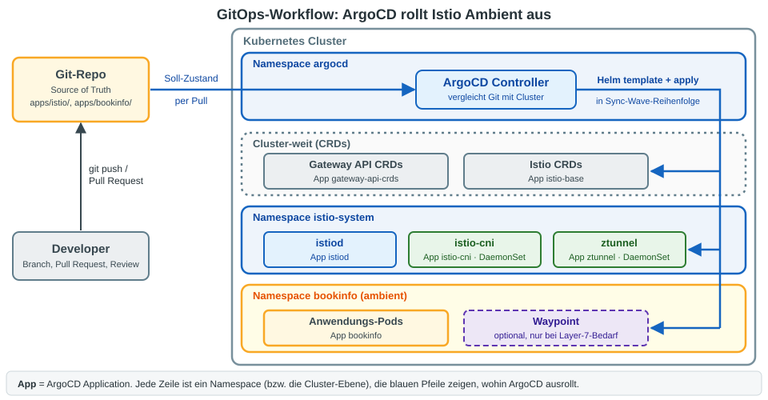
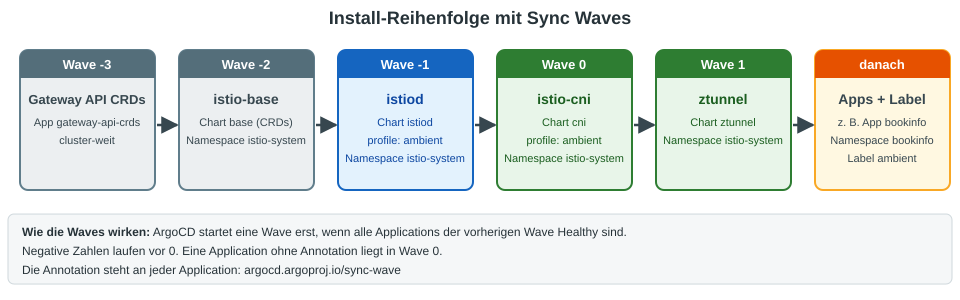
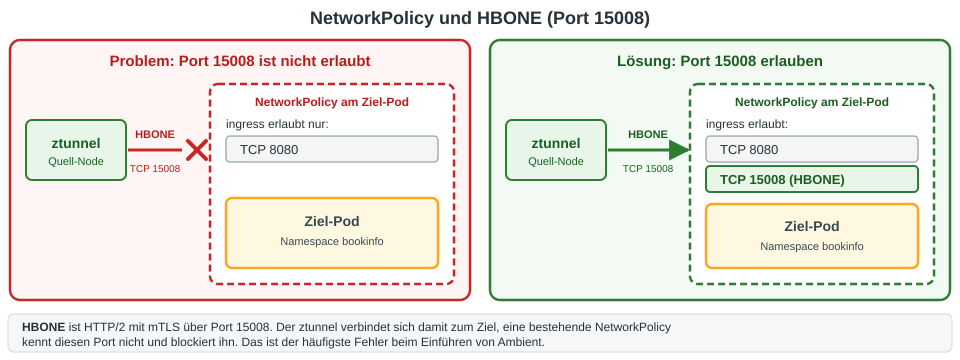
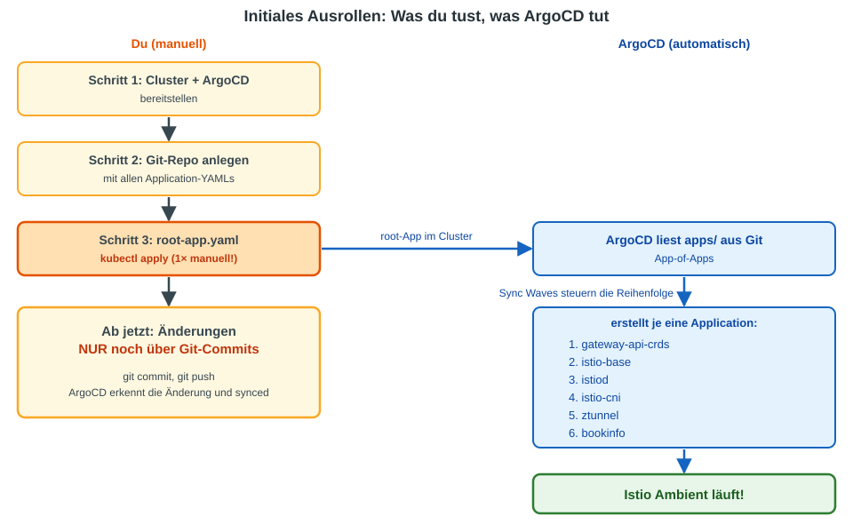
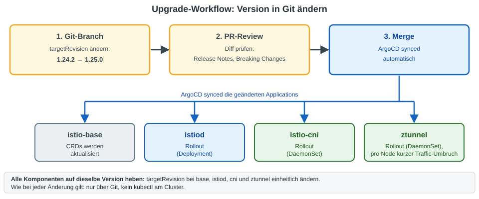
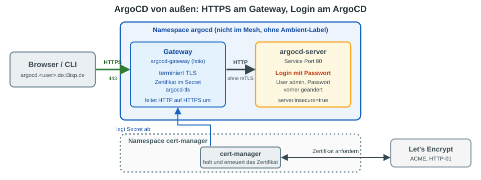

# ArgoCD + Istio Ambient Mode: Zusammenhänge & Praxis

## 1. Architektur-Überblick

### Istio Ambient Mode – Komponenten

Im Gegensatz zum Sidecar-Modus gibt es bei Ambient Mode **kein Envoy-Sidecar** pro Pod.
Stattdessen wird die Mesh-Funktionalität in zwei Schichten aufgeteilt:



**Zusammenfassung der Komponenten:**

| Helm Chart   | Funktion                                  | Typ        |
|-------------|-------------------------------------------|------------|
| `istio/base`  | CRDs (VirtualService, DestinationRule...) | Cluster    |
| `istio/istiod`| Control Plane (xDS, Cert-Mgmt)           | Cluster    |
| `istio/cni`   | CNI Plugin, Traffic-Redirect zu ztunnel  | DaemonSet  |
| `istio/ztunnel`| L4-Proxy, mTLS, HBONE-Tunnel            | DaemonSet  |
| Gateway API   | CRDs für Waypoint/Ingress-Konfiguration  | Cluster    |


---

## 2. Wie ArgoCD mit Istio Ambient zusammenspielt

### GitOps-Workflow



### Install-Reihenfolge (kritisch!)

ArgoCD deployed Helm Charts. Bei Istio Ambient gibt es **Abhängigkeiten**:



**Reihenfolge:** Gateway API CRDs → istio-base → istiod → cni → ztunnel → Apps

---

## 3. Gotchas & Fallstricke

### NetworkPolicy + HBONE Port 15008

Das ist der häufigste Fehler! Ambient Mode nutzt HBONE (HTTP/2 + mTLS) über **Port 15008**.
Bestehende NetworkPolicies blockieren diesen Port oft.



### ArgoCD HA + Ambient Mode

ArgoCD HA nutzt Redis-HA mit Sentinel. Wenn der ArgoCD-Namespace ins Ambient Mesh
eingebunden wird, muss Port 15008 in **allen** ArgoCD-NetworkPolicies erlaubt werden.

**Empfehlung:** ArgoCD-Namespace **NICHT** ins Ambient Mesh einbinden – ArgoCD ist die Management-Ebene für Istio und muss unabhängig davon funktionieren.
ArgoCD verwaltet Istio – es muss nicht selbst im Mesh sein.


## 4. Initiales Ausrollen – Schritt für Schritt



### Schritt 1: Voraussetzungen prüfen

```bash
# Kubernetes >= 1.28
kubectl version

# Helm >= 3.6 (nur zum Prüfen, ArgoCD nutzt Helm intern)
helm version
```

### Schritt 2: ArgoCD installieren

```bash
# Falls noch kein ArgoCD im Cluster:
kubectl create namespace argocd
kubectl apply -n argocd -f \
  https://raw.githubusercontent.com/argoproj/argo-cd/stable/manifests/install.yaml

# Warten bis alles läuft:
kubectl wait --for=condition=available deployment/argocd-server \
  -n argocd --timeout=120s

# Admin-Passwort holen:
kubectl -n argocd get secret argocd-initial-admin-secret \
  -o jsonpath='{.data.password}' | base64 -d; echo

# Optional: Port-Forward für UI
kubectl port-forward svc/argocd-server -n argocd 8080:443
# → https://localhost:8080  (User: admin)
```

### Schritt 3: Git-Repo anlegen und befüllen

```bash
# Neues Repo erstellen (z.B. auf GitHub/GitLab)
mkdir istio-ambient-gitops && cd istio-ambient-gitops
git init

# Verzeichnisstruktur anlegen
mkdir -p apps/istio/values apps/bookinfo
```

Jetzt alle Application-YAMLs und Values-Dateien erstellen
(siehe Abschnitt 4.5 für den Inhalt jeder Datei):

```bash
# Dateien erstellen:
touch apps/istio/gateway-api-crds.yaml
touch apps/istio/istio-base-app.yaml
touch apps/istio/istiod-app.yaml
touch apps/istio/istio-cni-app.yaml
touch apps/istio/ztunnel-app.yaml
touch apps/istio/values/istiod-values.yaml
touch apps/bookinfo/bookinfo-app.yaml

# Alles committen und pushen:
git add -A
git commit -m "Initial Istio Ambient + ArgoCD setup"
git remote add origin https://github.com/DEIN-USER/istio-ambient-gitops.git
git push -u origin main
```

### Schritt 4: root-app.yaml erstellen und anwenden

Diese Datei liegt NICHT im Git-Repo – sie ist der einzige manuelle Schritt:

```bash
cat <<'EOF' | kubectl apply -f -
apiVersion: argoproj.io/v1alpha1
kind: Application
metadata:
  name: root
  namespace: argocd
spec:
  project: default
  source:
    repoURL: https://github.com/DEIN-USER/istio-ambient-gitops.git
    targetRevision: main
    path: apps/
  destination:
    server: https://kubernetes.default.svc
  syncPolicy:
    automated:
      selfHeal: true
    syncOptions:
      - CreateNamespace=true
EOF
```

### Schritt 5: Zuschauen und verifizieren

```bash
# ArgoCD Applications beobachten:
kubectl get applications -n argocd -w

# Erwartete Ausgabe nach ein paar Minuten:
# NAME                STATUS   HEALTH
# root                Synced   Healthy
# gateway-api-crds    Synced   Healthy
# istio-base          Synced   Healthy
# istiod              Synced   Healthy
# istio-cni           Synced   Healthy
# ztunnel             Synced   Healthy
# bookinfo           Synced   Healthy

# Istio-Pods prüfen:
kubectl get pods -n istio-system

# CRDs prüfen:
kubectl get crds | grep -E 'istio|gateway'
```

### Ab jetzt: Alles über Git

```bash
# Beispiel: Neue App hinzufügen
vim apps/bookinfo/bookinfo-app.yaml
git add -A && git commit -m "Add bookinfo app"
git push
# → ArgoCD erkennt die Änderung und deployed automatisch

# Beispiel: Istio upgraden
# In apps/istio/*-app.yaml: targetRevision von 1.24.2 auf 1.25.0 ändern
git add -A && git commit -m "Upgrade Istio to 1.25.0"
git push
# → ArgoCD rolled die neuen Versionen aus
```

---

### 4.4 Git-Repo Struktur

```
istio-ambient-gitops/
├── apps/
│   ├── istio/
│   │   ├── gateway-api-crds.yaml       # ArgoCD Application
│   │   ├── istio-base-app.yaml         # ArgoCD Application
│   │   ├── istiod-app.yaml             # ArgoCD Application
│   │   ├── istio-cni-app.yaml          # ArgoCD Application
│   │   ├── ztunnel-app.yaml            # ArgoCD Application
│   │   └── values/
│   │       ├── istiod-values.yaml
│   │       ├── cni-values.yaml
│   │       └── ztunnel-values.yaml
│   ├── bookinfo/
│   │   └── bookinfo-app.yaml           # ArgoCD Application
│   └── root-app.yaml                   # App-of-Apps
```

### 4.5 ArgoCD Application Manifeste

#### Gateway API CRDs (Sync Wave -3)

```yaml
# apps/istio/gateway-api-crds.yaml
apiVersion: argoproj.io/v1alpha1
kind: Application
metadata:
  name: gateway-api-crds
  namespace: argocd
  annotations:
    argocd.argoproj.io/sync-wave: "-3"
  finalizers:
    - resources-finalizer.argocd.argoproj.io
spec:
  project: default
  source:
    repoURL: https://github.com/kubernetes-sigs/gateway-api.git
    targetRevision: v1.4.0
    path: config/crd/standard
  destination:
    server: https://kubernetes.default.svc
  syncPolicy:
    automated:
      selfHeal: true
    syncOptions:
      - ServerSideApply=true
      - CreateNamespace=false
```

#### istio-base (Sync Wave -2)

```yaml
# apps/istio/istio-base-app.yaml
apiVersion: argoproj.io/v1alpha1
kind: Application
metadata:
  name: istio-base
  namespace: argocd
  annotations:
    argocd.argoproj.io/sync-wave: "-2"
  finalizers:
    - resources-finalizer.argocd.argoproj.io
spec:
  project: default
  source:
    repoURL: https://istio-release.storage.googleapis.com/charts
    chart: base
    targetRevision: 1.24.2     # oder 1.29.x je nach Version
  destination:
    server: https://kubernetes.default.svc
    namespace: istio-system
  syncPolicy:
    automated:
      selfHeal: true
    syncOptions:
      - CreateNamespace=true
      - ServerSideApply=true    # wichtig für CRDs!
```

#### istiod (Sync Wave -1)

```yaml
# apps/istio/istiod-app.yaml
apiVersion: argoproj.io/v1alpha1
kind: Application
metadata:
  name: istiod
  namespace: argocd
  annotations:
    argocd.argoproj.io/sync-wave: "-1"
  finalizers:
    - resources-finalizer.argocd.argoproj.io
spec:
  project: default
  sources:
    - repoURL: https://istio-release.storage.googleapis.com/charts
      chart: istiod
      targetRevision: 1.24.2
      helm:
        valueFiles:
          - $values/apps/istio/values/istiod-values.yaml
    - repoURL: https://github.com/DEIN-USER/istio-ambient-gitops.git
      targetRevision: main
      ref: values
  destination:
    server: https://kubernetes.default.svc
    namespace: istio-system
  syncPolicy:
    automated:
      selfHeal: true
```

**istiod-values.yaml:**
```yaml
# apps/istio/values/istiod-values.yaml
profile: ambient
pilot:
  resources:
    requests:
      cpu: 200m
      memory: 256Mi
meshConfig:
  accessLogFile: /dev/stdout
```

#### istio-cni (Sync Wave 0)

```yaml
# apps/istio/istio-cni-app.yaml
apiVersion: argoproj.io/v1alpha1
kind: Application
metadata:
  name: istio-cni
  namespace: argocd
  annotations:
    argocd.argoproj.io/sync-wave: "0"
  finalizers:
    - resources-finalizer.argocd.argoproj.io
spec:
  project: default
  source:
    repoURL: https://istio-release.storage.googleapis.com/charts
    chart: cni
    targetRevision: 1.24.2
    helm:
      values: |
        profile: ambient
  destination:
    server: https://kubernetes.default.svc
    namespace: istio-system       # oder kube-system je nach Setup
  syncPolicy:
    automated:
      selfHeal: true
```

#### ztunnel (Sync Wave 1)

```yaml
# apps/istio/ztunnel-app.yaml
apiVersion: argoproj.io/v1alpha1
kind: Application
metadata:
  name: ztunnel
  namespace: argocd
  annotations:
    argocd.argoproj.io/sync-wave: "1"
  finalizers:
    - resources-finalizer.argocd.argoproj.io
spec:
  project: default
  source:
    repoURL: https://istio-release.storage.googleapis.com/charts
    chart: ztunnel
    targetRevision: 1.24.2
  destination:
    server: https://kubernetes.default.svc
    namespace: istio-system
  syncPolicy:
    automated:
      selfHeal: true
```

#### bookinfo (Sync Wave 2)

Die Beispiel-Anwendung kommt **nach** ztunnel (Wave 2), damit die Pods beim Start
bereits im Ambient Mesh sind. Die Application legt den Namespace samt Ambient-Label selbst an
(`managedNamespaceMetadata`, braucht `CreateNamespace=true`):

```yaml
# apps/bookinfo/bookinfo-app.yaml
apiVersion: argoproj.io/v1alpha1
kind: Application
metadata:
  name: bookinfo
  namespace: argocd
  annotations:
    argocd.argoproj.io/sync-wave: "2"
  finalizers:
    - resources-finalizer.argocd.argoproj.io
spec:
  project: default
  source:
    repoURL: https://github.com/istio/istio.git
    targetRevision: 1.24.2          # gleiche Version wie die Istio-Charts
    path: samples/bookinfo/platform/kube
    directory:
      include: bookinfo.yaml        # nur die Anwendung, nicht die Varianten im Ordner
  destination:
    server: https://kubernetes.default.svc
    namespace: bookinfo
  syncPolicy:
    automated:
      selfHeal: true
    syncOptions:
      - CreateNamespace=true
    managedNamespaceMetadata:
      labels:
        istio.io/dataplane-mode: ambient    # Namespace ins Ambient Mesh aufnehmen
```

#### Multi-Source Variante (alles in einer Application)

Alternativ kann man alle Charts in einer einzigen Application mit `sources` bündeln.
Das funktioniert, aber man verliert die Sync-Wave-Kontrolle:

```yaml
# Kompakte Variante – ACHTUNG: keine Reihenfolge-Garantie!
apiVersion: argoproj.io/v1alpha1
kind: Application
metadata:
  name: istio-ambient
  namespace: argocd
spec:
  project: default
  destination:
    server: https://kubernetes.default.svc
    namespace: istio-system
  sources:
    - repoURL: https://istio-release.storage.googleapis.com/charts
      chart: base
      targetRevision: 1.24.2
      helm:
        releaseName: istio-base
    - repoURL: https://istio-release.storage.googleapis.com/charts
      chart: istiod
      targetRevision: 1.24.2
      helm:
        releaseName: istiod
        parameters:
          - name: profile
            value: ambient
    - repoURL: https://istio-release.storage.googleapis.com/charts
      chart: cni
      targetRevision: 1.24.2
      helm:
        releaseName: istio-cni
        parameters:
          - name: profile
            value: ambient
    - repoURL: https://istio-release.storage.googleapis.com/charts
      chart: ztunnel
      targetRevision: 1.24.2
      helm:
        releaseName: ztunnel
  syncPolicy:
    automated:
      selfHeal: true
    syncOptions:
      - CreateNamespace=true
      - ServerSideApply=true
```

### 4.6 App-of-Apps (Root Application)

```yaml
# apps/root-app.yaml
apiVersion: argoproj.io/v1alpha1
kind: Application
metadata:
  name: root
  namespace: argocd
spec:
  project: default
  source:
    repoURL: https://github.com/DEIN-USER/istio-ambient-gitops.git
    targetRevision: main
    path: apps/
  destination:
    server: https://kubernetes.default.svc
  syncPolicy:
    automated:
      selfHeal: true
```

### 4.7 Namespace ins Ambient Mesh einbinden

```yaml
# bookinfo-namespace.yaml (im Git-Repo!)
apiVersion: v1
kind: Namespace
metadata:
  name: bookinfo
  labels:
    istio.io/dataplane-mode: ambient    # ← Das ist der Schlüssel!
```

### 4.8 Waypoint Proxy deployen (für L7-Features)

```yaml
# Nur nötig wenn AuthorizationPolicy, Retries, etc. auf L7 gebraucht werden
apiVersion: gateway.networking.k8s.io/v1
kind: Gateway
metadata:
  name: bookinfo-waypoint
  namespace: bookinfo
  labels:
    istio.io/waypoint-for: service      # oder "all" für den ganzen Namespace
spec:
  gatewayClassName: istio-waypoint
  listeners:
    - name: mesh
      port: 15008
      protocol: HBONE
```

### 4.9 Verifizierung

```bash
# Istio-Komponenten prüfen
kubectl get pods -n istio-system
# Erwartung: istiod-xxx, ztunnel-xxx (pro Node), istio-cni-node-xxx (pro Node)

# CRDs prüfen
kubectl get crds | grep -E 'istio|gateway'

# Ambient-Enrollment prüfen
kubectl get namespace bookinfo --show-labels | grep dataplane-mode

# ztunnel-Logs: mTLS-Verbindungen sichtbar
kubectl logs -n istio-system -l app=ztunnel --tail=20

# Mesh-Status mit istioctl
istioctl ztunnel-config workloads
```

---

## 5. Checkliste: Was muss ich beachten?

```
 ✓  Gateway API CRDs VOR Istio installieren (Sync Wave!)
 ✓  Helm Charts in korrekter Reihenfolge: base → istiod → cni → ztunnel
 ✓  ServerSideApply=true für CRD-haltige Charts setzen
 ✓  profile: ambient bei istiod und cni setzen
 ✓  NetworkPolicies: Port 15008 (HBONE) freigeben
 ✓  ArgoCD-Namespace NICHT ins Ambient Mesh (Management-Ebene bleibt unabhängig)
 ✓  Namespace-Label: istio.io/dataplane-mode=ambient
 ✓  ArgoCD extern nur über HTTPS und mit geändertem admin-Passwort (Abschnitt 7)
 ✓  Waypoint nur deployen, wenn L7-Features nötig sind
 ✓  Alle Istio-Versionen einheitlich halten (base, istiod, cni, ztunnel)
 ✓  Bei Upgrades: targetRevision in Git ändern → ArgoCD synced automatisch
```

---

## 6. Upgrade-Workflow



**Wichtig:** ztunnel ist ein DaemonSet – beim Upgrade gibt es einen kurzen
Traffic-Umbruch pro Node. In Produktion: `maxUnavailable: 1` in den Values setzen.


---

## 7. ArgoCD von außen erreichbar machen (HTTPS + Passwort)



> **Merkkasten: Das Gateway gehört nicht zum Mesh**
>
> Ein Gateway mit `gatewayClassName: istio` ist ein normaler Envoy-Ingress. Er kann an **jeden** Service im Cluster
> weiterleiten, auch an Anwendungen außerhalb des Meshs. Backends im Ambient Mesh erreicht er per HBONE/mTLS,
> Backends außerhalb per einfachem HTTP. Mesh-Policies (`PeerAuthentication`, `AuthorizationPolicy` für Workloads)
> gelten nur für Pods im Mesh. Liegt das Backend in einem anderen Namespace als die Route, braucht es ein `ReferenceGrant`.

**Wer schützt hier was?**

  * **Das Passwort** kommt von ArgoCD selbst (Login-Seite, User `admin`). Istio bringt kein Basic-Auth mit.
  * **Das Gateway** sorgt nur für HTTPS (Let's Encrypt). Ohne HTTPS würde das Passwort im Klartext übers Netz gehen.
  * Der Namespace `argocd` bleibt **außerhalb des Meshs** (siehe Abschnitt 3). Das Gateway ist ein normaler Envoy-Pod
    und spricht mit `argocd-server` per einfachem HTTP, ohne mTLS. Das geschieht nur innerhalb des Clusters.

### Voraussetzungen

  * cert-manager ist installiert (siehe Übung [Bookinfo mit HTTPS und Let's Encrypt](../exercises/17-https-letsencrypt-bookinfo.md), Schritt 2).
  * Ein DNS-Eintrag `argocd.<dein-user>.do.t3isp.de` zeigt auf die öffentliche IP des Gateways (Trainer fragen).
  * Auf dieser IP lauscht noch kein anderes Gateway auf Port 80/443. Läuft dort noch das `bookinfo-gateway` aus der HTTPS-Übung,
    das vorher löschen.

```bash
export HOST=argocd.$(whoami).do.t3isp.de
export IP=$(dig +short $HOST)
echo $HOST $IP
```

### Schritt 1: ArgoCD hinter dem Gateway ohne eigenes TLS betreiben

Das Gateway terminiert TLS. `argocd-server` soll deshalb selbst kein TLS sprechen (sonst gibt es Redirect-Schleifen):

```bash
kubectl -n argocd patch configmap argocd-cmd-params-cm \
  --type merge -p '{"data":{"server.insecure":"true"}}'
kubectl -n argocd rollout restart deployment argocd-server
kubectl -n argocd rollout status deployment argocd-server
```

### Schritt 2: Issuer, Gateway und Routen

```yaml
# 01-argocd-extern.yaml
apiVersion: cert-manager.io/v1
kind: Issuer
metadata:
  name: letsencrypt
  namespace: argocd
spec:
  acme:
    server: https://acme-v02.api.letsencrypt.org/directory
    privateKeySecretRef:
      name: letsencrypt-account-key
    solvers:
    - http01:
        gatewayHTTPRoute:
          parentRefs:
          - kind: Gateway
            name: argocd-gateway
---
apiVersion: gateway.networking.k8s.io/v1
kind: Gateway
metadata:
  name: argocd-gateway
  namespace: argocd
  annotations:
    cert-manager.io/issuer: letsencrypt
spec:
  gatewayClassName: istio
  addresses:
  - type: IPAddress
    value: ${IP}
  listeners:
  - name: http
    hostname: ${HOST}
    port: 80
    protocol: HTTP
    allowedRoutes:
      namespaces:
        from: Same
  - name: https
    hostname: ${HOST}
    port: 443
    protocol: HTTPS
    tls:
      mode: Terminate
      certificateRefs:
      - name: argocd-tls
    allowedRoutes:
      namespaces:
        from: Same
---
apiVersion: gateway.networking.k8s.io/v1
kind: HTTPRoute
metadata:
  name: http-to-https
  namespace: argocd
spec:
  parentRefs:
  - name: argocd-gateway
    sectionName: http
  rules:
  - filters:
    - type: RequestRedirect
      requestRedirect:
        scheme: https
        statusCode: 301
---
apiVersion: gateway.networking.k8s.io/v1
kind: HTTPRoute
metadata:
  name: argocd
  namespace: argocd
spec:
  parentRefs:
  - name: argocd-gateway
    sectionName: https
  rules:
  - backendRefs:
    - name: argocd-server
      port: 80
```

```bash
envsubst < 01-argocd-extern.yaml | kubectl apply -f -
kubectl -n argocd get gateway argocd-gateway       # PROGRAMMED True
kubectl -n argocd get certificate                  # READY True (ca. 1 Minute)
```

### Schritt 3: Passwort setzen

Das Initial-Passwort ist nur für den ersten Login gedacht. Ändere es, bevor ArgoCD im Internet steht
(am besten schon vor Schritt 2). Das Initial-Passwort steht im Secret `argocd-initial-admin-secret`
(Abschnitt 4, Schritt 2) und lässt sich auch mit `argocd admin initial-password -n argocd` anzeigen.

```bash
# Einloggen und Passwort ändern
# (--grpc-web: mit einer einfachen HTTPRoute auf Port 80 läuft die CLI über gRPC-Web statt HTTP/2)
argocd login $HOST --grpc-web --username admin
argocd account update-password --grpc-web
```

Alternativ in der Oberfläche: **User Info → Update Password**. Danach das Initial-Secret löschen:

```bash
kubectl -n argocd delete secret argocd-initial-admin-secret
```

### Schritt 4: Testen

```bash
# Weiterleitung auf HTTPS
curl -sI http://$HOST | head -n 2
# Erwartet: 301, location: https://...

# Ohne Login keine Daten (Erwartet: 401 oder 403)
curl -s -o /dev/null -w '%{http_code}\n' https://$HOST/api/v1/applications
```

Im Browser `https://<HOST>` öffnen: Schloss in der Adressleiste und die ArgoCD-Login-Seite.

### Gut zu wissen

| Thema | Hinweis |
|-------|---------|
| Brute-Force | ArgoCD sperrt Logins nach mehreren Fehlversuchen zeitweise. |
| Weitere Nutzer | Statt alle mit `admin` arbeiten zu lassen: lokale Accounts in `argocd-cm` (`accounts.<name>: login`) mit RBAC in `argocd-rbac-cm`, oder SSO (OIDC). |
| Zusätzlicher Vorab-Schutz | Soll schon vor der Login-Seite ein zweites Passwort oder SSO greifen: `oauth2-proxy` plus `AuthorizationPolicy` mit `CUSTOM`-Provider (ext_authz) am Gateway. Das ist ein eigenes Thema. |
| Zugriff einschränken | Die ArgoCD-API ist mächtig (sie deployed in den Cluster). Wenn möglich zusätzlich nach Quell-IP einschränken (Firewall oder `AuthorizationPolicy` mit `ipBlocks`). |

### Quellen

  * ArgoCD, Ingress-Konfiguration (`server.insecure`, Gateway-API-Beispiel mit Gateway, HTTPRoute, GRPCRoute, BackendTLSPolicy): https://argo-cd.readthedocs.io/en/stable/operator-manual/ingress/
  * ArgoCD, Initial-Passwort ändern und Secret löschen: https://argo-cd.readthedocs.io/en/stable/getting_started/
  * ArgoCD, `managedNamespaceMetadata`: https://argo-cd.readthedocs.io/en/stable/user-guide/sync-options/
  * Istio, Gateway API: https://istio.io/latest/docs/tasks/traffic-management/ingress/gateway-api/
  * cert-manager, Gateway API: https://cert-manager.io/docs/usage/gateway/
