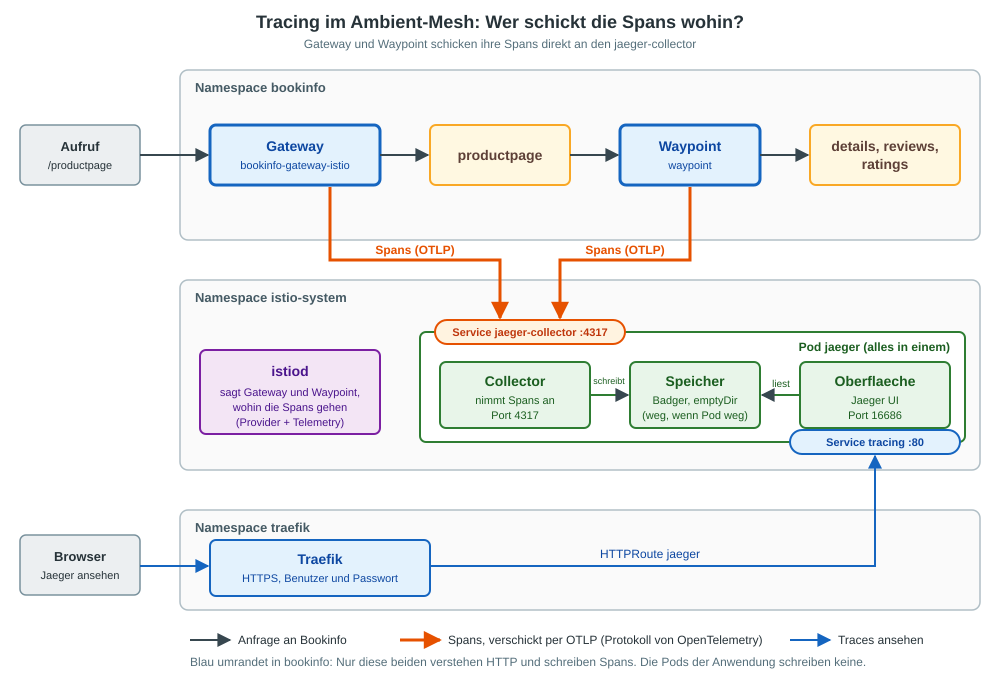
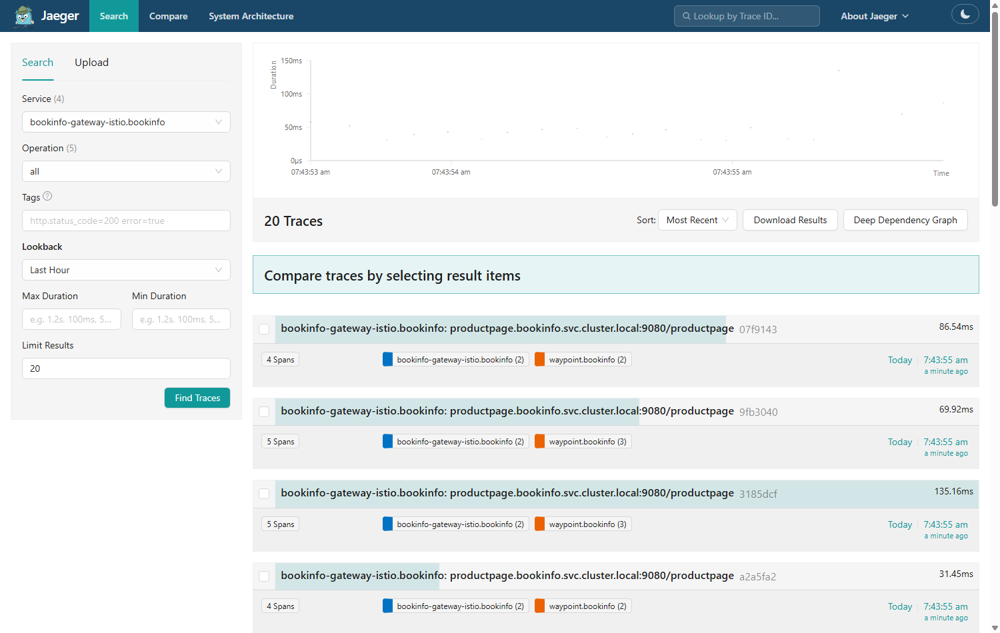
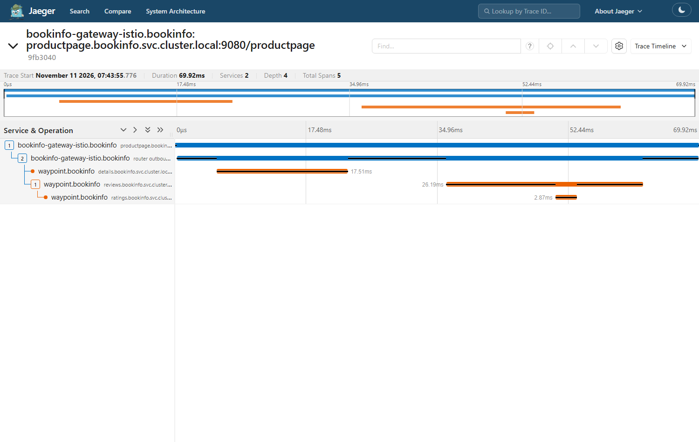

# Uebung: Distributed Tracing mit Jaeger (Ambient)

## Ziel

Istio schickt Traces an Jaeger. Du siehst in Jaeger den Weg einer Anfrage an Bookinfo:
vom Gateway zu `productpage` und von dort ueber den Waypoint zu `details`, `reviews` und `ratings`.

## Voraussetzung

  * [Installation Jaeger](../installation/addons/jaeger.md) ist durchgefuehrt
    (Jaeger laeuft, `https://jaeger.<dein-user>.do.t3isp.de/jaeger/` fragt nach Benutzer und Passwort).
  * [Bookinfo demo in ambient ausrollen](../installation/ambient/04-install-demo-app.md) ist durchgefuehrt
    (Namespace `bookinfo` mit Waypoint, Gateway `bookinfo-gateway`).
  * Istio ist mit `istioctl install --set profile=ambient` installiert.

## Hintergrund

Zwei Dinge fehlen nach der Installation noch:

| Was | Womit | Wirkung |
|-----|-------|---------|
| Istio kennt Jaeger nicht | `meshConfig.extensionProviders` (Datei fuer `istioctl install -f`) | Provider `jaeger` zeigt auf `jaeger-collector`, Port 4317 (OpenTelemetry) |
| Niemand nutzt den Provider | `Telemetry` in `istio-system` | Tracing fuer das ganze Mesh einschalten |

Im Ambient-Mode schreiben nur **Gateway** und **Waypoint** Spans, weil nur sie HTTP verstehen (Layer 7).
Der `ztunnel` arbeitet auf Layer 4 und erzeugt keine Spans. Ohne Waypoint gibt es deshalb nur den Span vom Gateway.

### Von wo nach wo gehen die Spans?



  1. Eine Anfrage laeuft durch Gateway und Waypoint. Jeder der beiden schreibt dazu einen Span.
  2. Beide schicken ihre Spans direkt an den Service `jaeger-collector`, Port 4317. Dahinter nimmt der Collector im Pod `jaeger` sie an und speichert sie.
  3. Die Oberflaeche von Jaeger liest aus demselben Speicher. Du erreichst sie ueber Traefik und den Service `tracing`.

Der Pod `jaeger` aus den Istio-Samples ist "alles in einem": Collector, Speicher und Oberflaeche.
Der Speicher liegt in einem `emptyDir`. Wird der Pod geloescht, sind die Traces weg. Fuer Produktion ist das nicht gedacht.

### Welche Rolle spielt OpenTelemetry (OTel)?

| Begriff | Was es ist | In dieser Uebung |
|---------|------------|------------------|
| OpenTelemetry | Offener Standard fuer Traces, Metriken und Logs | Gibt das Format und das Protokoll der Spans vor |
| OTLP | Das Protokoll von OpenTelemetry | Gateway und Waypoint schicken ihre Spans per OTLP (gRPC) an Port 4317 |
| Provider `opentelemetry` | Eintrag in `meshConfig.extensionProviders` | Sagt Istio: "sprich OTLP mit diesem Service". Der Name `jaeger` ist frei gewaehlt |
| OpenTelemetry Collector | Eigene Komponente, die Spans annimmt und weiterverteilt | **Laeuft hier nicht.** Jaeger nimmt OTLP selbst an |

OTel ist hier also nur die **Sprache** zwischen Istio und Jaeger, keine eigene Komponente im Cluster.
In Produktion steht oft ein OpenTelemetry Collector dazwischen, z. B. um Spans an mehrere Ziele zu schicken oder zu filtern.
Dann zeigt der Provider auf den Collector statt auf Jaeger, sonst aendert sich an Istio nichts.

## Schritt 1: Vorbereitung

```
cd
mkdir -p manifests
cd manifests
mkdir tracing-jaeger
cd tracing-jaeger
```

```
export HOST=jaeger.$(whoami).do.t3isp.de
export GATEWAY_IP=$(kubectl -n bookinfo get gateway bookinfo-gateway -o jsonpath='{.status.addresses[0].value}')
echo $HOST $GATEWAY_IP
```

Beide Werte muessen gefuellt sein.

## Schritt 2: Istio den Provider Jaeger mitgeben

Vorher: Es gibt noch keinen Provider.

```
kubectl -n istio-system get cm istio -o jsonpath='{.data.mesh}' | grep -A4 extensionProviders
```

Erwartet: keine Ausgabe.

Die Einstellung kommt in eine Datei. `kind: IstioOperator` ist dabei nur das Dateiformat, das `istioctl install` liest.
Im Cluster laeuft **kein** Operator (den gibt es in aktuellen Istio-Versionen nicht mehr), und die Datei wird auch nicht mit `kubectl apply` angewendet.

```
# vi 01-istio-tracing.yml
apiVersion: install.istio.io/v1alpha1
kind: IstioOperator
spec:
  profile: ambient
  meshConfig:
    extensionProviders:
    - name: jaeger
      opentelemetry:
        service: jaeger-collector.istio-system.svc.cluster.local
        port: 4317
  values:
    pilot:
      traceSampling: 100
```

```
istioctl install -f 01-istio-tracing.yml -y
```

`traceSampling: 100` zeichnet jede Anfrage auf (Standard: 1 von 100). Gut zum Ueben, in Produktion zu viel.

```
kubectl -n istio-system rollout status deployment istiod
kubectl -n istio-system get cm istio -o jsonpath='{.data.mesh}' | grep -A4 extensionProviders
```

Erwartet:

```
extensionProviders:
- name: jaeger
  opentelemetry:
    port: 4317
    service: jaeger-collector.istio-system.svc.cluster.local
```

## Schritt 3: Tracing einschalten

```
# vi 02-telemetry-jaeger.yml
apiVersion: telemetry.istio.io/v1
kind: Telemetry
metadata:
  name: mesh-default
spec:
  tracing:
  - providers:
    - name: jaeger
```

```
kubectl -n istio-system apply -f 02-telemetry-jaeger.yml
kubectl -n istio-system get telemetry
```

Ein `Telemetry` im Namespace `istio-system` gilt fuer das ganze Mesh.

Nachsehen, was beim Waypoint angekommen ist:

```
istioctl proxy-config listener deploy/waypoint -n bookinfo -o json | grep -m1 -A9 envoy.tracers.opentelemetry
```

Erwartet: `envoy.tracers.opentelemetry` mit dem Ziel `outbound|4317||jaeger-collector.istio-system.svc.cluster.local`
und `"serviceName": "waypoint.bookinfo"`. Das ist der Name, unter dem der Waypoint spaeter in Jaeger steht.

## Schritt 4: Anfragen erzeugen

```
for i in $(seq 1 100); do curl -s -o /dev/null "http://$GATEWAY_IP/productpage"; done
curl -s -o /dev/null -w '%{http_code}\n' "http://$GATEWAY_IP/productpage"
```

Erwartet: `200`.

Hast du die Uebung mit HTTPS und Let's Encrypt gemacht, antwortet das Gateway nur noch unter seinem Namen.
Dann stattdessen:

```
# nur nach der Uebung HTTPS mit Let's Encrypt
# for i in $(seq 1 100); do curl -s -o /dev/null "https://bookinfo.$(whoami).do.t3isp.de/productpage"; done
```

## Schritt 5: Traces in Jaeger ansehen

Zuerst auf der Kommandozeile: Welche Services kennt Jaeger?

```
sleep 10
curl -s -u 'training:myS3cr3t!' https://$HOST/jaeger/api/services
```

Erwartet: `bookinfo-gateway-istio.bookinfo` und `waypoint.bookinfo` (dazu `jaeger` selbst).

```
echo https://$HOST/jaeger/
```

Die URL im Browser oeffnen (Benutzer `training`, Passwort `myS3cr3t!`):

```
# Links unter "Service": bookinfo-gateway-istio.bookinfo auswaehlen
# Ganz unten: "Find Traces" anklicken
# Oben einen Punkt bzw. einen Trace anklicken
```



Ein Klick auf einen Trace zeigt die einzelnen Spans:



Ein Trace von `/productpage` hat 4 oder 5 Spans:

| Wer schreibt den Span | Ziel |
|-----------------------|------|
| `bookinfo-gateway-istio.bookinfo` | `productpage` (2 Spans: Anfrage und Weiterleitung) |
| `waypoint.bookinfo` | `details` |
| `waypoint.bookinfo` | `reviews` |
| `waypoint.bookinfo` | `ratings` (fehlt, wenn `reviews-v1` antwortet: v1 ruft `ratings` nicht auf) |

## Fragen

  1. Warum taucht `productpage` nicht als eigener Service in Jaeger auf?
  2. Was siehst du in Jaeger, wenn der Namespace keinen Waypoint hat?
  3. Warum haengen die Spans von Gateway und Waypoint in **einem** Trace zusammen?

## Loesungen

  1. In Jaeger steht unter "Service" der Proxy, der den Span schreibt. Im Sidecar-Mode hat jeder Pod einen eigenen Proxy,
     der sich mit dem Namen der Anwendung meldet. Im Ambient-Mode gibt es diese Proxys nicht, HTTP sehen nur Gateway und Waypoint.
     `productpage` taucht deshalb nur als Ziel im Namen eines Spans auf, nicht als eigener Service.
  2. Nur noch die Spans vom Gateway. Der `ztunnel` (Layer 4) schreibt keine.
  3. Bookinfo reicht die Trace-Header der eingehenden Anfrage (z. B. `traceparent`, `x-b3-traceid`) an seine eigenen Aufrufe weiter.
     Ohne das waeren es einzelne, unverbundene Traces. Das muss die Anwendung tun, Istio kann es nicht fuer sie.

## Aufraeumen

```
kubectl -n istio-system delete -f 02-telemetry-jaeger.yml
```

Istio wieder ohne Provider und mit dem Standard-Sampling:

```
istioctl install --set profile=ambient -y
kubectl -n istio-system rollout status deployment istiod
kubectl -n istio-system get cm istio -o jsonpath='{.data.mesh}' | grep -A4 extensionProviders
```

Erwartet: keine Ausgabe mehr.

## Ref

  * https://istio.io/latest/docs/tasks/observability/distributed-tracing/jaeger/
  * https://istio.io/latest/docs/tasks/observability/telemetry/
