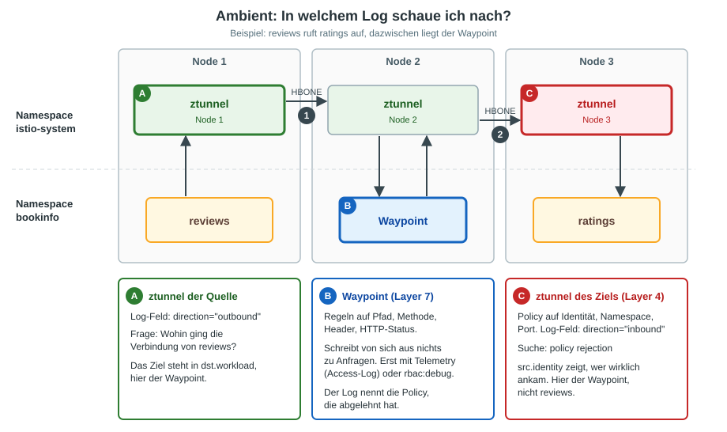

# Uebung: Fehlersuche im Ambient-Mesh - ztunnel-Log und Waypoint-Log

## Ziel

Du baust in Bookinfo drei Fehler ein. Von aussen sehen alle gleich aus: Auf der Produktseite fehlen die Ratings.
Die Ursache steht aber jedes Mal in einem anderen Log. Danach weisst du, **wo du bei welchem Fehler zuerst hinschaust**.

## Voraussetzung

  * Uebung [Bookinfo demo in ambient ausrollen](../installation/ambient/04-install-demo-app.md) ist durchgefuehrt
    (Namespace `bookinfo` mit Waypoint, alle Pods `1/1 Running`).
  * Im Namespace gibt es keine AuthorizationPolicies:

```
kubectl -n bookinfo get authorizationpolicy
```

Erwartet: `No resources found in bookinfo namespace.` Sonst vorher loeschen: `kubectl -n bookinfo delete authorizationpolicy --all`

## Wegweiser: Wer entscheidet wo?



| Frage oder Symptom | Wo schaue ich nach? | Woran erkenne ich es? |
|---|---|---|
| Verbindung wird abgelehnt (Policy auf Identitaet, Namespace, Port) | ztunnel auf dem Node des **Ziel-Pods** | `policy rejection`, `direction="inbound"` |
| Wer kommt beim Ziel wirklich an? | dieselbe Zeile, Feld `src.identity` | bei Waypoint im Pfad steht dort `sa/waypoint`, nicht der Aufrufer |
| Regel auf Pfad, Methode oder Header greift (HTTP 403) | **Waypoint**-Log (Access-Log per `Telemetry`) | `403 ... rbac_access_denied_matched_policy[...]` nennt die Policy |
| Ziel hat keine Pods (HTTP 503) | **Waypoint**-Log | `503 UH no_healthy_upstream`, im ztunnel steht nichts |
| Wohin ging die Verbindung der Quelle? | ztunnel auf dem Node der **Quelle** | `direction="outbound"`, Ziel in `dst.workload` |
| Wird der Pod vom ztunnel bedient? | `istioctl ztunnel-config workload` | Spalte `PROTOCOL`: `HBONE` (im Mesh) oder `TCP` (nicht im Mesh) |

Merksatz: **Layer 4 (Identitaet, Namespace, Port) entscheidet der ztunnel des Ziels. Layer 7 (Pfad, Methode, Header) entscheidet der Waypoint.**

Der Waypoint schreibt von sich aus nichts zu einzelnen Anfragen. Das schalten wir in Fehler 2 ein.

## Schritt 1: Vorbereitung

```
cd
mkdir -p manifests
cd manifests
mkdir ztunnel-log
cd ztunnel-log
```

Ein kleiner Client im Mesh, von dem aus wir die Produktseite aufrufen:

```
kubectl -n bookinfo apply -f ~/istio/samples/sleep/sleep.yaml
kubectl -n bookinfo rollout status deploy/sleep
```

Eine Pruefung, die wir immer wieder verwenden. Sie ruft die Produktseite 8-mal auf und zaehlt, wie oft die Ratings fehlen:

```
probe() {
  for i in $(seq 1 8); do
    kubectl -n bookinfo exec deploy/sleep -- curl -s -m 20 productpage:9080/productpage \
      | grep -q "Ratings service is currently unavailable" && echo FEHLER || echo ok
  done | sort | uniq -c
}
```

```
probe
```

Erwartet: `8 ok`

Hinweis: `reviews-v1` ruft `ratings` gar nicht auf. Bei einem Fehler siehst du deshalb nicht 8-mal `FEHLER`, sondern nur bei den Aufrufen, die an `reviews-v2` oder `reviews-v3` gehen.

Wo laeuft welcher ztunnel? Pro Node gibt es einen:

```
kubectl -n istio-system get pods -l app=ztunnel -o wide
kubectl -n bookinfo get pods -o wide
```

## Fehler 1: Policy mit falscher Identitaet

### Fehler einbauen

Ein Kollege will, dass nur `reviews` auf `ratings` zugreifen darf:

```
# vi 01-ratings-nur-reviews.yml
apiVersion: security.istio.io/v1
kind: AuthorizationPolicy
metadata:
  name: ratings-nur-reviews
spec:
  selector:
    matchLabels:
      app: ratings
  action: ALLOW
  rules:
  - from:
    - source:
        principals: ["cluster.local/ns/bookinfo/sa/bookinfo-reviews"]
```

```
kubectl -n bookinfo apply -f .
sleep 10
probe
```

Erwartet: mindestens ein `FEHLER`. Die Seite laedt, aber bei den Reviews steht "Ratings service is currently unavailable".

### Diagnose: erst der Waypoint

Der erste Impuls: Der Waypoint steht im Pfad, also dort nachsehen.

```
kubectl -n bookinfo logs deploy/waypoint --since=5m | grep ratings
```

Erwartet: keine Ausgabe. Der Waypoint schreibt standardmaessig nichts zu Anfragen, und die Ablehnung passiert hinter ihm.

### Diagnose: ztunnel des Ziels

Die Ablehnung entscheidet der ztunnel auf dem Node des `ratings`-Pods. Den finden wir so:

```
NODE=$(kubectl -n bookinfo get pod -l app=ratings -o jsonpath='{.items[0].spec.nodeName}')
ZT=$(kubectl -n istio-system get pod -l app=ztunnel --field-selector spec.nodeName=$NODE -o jsonpath='{.items[0].metadata.name}')
echo $NODE $ZT
```

```
probe
kubectl -n istio-system logs $ZT --since=2m | grep "policy rejection" | tail -2
```

Erwartet (gekuerzt):

```
error  access  connection complete  src.workload="waypoint-..." src.identity="spiffe://cluster.local/ns/bookinfo/sa/waypoint" ... dst.workload="ratings-v1-..." direction="inbound" ... error="connection closed due to policy rejection: allow policies exist, but none allowed"
```

So liest du die Zeile:

| Feld | Bedeutung hier |
|---|---|
| `direction="inbound"` | Die Entscheidung fiel beim Ziel (richtiger ztunnel) |
| `dst.workload` | Wer abgelehnt wurde: `ratings` |
| `src.identity` | **Wer wirklich ankam: `sa/waypoint`**, nicht `bookinfo-reviews` |
| `error=...none allowed` | Es gibt eine ALLOW-Policy, aber die Identitaet steht nicht darin |

Ursache: `reviews` ruft `ratings` nicht direkt auf, sondern ueber den Waypoint. Am Ziel kommt deshalb die Identitaet des Waypoints an.

Gegenprobe: Auf den anderen Nodes steht dazu nichts. Das ist der falsche ztunnel.

```
for p in $(kubectl -n istio-system get pod -l app=ztunnel -o name); do echo "-- $p"; kubectl -n istio-system logs $p --since=2m | grep -c "policy rejection"; done
```

Ist `ratings` ueberhaupt im Mesh, und welche Policy kennt der ztunnel?

```
istioctl ztunnel-config workload | grep -E "NAMESPACE|ratings"
istioctl ztunnel-config policies | grep -E "NAMESPACE|ratings"
```

Erwartet: `ratings` mit `PROTOCOL HBONE` und die Policy `ratings-nur-reviews`.

### Abhilfe

Die Policy muss die Identitaet erlauben, die tatsaechlich ankommt:

```
# vi 01-ratings-nur-reviews.yml
apiVersion: security.istio.io/v1
kind: AuthorizationPolicy
metadata:
  name: ratings-nur-reviews
spec:
  selector:
    matchLabels:
      app: ratings
  action: ALLOW
  rules:
  - from:
    - source:
        principals: ["cluster.local/ns/bookinfo/sa/waypoint"]
```

```
kubectl -n bookinfo apply -f .
sleep 10
```

### Verifizieren

```
probe
kubectl -n istio-system logs $ZT --since=15s | grep -c "policy rejection"
```

Erwartet: `8 ok` und danach `0`. Keine Ablehnung mehr im ztunnel des Ziels.

## Fehler 2: Tippfehler im Pfad einer Layer-7-Regel

Layer-7-Regeln gehoeren an den Waypoint. Hier schreibt der Waypoint zunaechst nichts. Wir schalten sein Access-Log ein:

```
# vi 02-telemetry-waypoint.yml
apiVersion: telemetry.istio.io/v1
kind: Telemetry
metadata:
  name: waypoint-logging
spec:
  targetRefs:
  - kind: Gateway
    group: gateway.networking.k8s.io
    name: waypoint
  accessLogging:
  - providers:
    - name: envoy
```

Den Fehler aus Fehler 1 raeumen wir weg, dann bauen wir den neuen ein:

```
kubectl -n bookinfo delete authorizationpolicy ratings-nur-reviews
rm 01-ratings-nur-reviews.yml
```

### Fehler einbauen

Ein Kollege will auf `ratings` nur `GET` auf `/ratings/...` erlauben und haengt die Regel an den Waypoint. Er vertippt sich im Pfad (`rating` statt `ratings`):

```
# vi 03-ratings-l7.yml
apiVersion: security.istio.io/v1
kind: AuthorizationPolicy
metadata:
  name: ratings-nur-get
spec:
  targetRefs:
  - kind: Service
    group: ""
    name: ratings
  action: ALLOW
  rules:
  - to:
    - operation:
        methods: ["GET"]
        paths: ["/rating/*"]
```

```
kubectl -n bookinfo apply -f .
sleep 10
probe
```

Erwartet: mindestens ein `FEHLER`, wieder fehlen die Ratings.

### Diagnose: ztunnel schweigt, der Waypoint redet

Wir rufen die Seite auf und sehen sofort in beide Logs. Das kurze Zeitfenster (15 Sekunden) sorgt dafuer, dass keine alten Zeilen aus Fehler 1 mitzaehlen.

```
probe
kubectl -n istio-system logs $ZT --since=15s | grep -c "policy rejection"
kubectl -n bookinfo logs deploy/waypoint --since=15s | grep '"GET /ratings' | tail -2
```

Erwartet:

  * Anzahl `policy rejection`: `0`. Der ztunnel hat nichts abgelehnt.
  * Zwei Zeilen aus dem Waypoint (gekuerzt):

```
"GET /ratings/0 HTTP/1.1" 403 - rbac_access_denied_matched_policy[none] ... "ratings:9080" ... inbound-vip|9080|http|ratings.bookinfo.svc.cluster.local
```

`403` und `rbac_access_denied_matched_policy[none]` heissen: Es gibt eine Policy, aber **keine ihrer Regeln hat auf die Anfrage gepasst**. Der Pfad `/ratings/0` passt nicht auf `/rating/*`. Steht statt `[none]` ein Name in den Klammern, hat genau diese Policy die Anfrage abgelehnt.

Alternative ohne Telemetry, mit mehr Details (laut, nur zum Debuggen):

```
istioctl proxy-config log deploy/waypoint -n bookinfo --level rbac:debug | grep rbac
probe
kubectl -n bookinfo logs deploy/waypoint --since=15s | grep "enforced" | tail -2
istioctl proxy-config log deploy/waypoint -n bookinfo --reset | grep rbac
```

Erwartet: `rbac: debug`, dann `enforced denied, matched policy none`, zuletzt `rbac: warning`. Die Warnung zu `istio-sidecar-injector` beim Zuruecksetzen ist harmlos.

### Abhilfe

```
# vi 03-ratings-l7.yml
apiVersion: security.istio.io/v1
kind: AuthorizationPolicy
metadata:
  name: ratings-nur-get
spec:
  targetRefs:
  - kind: Service
    group: ""
    name: ratings
  action: ALLOW
  rules:
  - to:
    - operation:
        methods: ["GET"]
        paths: ["/ratings/*"]
```

```
kubectl -n bookinfo apply -f .
sleep 10
```

### Verifizieren

```
probe
kubectl -n bookinfo logs deploy/waypoint --since=15s | grep '"GET /ratings' | tail -1
```

Erwartet: `8 ok` und eine Zeile `"GET /ratings/0 HTTP/1.1" 200 ... via_upstream`

## Fehler 3: Ziel hat keine Pods

Die Policy aus Fehler 2 raeumen wir weg. Dann nehmen wir `ratings` die Pods weg:

```
kubectl -n bookinfo delete authorizationpolicy ratings-nur-get
rm 03-ratings-l7.yml
kubectl -n bookinfo scale deploy ratings-v1 --replicas=0
sleep 10
```

Dasselbe Bild wie vorher, aber die Ursache steht woanders. Wieder beide Logs:

```
probe
kubectl -n istio-system logs $ZT --since=15s | grep -c "policy rejection"
kubectl -n bookinfo logs deploy/waypoint --since=15s | grep '"GET /ratings' | tail -1
```

Erwartet: mindestens ein `FEHLER`, dann `0` und eine Zeile mit `503 UH no_healthy_upstream`. Der Waypoint findet keinen Pod, an den er weiterleiten kann. Der ztunnel hat nichts abgelehnt.

### Abhilfe und Verifizieren

```
kubectl -n bookinfo scale deploy ratings-v1 --replicas=1
kubectl -n bookinfo rollout status deploy/ratings-v1
sleep 5
probe
```

Erwartet: `8 ok`

## Zusammenfassung

| Fehler | Symptom | Welches Log | Zeile |
|---|---|---|---|
| 1: falsche Identitaet in der Policy (Layer 4) | Ratings fehlen | ztunnel auf dem Node des Ziels | `policy rejection ... none allowed`, `src.identity=sa/waypoint` |
| 2: Tippfehler im Pfad (Layer 7) | Ratings fehlen | Waypoint (Access-Log) | `403 rbac_access_denied_matched_policy[none]` |
| 3: Ziel hat keine Pods | Ratings fehlen | Waypoint (Access-Log) | `503 UH no_healthy_upstream` |

Vorgehen bei "Ratings fehlen" oder aehnlichen Fehlern:

  1. Waypoint-Access-Log ansehen (Status 403 oder 503, nennt die Policy oder fehlende Upstreams).
  2. Steht dort nichts, ist die Verbindung schon vorher abgelehnt worden: ztunnel auf dem Node des Ziels (`policy rejection`).
  3. Im Zweifel: `istioctl ztunnel-config workload` (ist der Pod im Mesh?) und `istioctl ztunnel-config policies`.

## Troubleshooting

| Problem | Pruefen |
|---|---|
| `grep "policy rejection"` ist leer | Richtiger Node? `echo $NODE $ZT`, Pod mit `-o wide` nochmal ansehen. `--since` laenger waehlen |
| `probe` zeigt trotz Fehler `8 ok` | 10 Sekunden warten, Policy braucht einen Moment. `reviews-v1` ruft `ratings` nicht auf, `probe` nochmal ausfuehren |
| Waypoint-Log zeigt nichts zu `GET /ratings` | `Telemetry` angelegt? `kubectl -n bookinfo get telemetry` |
| `istioctl x authz check` zeigt einen Fehler | Normal bei Ambient: `ratings` hat keinen Envoy. Stattdessen `istioctl ztunnel-config policies` |

## Aufraeumen

```
kubectl -n bookinfo delete authorizationpolicy --all
kubectl -n bookinfo delete telemetry waypoint-logging
kubectl -n bookinfo delete -f ~/istio/samples/sleep/sleep.yaml
```

```
kubectl -n bookinfo get pods
```

Erwartet: alle Bookinfo-Pods und der Waypoint `1/1 Running`, kein `sleep`.

## Ref

  * https://istio.io/latest/docs/ambient/usage/troubleshoot-ztunnel/
  * https://istio.io/latest/docs/ambient/usage/l7-features/
