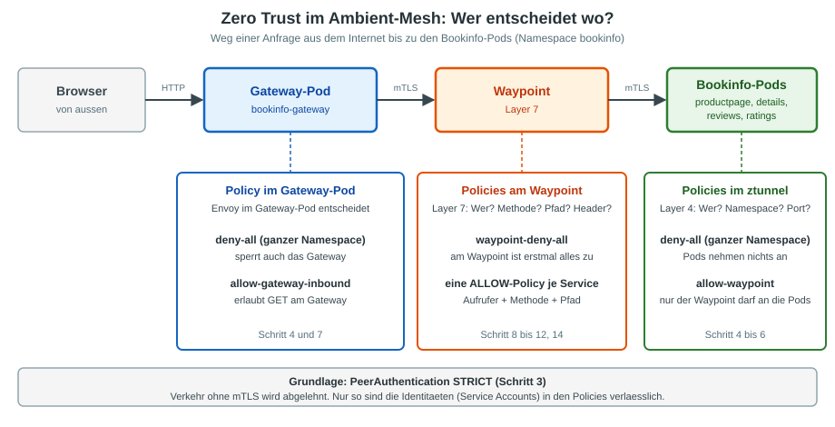

# Uebung: Zero Trust mit Bookinfo im Ambient-Mesh (ztunnel und Waypoint)

## Ziel

Du setzt **Zero Trust** im Ambient-Mesh Schritt fuer Schritt um:
**Erst alles verbieten, dann genau das erlauben, was Bookinfo braucht.**

Jeder Service darf nur mit den Services reden, die er wirklich braucht, und nur mit den erlaubten HTTP-Methoden und Pfaden.

Im Ambient-Modus gibt es dafuer **zwei Stellen**, die du nacheinander einrichtest:

| Ebene | Wer entscheidet | Was kann die Regel pruefen |
|---|---|---|
| Layer 4 | **ztunnel** auf dem Node des Ziel-Pods | Identitaet (Service Account), Namespace, Port |
| Layer 7 | **Waypoint** | zusaetzlich HTTP-Methode, Pfad, Header |



Hinweis: Die gleiche Uebung fuer den **Sidecar-Modus** steht in [Zero Trust mit Bookinfo (Sidecar)](16-zerotrust-bookinfo-einrichten.md).

## Voraussetzung

  * Uebung [Bookinfo demo in ambient ausrollen](../installation/ambient/04-install-demo-app.md) ist durchgefuehrt
    (Namespace `bookinfo` mit Waypoint `waypoint`, Gateway `bookinfo-gateway`, alle Pods `1/1 Running`).
  * Falls du Uebung [Bookinfo mit HTTPS und Let's Encrypt](17-https-letsencrypt-bookinfo.md) gemacht hast:
    Dort zuerst den Abschnitt **Aufraeumen** ausfuehren, damit das Gateway wieder nur HTTP spricht.
  * Im Namespace gibt es keine Policies:

```
kubectl -n bookinfo get authorizationpolicy,peerauthentication
```

Erwartet: `No resources found in bookinfo namespace.` Sonst vorher loeschen:
`kubectl -n bookinfo delete authorizationpolicy --all` und `kubectl -n bookinfo delete peerauthentication --all`

## Schritt 1: Vorbereitung

```
cd
mkdir -p manifests
cd manifests
mkdir zero-trust-ambient
cd zero-trust-ambient
```

Ein kleiner Client im Mesh, von dem aus wir Services direkt aufrufen:

```
kubectl -n bookinfo apply -f ~/istio/samples/sleep/sleep.yaml
kubectl -n bookinfo rollout status deploy/sleep
```

Die IP des Gateways:

```
GATEWAY_IP=$(kubectl -n bookinfo get svc bookinfo-gateway-istio -o jsonpath='{.status.loadBalancer.ingress[0].ip}')
echo $GATEWAY_IP
```

Drei kleine Hilfen, die wir immer wieder benutzen:

```
# HTTP-Statuscode der Produktseite ueber das Gateway (von aussen)
gw() { curl -s -m 10 -o /dev/null -w "%{http_code}\n" http://$GATEWAY_IP/productpage; }

# HTTP-Statuscode eines Aufrufs vom Pod "sleep" aus (aus dem Mesh)
call() { kubectl -n bookinfo exec deploy/sleep -- curl -s -m 10 -o /dev/null -w "%{http_code}\n" "$@"; }

# Produktseite 8-mal laden und zaehlen, was darauf steht (Bookinfo waehlt zufaellig reviews v1, v2 oder v3)
seite() {
  for i in $(seq 1 8); do
    curl -s -m 10 http://$GATEWAY_IP/productpage \
      | grep -o -E "Error fetching product details|Error fetching product reviews|Ratings service is currently unavailable|glyphicon-star" \
      | sort -u | tr '\n' ',' ; echo
  done | sort | uniq -c
}
```

## Schritt 2: Ausgangszustand - alles ist erlaubt

```
gw
call http://productpage:9080/productpage
call http://ratings:9080/ratings/0
```

Erwartet: dreimal `200`.

Der Pod `sleep` hat mit Bookinfo nichts zu tun und kommt trotzdem an `ratings` heran. Ohne Policy darf im Mesh **jeder alles**.
Das aendern wir jetzt.

```
seite
```

Erwartet: Die Seite ist vollstaendig. Je nach `reviews`-Version steht eine leere Zeile (v1, keine Sterne) oder `glyphicon-star,` (v2, v3).

## Schritt 3: mTLS erzwingen

Policies auf Identitaeten (`principals`) sind nur verlaesslich, wenn jede Verbindung mTLS spricht.
Im Mesh macht der ztunnel das von selbst. Was ist mit einem Pod **ausserhalb** des Mesh?

Ein Pod in einem Namespace ohne Mesh:

```
kubectl create ns zt-ohne-mesh
kubectl -n zt-ohne-mesh apply -f ~/istio/samples/sleep/sleep.yaml
kubectl -n zt-ohne-mesh rollout status deploy/sleep
```

```
kubectl -n zt-ohne-mesh exec deploy/sleep -- curl -s -m 10 -o /dev/null -w "%{http_code}\n" http://productpage.bookinfo:9080/productpage
```

Erwartet: `200`. Der ztunnel nimmt auch unverschluesselte Verbindungen an. Das schliessen wir:

```
# vi 01-peerauthentication.yml
apiVersion: security.istio.io/v1
kind: PeerAuthentication
metadata:
  name: default
spec:
  mtls:
    mode: STRICT
```

```
kubectl -n bookinfo apply -f .
sleep 15
```

### Verifizieren

```
kubectl -n zt-ohne-mesh exec deploy/sleep -- curl -s -m 10 -o /dev/null -w "%{http_code}\n" http://productpage.bookinfo:9080/productpage
```

Erwartet: `000` und `command terminated with exit code 56` (manchmal `52`). Die Verbindung wird abgelehnt, weil kein mTLS-Zertifikat im Spiel ist.

```
gw
call http://productpage:9080/productpage
```

Erwartet: zweimal `200`. Im Mesh und ueber das Gateway funktioniert weiter alles.

## Schritt 4: Layer 4 - Deny All im ganzen Namespace

Die Basis von Zero Trust: **Erstmal alles verbieten.**
Eine `AuthorizationPolicy` ohne `rules` laesst nichts durch. Ohne `targetRefs` und ohne `selector` gilt sie fuer den **ganzen Namespace**.

```
# vi 02-deny-all.yml
apiVersion: security.istio.io/v1
kind: AuthorizationPolicy
metadata:
  name: deny-all
spec: {}
```

```
kubectl -n bookinfo apply -f .
sleep 15
```

### Verifizieren

```
gw
call http://productpage:9080/productpage
call http://ratings:9080/ratings/0
```

Erwartet:

| Aufruf | Status | Wer lehnt ab |
|---|---|---|
| `gw` (von aussen ueber das Gateway) | `403` | das Gateway selbst (die Policy gilt auch fuer den Gateway-Pod) |
| `call productpage`, `call ratings` | `503` | der ztunnel am Ziel-Pod (siehe Schritt 5) |

## Schritt 5: Ursache im ztunnel-Log ansehen

Wir wollen sehen, **wer** am Ziel abgelehnt wird. Dazu brauchen wir den ztunnel auf dem Node des Ziel-Pods `productpage`:

```
NODE=$(kubectl -n bookinfo get pod -l app=productpage -o jsonpath='{.items[0].spec.nodeName}')
ZT=$(kubectl -n istio-system get pod -l app=ztunnel --field-selector spec.nodeName=$NODE -o jsonpath='{.items[0].metadata.name}')
echo $NODE $ZT
```

```
call http://productpage:9080/productpage
kubectl -n istio-system logs $ZT --since=1m | grep "policy rejection" | tail -2
```

Erwartet (gekuerzt):

```
error  access  connection complete  src.workload="waypoint-..." src.identity="spiffe://cluster.local/ns/bookinfo/sa/waypoint" ... dst.workload="productpage-v1-..." direction="inbound" ... error="connection closed due to policy rejection: allow policies exist, but none allowed"
```

Wichtig ist `src.identity`: Am Pod kommt **nicht** `sleep` an, sondern der **Waypoint** (`sa/waypoint`).
Der Aufruf von `sleep` laeuft ueber den Waypoint, und der Waypoint ruft dann den Pod auf.
Mehr zum Lesen dieser Zeilen steht in der Uebung [Fehlersuche im Ambient-Mesh](18-ztunnel-log-debugging.md).

## Schritt 6: Layer 4 - nur der Waypoint darf an die Pods

Die Pods sollen nur noch Verbindungen vom Waypoint annehmen. Wer am Waypoint vorbei direkt an einen Pod will, wird vom ztunnel abgelehnt.

```
# vi 03-allow-waypoint.yml
apiVersion: security.istio.io/v1
kind: AuthorizationPolicy
metadata:
  name: allow-waypoint
spec:
  action: ALLOW
  rules:
  - from:
    - source:
        principals: ["cluster.local/ns/bookinfo/sa/waypoint"]
```

```
kubectl -n bookinfo apply -f .
sleep 15
```

### Verifizieren

```
call http://productpage:9080/productpage
call http://ratings:9080/ratings/0
gw
```

Erwartet: `200`, `200` und `403`.

Im Mesh geht es wieder, weil der Waypoint durchgelassen wird. Vom Waypoint kommt aber **jeder** Aufrufer durch, denn am Waypoint ist noch keine Regel
(das machen wir ab Schritt 8). Von aussen ueber das Gateway bleibt es bei `403`.

## Schritt 7: Das Gateway erlauben und durch den Waypoint schicken

### 7a: Den Gateway-Pod freigeben

Der `403` kommt aus dem Gateway-Pod. Wir erlauben dort `GET`. Die Policy zeigt mit `targetRefs` auf das Gateway:

```
# vi 04-allow-gateway-inbound.yml
apiVersion: security.istio.io/v1
kind: AuthorizationPolicy
metadata:
  name: allow-gateway-inbound
spec:
  targetRefs:
  - kind: Gateway
    group: gateway.networking.k8s.io
    name: bookinfo-gateway
  action: ALLOW
  rules:
  - to:
    - operation:
        methods: ["GET"]
```

```
kubectl -n bookinfo apply -f .
sleep 15
gw
```

Erwartet: `503`. Das Gateway ist jetzt durch, aber der naechste Schritt scheitert.
Warum? Wieder ins ztunnel-Log am Ziel (`productpage`) schauen:

```
kubectl -n istio-system logs $ZT --since=1m | grep "policy rejection" | tail -1
```

Erwartet: `src.identity="spiffe://cluster.local/ns/bookinfo/sa/bookinfo-gateway-istio"` mit `none allowed`.
Das Gateway ruft den Pod **direkt** auf, am Waypoint vorbei. Der ztunnel erlaubt aber nur den Waypoint.

### 7b: Das Gateway ueber den Waypoint leiten

Ein Ingress-Gateway nutzt den Waypoint nicht von selbst. Wir sagen es ihm mit einem Label am Namespace:

```
kubectl label namespace bookinfo istio.io/ingress-use-waypoint=true
sleep 15
gw
```

Erwartet: `200`.

Hinweis: Laut Istio-Doku wirkt das Label nur, wenn istiod die Variable `ENABLE_INGRESS_WAYPOINT_ROUTING` aktiv hat (Standard `false`).
Auf unseren Clustern (Istio 1.31.4) ist sie nicht gesetzt, und es klappt trotzdem. Bleibt bei dir der `503`, ist das die erste Stelle zum Pruefen.

Jetzt laeuft **aller** Verkehr durch den Waypoint, auch der von aussen. Nur so wirken die Layer-7-Regeln der naechsten Schritte
auch fuer Anfragen aus dem Internet. (Haetten wir stattdessen das Gateway im ztunnel erlaubt, wuerde es den Waypoint umgehen und
keine Layer-7-Regel haette Einfluss.)

## Schritt 8: Layer 7 - Deny All am Waypoint

Die Layer-4-Regeln aus Schritt 4 bis 6 sagen nur: "Der Waypoint darf an die Pods". Wer **am Waypoint** was darf, regeln wir jetzt.
Auch hier zuerst alles verbieten. Die Policy zeigt mit `targetRefs` auf den Waypoint:

```
# vi 05-waypoint-deny-all.yml
apiVersion: security.istio.io/v1
kind: AuthorizationPolicy
metadata:
  name: waypoint-deny-all
spec:
  targetRefs:
  - kind: Gateway
    group: gateway.networking.k8s.io
    name: waypoint
```

```
kubectl -n bookinfo apply -f .
sleep 15
```

### Verifizieren

```
gw
call http://productpage:9080/productpage
```

Erwartet: zweimal `403`. Diesmal sagt der **Waypoint** nein (Layer 7). Der ztunnel ist unbeteiligt.

Merke den Unterschied: `503` kam aus dem ztunnel (Verbindung abgelehnt), `403` kommt aus einem Envoy (Gateway oder Waypoint).

## Schritt 9: Gateway darf productpage aufrufen

Jetzt erlauben wir Weg fuer Weg. Die Regeln gehoeren an den Service, den der Waypoint schuetzt (`targetRefs` auf den Service).
Die Identitaet des Aufrufers steht im Waypoint als `principals`.

```
# vi 06-allow-productpage-from-gateway.yml
apiVersion: security.istio.io/v1
kind: AuthorizationPolicy
metadata:
  name: allow-productpage-from-gateway
spec:
  targetRefs:
  - kind: Service
    group: ""
    name: productpage
  action: ALLOW
  rules:
  - from:
    - source:
        principals: ["cluster.local/ns/bookinfo/sa/bookinfo-gateway-istio"]
    to:
    - operation:
        methods: ["GET"]
        paths: ["/productpage", "/static/*", "/login", "/logout", "/api/v1/products*"]
```

```
kubectl -n bookinfo apply -f .
sleep 15
```

### Verifizieren

```
seite
```

Erwartet: Die Seite laedt, aber `Error fetching product details,Error fetching product reviews,` (8-mal). `productpage` darf noch niemanden aufrufen.

## Schritt 10: productpage darf details aufrufen

```
# vi 07-allow-details.yml
apiVersion: security.istio.io/v1
kind: AuthorizationPolicy
metadata:
  name: allow-details
spec:
  targetRefs:
  - kind: Service
    group: ""
    name: details
  action: ALLOW
  rules:
  - from:
    - source:
        principals: ["cluster.local/ns/bookinfo/sa/bookinfo-productpage"]
    to:
    - operation:
        methods: ["GET"]
        paths: ["/details/*"]
```

```
kubectl -n bookinfo apply -f .
sleep 15
seite
```

Erwartet: `Error fetching product details` ist weg, es bleibt `Error fetching product reviews,`.

## Schritt 11: productpage darf reviews aufrufen

```
# vi 08-allow-reviews.yml
apiVersion: security.istio.io/v1
kind: AuthorizationPolicy
metadata:
  name: allow-reviews
spec:
  targetRefs:
  - kind: Service
    group: ""
    name: reviews
  action: ALLOW
  rules:
  - from:
    - source:
        principals: ["cluster.local/ns/bookinfo/sa/bookinfo-productpage"]
    to:
    - operation:
        methods: ["GET"]
        paths: ["/reviews/*"]
```

```
kubectl -n bookinfo apply -f .
sleep 15
seite
```

Erwartet: Die Fehlermeldung zu den Reviews ist weg. Bei `reviews` v2 und v3 steht jetzt
`Ratings service is currently unavailable,` (v1 zeigt nichts an, das ist die leere Zeile).

## Schritt 12: reviews darf ratings aufrufen

```
# vi 09-allow-ratings.yml
apiVersion: security.istio.io/v1
kind: AuthorizationPolicy
metadata:
  name: allow-ratings
spec:
  targetRefs:
  - kind: Service
    group: ""
    name: ratings
  action: ALLOW
  rules:
  - from:
    - source:
        principals: ["cluster.local/ns/bookinfo/sa/bookinfo-reviews"]
    to:
    - operation:
        methods: ["GET"]
        paths: ["/ratings/*"]
```

```
kubectl -n bookinfo apply -f .
sleep 15
seite
```

Erwartet: nur noch leere Zeilen (v1) und `glyphicon-star,` (v2, v3). Keine Fehlermeldung mehr.

## Schritt 13: Gesamtstatus und Negativtests

```
kubectl -n bookinfo get authorizationpolicy
```

Erwartet: `deny-all`, `allow-waypoint`, `allow-gateway-inbound`, `waypoint-deny-all`, `allow-productpage-from-gateway`, `allow-details`, `allow-reviews`, `allow-ratings`.

Was der ztunnel kennt (Layer 4) und was am Waypoint haengt:

```
istioctl ztunnel-config policies | grep -E "NAMESPACE|bookinfo"
```

Erwartet: `deny-all` und `allow-waypoint` mit `SCOPE Namespace`. Die anderen Policies siehst du hier nicht, die setzt der Waypoint durch.

### Negativtests - Nicht erlaubte Kommunikation

```
# Test 1: sleep darf ratings NICHT aufrufen
call http://ratings:9080/ratings/0
```

Erwartet: `403`. (In Schritt 2 war es noch `200`.)

```
# Test 2: sleep darf productpage nicht aufrufen und schon gar nicht mit POST
call http://productpage:9080/productpage
call -X POST http://productpage:9080/productpage
```

Erwartet: zweimal `403`.

```
# Test 3: details darf NICHT reviews aufrufen
POD=$(kubectl -n bookinfo get pods -l app=details -o jsonpath='{.items[0].metadata.name}')
kubectl -n bookinfo debug $POD -it --image=curlimages/curl --profile=general --target=details -- sh
```

Im Container (er hat die Identitaet des `details`-Pods):

```
curl -s -o /dev/null -w "%{http_code}\n" http://reviews:9080/reviews/0
exit
```

Erwartet: `403`.

```
# Gegenprobe: reviews darf ratings aufrufen
POD=$(kubectl -n bookinfo get pods -l app=reviews,version=v2 -o jsonpath='{.items[0].metadata.name}')
kubectl -n bookinfo debug $POD -it --image=curlimages/curl --profile=general --target=reviews -- sh
```

Im Container:

```
curl -s -o /dev/null -w "%{http_code}\n" http://ratings:9080/ratings/0
exit
```

Erwartet: `200`.

## Schritt 14: DENY-Policy - gezielt etwas blockieren

DENY-Policies werden **vor** ALLOW ausgewertet. Sie eignen sich fuer zusaetzliche Einschraenkungen.
Beispiel: Aufrufe von `ratings` mit dem Header `x-debug: true` sperren.

```
# vi 10-deny-ratings-debug.yml
apiVersion: security.istio.io/v1
kind: AuthorizationPolicy
metadata:
  name: deny-ratings-debug
spec:
  targetRefs:
  - kind: Service
    group: ""
    name: ratings
  action: DENY
  rules:
  - when:
    - key: request.headers[x-debug]
      values: ["true"]
```

```
kubectl -n bookinfo apply -f .
sleep 15
```

### Verifizieren

```
POD=$(kubectl -n bookinfo get pods -l app=reviews,version=v2 -o jsonpath='{.items[0].metadata.name}')
kubectl -n bookinfo debug $POD -it --image=curlimages/curl --profile=general --target=reviews -- sh
```

Im Container:

```
curl -s -o /dev/null -w "%{http_code}\n" http://ratings:9080/ratings/0
curl -s -o /dev/null -w "%{http_code}\n" -H "x-debug: true" http://ratings:9080/ratings/0
exit
```

Erwartet: `200` und `403`.

## Schritt 15 (Bonus): Andere Namespaces aussperren

Defense in Depth: Selbst wenn spaeter eine zu weit gefasste ALLOW-Policy dazukommt, bleibt Verkehr aus anderen Namespaces draussen.
DENY gewinnt immer.

```
# vi 11-deny-other-namespaces.yml
apiVersion: security.istio.io/v1
kind: AuthorizationPolicy
metadata:
  name: deny-other-namespaces
spec:
  targetRefs:
  - kind: Gateway
    group: gateway.networking.k8s.io
    name: waypoint
  action: DENY
  rules:
  - from:
    - source:
        notNamespaces: ["bookinfo"]
```

```
kubectl -n bookinfo apply -f .
sleep 15
```

### Verifizieren

Ein Pod aus einem anderen Namespace, der **im Mesh** ist:

```
kubectl create ns zt-fremd
kubectl label namespace zt-fremd istio.io/dataplane-mode=ambient
kubectl -n zt-fremd apply -f ~/istio/samples/sleep/sleep.yaml
kubectl -n zt-fremd rollout status deploy/sleep
```

```
kubectl -n zt-fremd exec deploy/sleep -- curl -s -m 10 -o /dev/null -w "%{http_code}\n" http://productpage.bookinfo:9080/productpage
gw
```

Erwartet: `403` (fremder Namespace) und `200` (Gateway im Namespace `bookinfo`).

## Zusammenfassung - Zero Trust Checkliste

| Prinzip | Umsetzung im Ambient-Mesh | Wer setzt es durch |
|---|---|---|
| **mTLS erzwingen** | `PeerAuthentication` mit `mode: STRICT` | ztunnel |
| **Default Deny, Layer 4** | `AuthorizationPolicy` ohne Regeln im Namespace | ztunnel |
| **Nur ueber den Waypoint** | `allow-waypoint`: Pods nehmen nur den Waypoint an | ztunnel |
| **Default Deny, Layer 7** | `AuthorizationPolicy` mit `targetRefs` auf den Waypoint, ohne Regeln | Waypoint |
| **Least Privilege** | je Service eine ALLOW-Policy mit Aufrufer, Methode und Pfad | Waypoint |
| **Defense in Depth** | DENY-Policies (Header, fremde Namespaces) | Waypoint |

### Unterschied zum Sidecar-Modus

| | Sidecar | Ambient |
|---|---|---|
| Wo steht die Regel | `selector` auf den Pod | `targetRefs` auf Service oder Waypoint |
| Wer sieht den Aufrufer | der Sidecar des Ziels, `principals` = Aufrufer | am Pod nur der Waypoint, `principals` = Aufrufer gilt **am Waypoint** |
| Debuggen | `rbac:debug` am Sidecar, `istioctl x authz check` | ztunnel-Log (Layer 4), Waypoint-Log (Layer 7), `istioctl ztunnel-config policies` |

### Evaluierungsreihenfolge

```
1. CUSTOM Policies  (externe Authorizer)
2. DENY Policies    (blockt wenn eine Regel passt)
3. ALLOW Policies   (erlaubt wenn eine Regel passt)
4. Keine Policy     -> Default: ALLOW
5. Leere Policy     -> Default: DENY (keine Regel kann passen)
```

Diese Reihenfolge gilt getrennt je Ebene: einmal im ztunnel (Layer 4), einmal am Waypoint (Layer 7).

## Troubleshooting

| Beobachtung | Pruefen |
|---|---|
| Eine neue Policy wirkt nicht | 15 Sekunden warten und den Test wiederholen, sie braucht einen Moment im Mesh |
| `503` | Verbindung am Ziel abgelehnt: ztunnel-Log auf dem Node des Ziels (`grep "policy rejection"`), Feld `src.identity` ansehen |
| `403` | Ein Envoy hat abgelehnt: Gateway oder Waypoint. Welche Policy? `kubectl -n bookinfo get authorizationpolicy`, dann `targetRefs` der Policy pruefen |
| `403` obwohl eine passende ALLOW-Policy existiert | `principals` stimmen? Service Account des Aufrufers: `kubectl -n bookinfo get pod <pod> -o jsonpath='{.spec.serviceAccountName}'` |
| `gw` liefert `000` | `echo $GATEWAY_IP` gefuellt? Gateway `PROGRAMMED True`? |
| Policy am Waypoint wirkt nicht fuer Anfragen von aussen | Label `istio.io/ingress-use-waypoint=true` am Namespace gesetzt? |
| `istioctl x authz check` zeigt einen Fehler | Normal bei Ambient. Stattdessen `istioctl ztunnel-config policies` |
| Waypoint-Log zeigt nichts | Der Waypoint schreibt Anfragen nur mit einer `Telemetry`-Resource, siehe [Fehlersuche im Ambient-Mesh](18-ztunnel-log-debugging.md) |

## Aufraeumen

```
kubectl -n bookinfo delete authorizationpolicy --all
kubectl -n bookinfo delete peerauthentication default
kubectl label namespace bookinfo istio.io/ingress-use-waypoint-
```

```
kubectl -n bookinfo delete -f ~/istio/samples/sleep/sleep.yaml
kubectl delete namespace zt-ohne-mesh zt-fremd
```

```
gw
```

Erwartet: `200`. Bookinfo ist wieder wie nach der Demo-Installation.

## Ref

  * https://istio.io/latest/docs/ambient/usage/l7-features/
  * https://istio.io/latest/docs/ambient/usage/waypoint/
  * https://istio.io/latest/docs/ambient/usage/troubleshoot-ztunnel/
