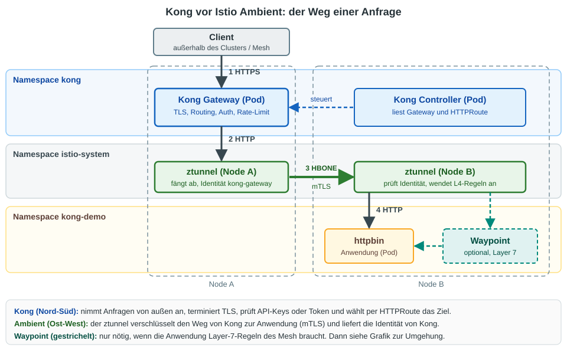
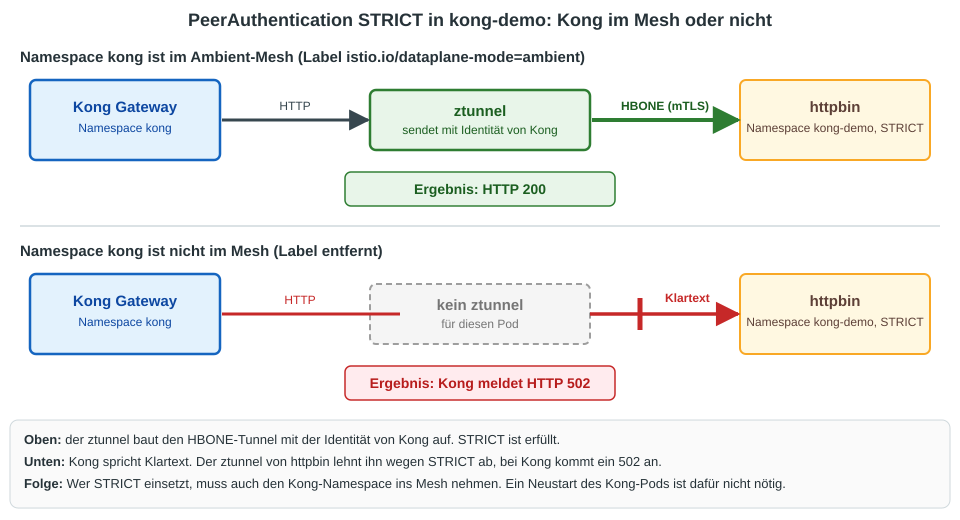
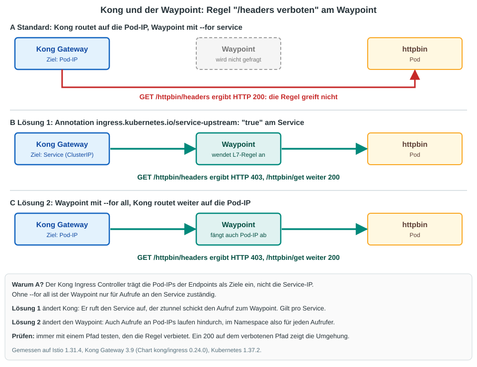

# Uebung: Kong als API-Gateway vor Istio Ambient

## Ziel

Kong nimmt Anfragen von aussen an (Routing, Authentifizierung, Rate-Limit, TLS). Istio Ambient sichert den Weg von Kong
zur Anwendung (mTLS, Identitaet, Regeln). In dieser Uebung bauen wir beides zusammen und pruefen:

  * Kong laeuft als normaler Workload im Ambient-Mesh, ohne Sidecar.
  * Der Weg Kong zur Anwendung ist mTLS (HBONE), mit der Identitaet von Kong.
  * `STRICT` funktioniert nur, wenn auch Kong im Mesh ist.
  * Eine Regel kann festlegen: **nur Kong darf an die Anwendung.**
  * **Stolperfalle:** Layer-7-Regeln am Waypoint werden von Kong standardmaessig umgangen. Wir zeigen das und zwei Loesungen.



## Voraussetzung

  * Istio Ambient ist installiert, siehe [istio-installation mit istioctl - ambient](../installation/ambient/03-install-with-istioctl-ambient.md).
  * Die Gateway-API-CRDs sind da (Istio braucht sie fuer jeden Waypoint, Kong fuer seine `HTTPRoute`):

```
kubectl get crd gateways.gateway.networking.k8s.io
```

  * `helm` ist auf dem Client installiert (`helm version`).
  * Bookinfo wird fuer diese Uebung **nicht** gebraucht. Alles liegt in eigenen Namespaces.

## Hintergrund

| Frage | Antwort |
|---|---|
| Ersetzt Kong den Istio-Ingress? | Ja. Kong ist hier das Gateway fuer Verkehr von aussen. Ein zweites Gateway von Istio laeuft nicht dahinter. |
| Braucht Kong einen Sidecar? | Nein. Der Namespace von Kong bekommt das Label `istio.io/dataplane-mode=ambient`, der ztunnel uebernimmt. |
| Welche GatewayClass nutzt Kong? | `kong`. Istio nutzt `istio`. Beide koennen im selben Cluster laufen, ohne sich zu stoeren. |
| Wer ist fuer was zustaendig? | Kong: TLS von aussen, API-Keys, OAuth, Rate-Limit, Routing. Ambient: mTLS zwischen den Pods, Identitaet, Regeln. |
| Woran erkennt die Anwendung Kong? | An der Identitaet `spiffe://cluster.local/ns/kong/sa/kong-gateway`. Sie steht im Zertifikat des ztunnel. |

## Schritt 1: Vorbereitung

```
cd
mkdir -p manifests
cd manifests
mkdir kong-ambient
cd kong-ambient
```

## Schritt 2: Anwendung im Mesh und Test-Client ausserhalb

Die Anwendung `httpbin` in einem Namespace im Ambient-Mesh. Ein curl-Pod in einem Namespace **ohne** Mesh simuliert den Client von aussen:

```
kubectl create namespace kong-demo
kubectl label namespace kong-demo istio.io/dataplane-mode=ambient
kubectl -n kong-demo apply -f ~/istio/samples/httpbin/httpbin.yaml
kubectl create namespace kong-client
kubectl -n kong-client apply -f ~/istio/samples/curl/curl.yaml
kubectl -n kong-demo rollout status deploy/httpbin
kubectl -n kong-client rollout status deploy/curl
```

## Schritt 3: Kong installieren und ins Mesh holen

Der Namespace bekommt das Label **vor** der Installation. Dann laeuft Kong von Anfang an im Mesh.
`ClusterIP` genuegt, weil wir aus dem Cluster testen:

```
kubectl create namespace kong
kubectl label namespace kong istio.io/dataplane-mode=ambient
helm repo add kong https://charts.konghq.com
helm repo update
helm install kong kong/ingress --version 0.24.0 -n kong --set gateway.proxy.type=ClusterIP --wait --timeout 5m
```

```
kubectl -n kong get pods
```

Erwartet: `kong-controller-...` und `kong-gateway-...`, beide `1/1 Running`. Es gibt keinen zweiten Container (kein Sidecar).

Der ztunnel kennt beide Pods als Mesh-Teilnehmer:

```
istioctl ztunnel-config workload | grep -E "NAMESPACE|kong"
```

In der Spalte `PROTOCOL` steht fuer die Kong-Pods `HBONE`. Der curl-Pod aus `kong-client` hat `TCP`, er ist nicht im Mesh.

## Schritt 4: Gateway und Route fuer Kong

Kong braucht eine `GatewayClass`, ein `Gateway` und eine `HTTPRoute`. Das ist dieselbe Gateway API wie bei Istio, nur mit `gatewayClassName: kong`:

```
# vi 01-gateway.yml
apiVersion: gateway.networking.k8s.io/v1
kind: GatewayClass
metadata:
  name: kong
  annotations:
    konghq.com/gatewayclass-unmanaged: "true"
spec:
  controllerName: konghq.com/kic-gateway-controller
---
apiVersion: gateway.networking.k8s.io/v1
kind: Gateway
metadata:
  name: kong
  namespace: kong
spec:
  gatewayClassName: kong
  listeners:
  - name: http
    port: 80
    protocol: HTTP
    allowedRoutes:
      namespaces:
        from: All
```

Die Route liegt im Namespace der Anwendung und haengt sich an das Gateway in `kong`. Kong schneidet den Praefix `/httpbin` ab:

```
# vi 02-httproute.yml
apiVersion: gateway.networking.k8s.io/v1
kind: HTTPRoute
metadata:
  name: httpbin
spec:
  parentRefs:
  - name: kong
    namespace: kong
  rules:
  - matches:
    - path:
        type: PathPrefix
        value: /httpbin
    filters:
    - type: URLRewrite
      urlRewrite:
        path:
          type: ReplacePrefixMatch
          replacePrefixMatch: /
    backendRefs:
    - name: httpbin
      port: 8000
```

```
kubectl apply -f 01-gateway.yml
kubectl apply -f 02-httproute.yml -n kong-demo
```

```
kubectl get gatewayclass
kubectl get gateway -n kong
```

Nach etwa 15 Sekunden: Die GatewayClass `kong` ist `ACCEPTED True`, das Gateway `PROGRAMMED True`.

## Schritt 5: Erster Aufruf und der Weg im ztunnel

Vom Client ausserhalb des Mesh durch Kong zur Anwendung:

```
kubectl -n kong-client exec deploy/curl -- curl -s -o /dev/null -w "%{http_code}\n" http://kong-gateway-proxy.kong/httpbin/get
```

Erwartet: `200`. Kommt direkt nach dem Anlegen noch `404` (`no Route matched with those values`), hat Kong die Route noch nicht uebernommen: 10 Sekunden warten, dann wiederholen.

Die Antwort von `/headers` zeigt, dass Kong dabei war (`Via: 1.1 kong/...`, `X-Forwarded-Path`):

```
kubectl -n kong-client exec deploy/curl -- curl -s http://kong-gateway-proxy.kong/httpbin/headers
```

Den Weg von Kong zur Anwendung sehen wir im ztunnel-Log auf dem Node des Kong-Pods:

```
NODE=$(kubectl -n kong get pods -o wide --no-headers | grep kong-gateway | awk '{print $7}')
ZT=$(kubectl -n istio-system get pod -l app=ztunnel --field-selector spec.nodeName=$NODE -o name)
kubectl -n istio-system logs $ZT --tail=200 | grep 'src.workload="kong-gateway' | grep 'dst.workload="httpbin' | tail -2
```

Erwartet: Zeilen mit `src.identity="spiffe://cluster.local/ns/kong/sa/kong-gateway"`, `dst.identity="spiffe://cluster.local/ns/kong-demo/sa/httpbin"`,
`dst.addr=...:15008` (HBONE) und `direction="outbound"`. Kong hat selbst nur HTTP gesprochen, die Verschluesselung kommt vom ztunnel.

## Schritt 6: STRICT - Kong muss im Mesh sein



`STRICT` fuer `kong-demo`:

```
# vi 03-peerauthentication-strict.yml
apiVersion: security.istio.io/v1
kind: PeerAuthentication
metadata:
  name: default
spec:
  mtls:
    mode: STRICT
```

```
kubectl apply -f 03-peerauthentication-strict.yml -n kong-demo
```

Durch Kong (Kong ist im Mesh):

```
kubectl -n kong-client exec deploy/curl -- curl -s -o /dev/null -w "%{http_code}\n" http://kong-gateway-proxy.kong/httpbin/get
```

Erwartet: `200`. Direkt an `httpbin`, vom Client ausserhalb des Mesh:

```
kubectl -n kong-client exec deploy/curl -- curl -s -m 8 -o /dev/null -w "%{http_code}\n" http://httpbin.kong-demo:8000/get
```

**Erwarteter Fehler:** `000` und `command terminated with exit code 56` (bei anderer curl-Version auch `52`). Der ztunnel lehnt Klartext ab.

Jetzt Kong aus dem Mesh nehmen. Ein Neustart ist nicht noetig:

```
kubectl label namespace kong istio.io/dataplane-mode-
sleep 5
kubectl -n kong-client exec deploy/curl -- curl -s -m 8 -o /dev/null -w "%{http_code}\n" http://kong-gateway-proxy.kong/httpbin/get
```

**Erwarteter Fehler:** `502`. Kong spricht Klartext, `STRICT` lehnt ihn ab.

Wieder zurueck:

```
kubectl label namespace kong istio.io/dataplane-mode=ambient
sleep 5
kubectl -n kong-client exec deploy/curl -- curl -s -m 8 -o /dev/null -w "%{http_code}\n" http://kong-gateway-proxy.kong/httpbin/get
```

Erwartet: wieder `200`.

## Schritt 7: Nur Kong darf an die Anwendung

Die Identitaet von Kong steht im Zertifikat. Damit laesst sich der Zugang einschraenken (Layer 4, der ztunnel prueft):

```
# vi 04-authorizationpolicy-nur-kong.yml
apiVersion: security.istio.io/v1
kind: AuthorizationPolicy
metadata:
  name: nur-kong
spec:
  selector:
    matchLabels:
      app: httpbin
  action: ALLOW
  rules:
  - from:
    - source:
        principals: ["cluster.local/ns/kong/sa/kong-gateway"]
```

```
kubectl apply -f 04-authorizationpolicy-nur-kong.yml -n kong-demo
sleep 5
```

Ein zweiter curl-Pod, diesmal **im** Mesh, im Namespace der Anwendung:

```
kubectl -n kong-demo apply -f ~/istio/samples/curl/curl.yaml
kubectl -n kong-demo rollout status deploy/curl
```

Durch Kong, und direkt aus dem Mesh:

```
kubectl -n kong-client exec deploy/curl -- curl -s -o /dev/null -w "durch Kong: %{http_code}\n" http://kong-gateway-proxy.kong/httpbin/get
kubectl -n kong-demo exec deploy/curl -- curl -s -m 8 -o /dev/null -w "direkt aus dem Mesh: %{http_code}\n" http://httpbin:8000/get
```

Erwartet: `durch Kong: 200`. **Erwarteter Fehler:** `direkt aus dem Mesh: 000` (Exit-Code 56). Die Anwendung ist nur noch ueber Kong erreichbar.

Regel wieder weg:

```
kubectl delete -f 04-authorizationpolicy-nur-kong.yml -n kong-demo
```

## Schritt 8: Die Stolperfalle - Kong umgeht den Waypoint



Fuer Layer-7-Regeln (Pfade, Methoden, JWT) braucht die Anwendung einen Waypoint. Wir legen einen an und verbieten den Pfad `/headers`:

```
istioctl waypoint apply -n kong-demo --enroll-namespace --wait
```

```
# vi 05-deny-headers.yml
apiVersion: security.istio.io/v1
kind: AuthorizationPolicy
metadata:
  name: deny-headers
spec:
  targetRefs:
  - kind: Gateway
    group: gateway.networking.k8s.io
    name: waypoint
  action: DENY
  rules:
  - to:
    - operation:
        paths: ["/headers"]
```

```
kubectl apply -f 05-deny-headers.yml -n kong-demo
sleep 8
```

Die Warnung `will deny all traffic to TCP ports ... recommended to explicitly specify the port` kannst du hier ignorieren.

Kontrolle, **ohne Kong**, aus dem Mesh (der Aufruf geht ueber den Service, also durch den Waypoint):

```
kubectl -n kong-demo exec deploy/curl -- curl -s -o /dev/null -w "/headers direkt: %{http_code}\n" http://httpbin:8000/headers
kubectl -n kong-demo exec deploy/curl -- curl -s -o /dev/null -w "/get direkt: %{http_code}\n" http://httpbin:8000/get
```

Erwartet: `/headers direkt: 403` und `/get direkt: 200`. Die Regel wirkt.

Jetzt **durch Kong**:

```
kubectl -n kong-client exec deploy/curl -- curl -s -o /dev/null -w "/headers ueber Kong: %{http_code}\n" http://kong-gateway-proxy.kong/httpbin/headers
```

**Ueberraschung:** `200`. Die verbotene Regel greift nicht. Der Kong Ingress Controller traegt die Pod-IPs der Endpoints als Ziele ein,
nicht die Service-IP. Ein Waypoint mit `--for service` (Standard) ist aber nur fuer Aufrufe an den Service zustaendig.
Das siehst du, wenn du die Endpoints ansiehst:

```
kubectl -n kong-demo get endpoints httpbin
```

### Loesung 1: Kong soll den Service aufrufen

Eine Annotation am Service der Anwendung:

```
kubectl -n kong-demo annotate service httpbin ingress.kubernetes.io/service-upstream=true
sleep 10
kubectl -n kong-client exec deploy/curl -- curl -s -o /dev/null -w "/headers ueber Kong: %{http_code}\n" http://kong-gateway-proxy.kong/httpbin/headers
kubectl -n kong-client exec deploy/curl -- curl -s -o /dev/null -w "/get ueber Kong: %{http_code}\n" http://kong-gateway-proxy.kong/httpbin/get
```

Erwartet: `/headers ueber Kong: 403`, `/get ueber Kong: 200`. Die Annotation gilt pro Service.

### Loesung 2: Der Waypoint faengt auch Pod-IPs ab

Erst die Annotation wieder entfernen, dann den Waypoint mit `--for all` neu anlegen:

```
kubectl -n kong-demo annotate service httpbin ingress.kubernetes.io/service-upstream-
istioctl waypoint apply -n kong-demo --for all --overwrite --wait
sleep 12
kubectl -n kong-client exec deploy/curl -- curl -s -o /dev/null -w "/headers ueber Kong: %{http_code}\n" http://kong-gateway-proxy.kong/httpbin/headers
kubectl -n kong-client exec deploy/curl -- curl -s -o /dev/null -w "/get ueber Kong: %{http_code}\n" http://kong-gateway-proxy.kong/httpbin/get
```

Erwartet: `/headers ueber Kong: 403`, `/get ueber Kong: 200`. Hier bleibt Kong unveraendert. Dafuer laufen im Namespace alle Aufrufe
an Pod-IPs durch den Waypoint, auch die anderer Aufrufer. Mehr dazu: [Waypoint: was bedeutet --for service, workload und all?](../overview/10-waypoint-for-service-oder-workload.md).

Zur Gegenprobe wieder auf den Standard zurueck. Der Verbotene Pfad kommt wieder durch:

```
istioctl waypoint apply -n kong-demo --for service --overwrite --wait
sleep 12
kubectl -n kong-client exec deploy/curl -- curl -s -o /dev/null -w "/headers ueber Kong: %{http_code}\n" http://kong-gateway-proxy.kong/httpbin/headers
```

Erwartet: `200`.

## Aufraeumen

```
helm uninstall kong -n kong
kubectl delete namespace kong kong-demo kong-client
kubectl delete gatewayclass kong
kubectl get crd -o name | grep konghq.com | xargs -r kubectl delete
cd
rm -rf manifests/kong-ambient
```

`helm uninstall` laesst die Kong-CRDs (`konghq.com`) stehen, deshalb die letzte `kubectl delete`-Zeile.
Die Gateway-API-CRDs und alles von Istio bleiben unberuehrt.

## Zusammenfassung

| Szenario | Ergebnis |
|---|---|
| Kong im Ambient-Mesh (Namespace-Label) | Kein Sidecar, ztunnel verschluesselt Kong zur Anwendung (HBONE) |
| Aufruf ueber Kong, `STRICT` in `kong-demo`, Kong im Mesh | 200 |
| Direktaufruf von aussen bei `STRICT` | 000, Klartext abgelehnt |
| Kong nicht im Mesh, `STRICT` | 502 |
| `AuthorizationPolicy` mit Principal von Kong | Nur Kong darf an die Anwendung |
| L7-Regel am Waypoint, Kong mit Standard (Pod-IP) | **Wird umgangen** (200 auf verbotenem Pfad) |
| Annotation `service-upstream` am Service | Regel wirkt (403) |
| Waypoint mit `--for all` | Regel wirkt (403), Kong unveraendert |

## Referenz

  * Getestet mit Istio 1.31.4 (Ambient), Kubernetes 1.37.2, Kong Gateway 3.9 (Helm-Chart `kong/ingress` 0.24.0, Kong Ingress Controller mit Gateway API).
  * Nicht getestet: Kong als `LoadBalancer` (`--set gateway.proxy.type=LoadBalancer`), Kong-Plugins (Authentifizierung, Rate-Limit), Kong mit eigener Datenbank.
  * Kong-Doku zur Annotation: `ingress.kubernetes.io/service-upstream`.
