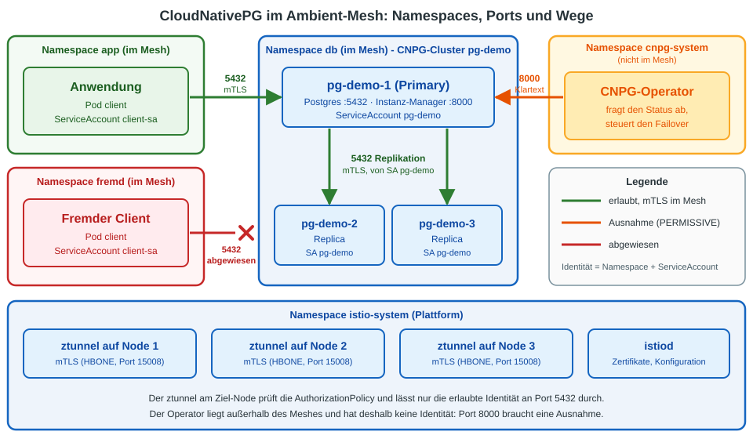

# Uebung: CloudNativePG (Postgres) im Ambient-Mesh absichern

## Ziel

Du betreibst eine Postgres-Datenbank mit **CloudNativePG (CNPG)** und legst sie ins Ambient-Mesh.
Danach darf **nur die Anwendung** an die Datenbank, und du lernst die drei Stellen kennen, an denen das gerne schiefgeht:

  1. Der **Operator** erreicht die Datenbank-Pods auf Port 8000. STRICT-mTLS sperrt ihn aus.
  2. Die **Replikation** zwischen den Datenbank-Pods laeuft ueber Port 5432. Eine zu strenge `AuthorizationPolicy` stoppt sie, CNPG meldet trotzdem "healthy".
  3. Eine **NetworkPolicy** muss im Ambient-Mesh den HBONE-Port 15008 erlauben.



Hintergrund und Entscheidungshilfe (lohnt sich das Mesh fuer die Datenbank?) steht in
[CloudNativePG im Ambient-Mesh: Ueberblick](../overview/15-cnpg-postgres-im-ambient-mesh.md).

Dauer: ca. 40 Minuten (CNPG braucht beim Start und bei Neustarts jeweils ein bis zwei Minuten).

## Voraussetzung

  * Dein Cluster hat **Istio Ambient** (Profil `ambient`, siehe [Installation](../installation/ambient/)) und **Calico** als CNI (kennt NetworkPolicies).
  * Der Cluster hat Zugriff ins Internet (Images, Manifeste von GitHub).
  * Du arbeitest in **einem** Terminal, weil wir kleine Hilfsfunktionen definieren.

## Schritt 1: Vorbereitung

```
cd
mkdir -p manifests
cd manifests
mkdir cnpg-ambient
cd cnpg-ambient
```

## Schritt 2: Speicher und Operator installieren

CNPG legt fuer jede Datenbank-Instanz ein PersistentVolume an. Auf dem Trainings-Cluster gibt es noch keine StorageClass,
deshalb installieren wir den `local-path-provisioner` (er wird **nicht** zum Default).

```
kubectl apply -f https://raw.githubusercontent.com/rancher/local-path-provisioner/v0.0.37/deploy/local-path-storage.yaml
kubectl -n local-path-storage rollout status deploy/local-path-provisioner --timeout=120s
kubectl get storageclass
```

Der CNPG-Operator (Version 1.30.1). `--server-side` ist noetig, weil die CRDs sehr gross sind:

```
kubectl apply --server-side -f https://github.com/cloudnative-pg/cloudnative-pg/releases/download/v1.30.1/cnpg-1.30.1.yaml
kubectl -n cnpg-system rollout status deploy/cnpg-controller-manager --timeout=180s
kubectl -n cnpg-system get pods
```

## Schritt 3: Datenbank und Clients ohne Mesh

Drei Namespaces:

| Namespace | Inhalt |
|---|---|
| `db` | die Datenbank `pg-demo` (CNPG-Cluster) |
| `app` | die Anwendung (erlaubter Client) |
| `fremd` | ein fremder Client, der **nicht** an die Datenbank darf |

```
kubectl create ns db
kubectl create ns app
kubectl create ns fremd
```

Ein Test-Passwort fuer den Datenbank-Benutzer `app` (nur fuer diese Uebung):

```
kubectl -n db create secret generic pg-demo-appuser --type=kubernetes.io/basic-auth \
  --from-literal=username=app --from-literal=password=lab-only-cnpg-test
```

Die Datenbank mit zwei Instanzen (ein Primary, eine Replica):

```
# vi 01-cluster.yml
apiVersion: postgresql.cnpg.io/v1
kind: Cluster
metadata:
  name: pg-demo
spec:
  instances: 2
  storage:
    size: 1Gi
    storageClass: local-path
  bootstrap:
    initdb:
      database: app
      owner: app
      secret:
        name: pg-demo-appuser
```

```
kubectl apply -f 01-cluster.yml -n db
```

Zwei Clients mit dem **gleichen** ServiceAccount-Namen `client-sa`, aber in verschiedenen Namespaces:

```
# vi 02-client.yml
apiVersion: v1
kind: ServiceAccount
metadata:
  name: client-sa
---
apiVersion: v1
kind: Pod
metadata:
  name: client
spec:
  serviceAccountName: client-sa
  containers:
  - name: psql
    image: ghcr.io/cloudnative-pg/postgresql:17
    command: ["sleep", "infinity"]
    env:
    - name: PGPASSWORD
      value: lab-only-cnpg-test
    - name: PGCONNECT_TIMEOUT
      value: "5"
```

```
kubectl apply -f 02-client.yml -n app
kubectl apply -f 02-client.yml -n fremd
```

Warten, bis alles laeuft:

```
kubectl -n db wait --for=condition=Ready cluster/pg-demo --timeout=400s
kubectl -n app wait --for=condition=Ready pod/client --timeout=200s
kubectl -n fremd wait --for=condition=Ready pod/client --timeout=200s
kubectl -n db get cluster,pods
```

Erwartet: `Cluster in healthy state`, `pg-demo-1` und `pg-demo-2` sind `1/1 Running`.

Zwei Hilfsfunktionen. `sql` verbindet sich von einem Client-Pod aus mit der Datenbank, `repl` zaehlt auf dem Primary die Replikas, die wirklich streamen:

```
sql() { kubectl -n $1 exec $2 -- psql -h pg-demo-rw.db -U app -d app -tAc "select 'ok, Primary='||not pg_is_in_recovery()" 2>&1 | tail -1; }
repl() { kubectl -n db exec $(kubectl -n db get pod -l cnpg.io/instanceRole=primary -o name) -c postgres -- psql -U postgres -tAc "select count(*)||' Replikas streamen' from pg_stat_replication where state='streaming'" 2>&1 | tail -1; }
```

Ausgangszustand: Beide Clients kommen an die Datenbank. Genau das wollen wir aendern.

```
sql app client
sql fremd client
repl
```

Erwartet: zweimal `ok, Primary=true`, dann `1 Replikas streamen`.

## Schritt 4: Die Datenbank ins Ambient-Mesh legen

Ein Label am Namespace genuegt. Die Pods muessen **nicht** neu gestartet werden.

```
kubectl label ns db istio.io/dataplane-mode=ambient
sleep 10
```

Der ztunnel kennt die Datenbank-Pods jetzt und spricht HBONE (mTLS) mit ihnen:

```
istioctl ztunnel-config workloads $(kubectl -n istio-system get pod -l app=ztunnel -o jsonpath='{.items[0].metadata.name}').istio-system | grep -E 'NAMESPACE|pg-demo'
```

Erwartet: `pg-demo-1` und `pg-demo-2` mit Protokoll `HBONE`.

Die Clients sind noch **nicht** im Mesh. Der Namespace steht auf PERMISSIVE (Standard), also geht Klartext weiter:

```
sql app client
```

Erwartet: `ok, Primary=true`.

## Schritt 5: STRICT einschalten

Jetzt nimmt die Datenbank nur noch mTLS an:

```
# vi 03-peerauthentication-strict.yml
apiVersion: security.istio.io/v1
kind: PeerAuthentication
metadata:
  name: default
spec:
  mtls:
    mode: STRICT
```

```
kubectl apply -f 03-peerauthentication-strict.yml -n db
sleep 15
sql app client
sql fremd client
```

Erwartet: zweimal `command terminated with exit code 2`. Die Clients sind noch nicht im Mesh und sprechen kein mTLS.

## Schritt 6: Stolperfalle 1 - der Operator wird ausgesperrt

Der CNPG-Operator liegt in `cnpg-system`, **ausserhalb** des Meshes. Er fragt die Datenbank-Pods direkt ueber die Pod-IP auf **Port 8000** nach ihrem Status.
Wir lassen ihn arbeiten, indem wir die Datenbank auf drei Instanzen vergroessern:

```
kubectl -n db patch cluster pg-demo --type merge -p '{"spec":{"instances":3}}'
sleep 90
kubectl -n db get cluster
kubectl -n db get pods
```

Erwartet: Status `Instance Status Extraction Error: HTTP communication issue`, es gibt nur `pg-demo-1` und `pg-demo-2`, **kein** `pg-demo-3`.

Der Operator-Log bestaetigt es:

```
kubectl -n cnpg-system logs deploy/cnpg-controller-manager --since=100s | grep -c "Cannot extract Pod status"
```

Erwartet: eine Zahl groesser als 0.

**Loesung:** Port 8000 darf Klartext annehmen (PERMISSIVE), alle anderen Ports bleiben STRICT. Das Port-Level-Mapping braucht einen `selector`:

```
# vi 04-peerauthentication-port8000.yml
apiVersion: security.istio.io/v1
kind: PeerAuthentication
metadata:
  name: pg-8000-permissive
spec:
  selector:
    matchLabels:
      cnpg.io/cluster: pg-demo
  mtls:
    mode: STRICT
  portLevelMtls:
    "8000":
      mode: PERMISSIVE
```

```
kubectl apply -f 04-peerauthentication-port8000.yml -n db
kubectl -n db wait --for=condition=Ready cluster/pg-demo --timeout=300s
kubectl -n db get cluster
kubectl -n db get pods
```

Erwartet: `Cluster in healthy state`, drei Instanzen. Der neue Pod `pg-demo-3` ist ohne Sonderbehandlung ins Mesh gekommen (mit einem Sidecar gaebe es hier Probleme mit den Init-Pods).

## Schritt 7: Die Clients ins Mesh holen

Damit die Clients mTLS sprechen und eine **Identitaet** haben, kommen auch ihre Namespaces ins Ambient-Mesh:

```
kubectl label ns app istio.io/dataplane-mode=ambient
kubectl label ns fremd istio.io/dataplane-mode=ambient
sleep 10
sql app client
sql fremd client
```

Erwartet: zweimal `ok, Primary=true`. Beide sind jetzt im Mesh, und es gibt noch keine Regel, die einen davon sperrt.

## Schritt 8: Nur die Anwendung darf an die Datenbank

Die Identitaet eines Clients ist der **Namespace plus ServiceAccount**. Beide Clients heissen `client-sa`, aber nur der in `app` ist erlaubt:

```
# vi 05-authorizationpolicy-app.yml
apiVersion: security.istio.io/v1
kind: AuthorizationPolicy
metadata:
  name: pg-allow-app
spec:
  selector:
    matchLabels:
      cnpg.io/cluster: pg-demo
  action: ALLOW
  rules:
  - from:
    - source:
        principals: ["cluster.local/ns/app/sa/client-sa"]
    to:
    - operation:
        ports: ["5432"]
  - to:
    - operation:
        ports: ["8000"]
```

Die zweite Regel laesst den Operator weiter auf Port 8000. Er hat keine Mesh-Identitaet und wird deshalb nur ueber den Port erkannt.

```
kubectl apply -f 05-authorizationpolicy-app.yml -n db
sleep 15
sql app client
sql fremd client
```

Erwartet: `ok, Primary=true` fuer `app`, `command terminated with exit code 2` fuer `fremd`. Das Ziel ist erreicht, aber schau jetzt, was mit der Replikation passiert.

## Schritt 9: Stolperfalle 2 - die Replikation steht, CNPG meldet "healthy"

```
repl
```

Erwartet: `2 Replikas streamen`. Die bestehenden Verbindungen laufen weiter. Wir starten die Replikas neu, damit sie sich **neu** mit dem Primary verbinden muessen:

```
kubectl -n db delete pod -l cnpg.io/instanceRole=replica --wait=false
sleep 70
kubectl -n db get cluster
kubectl -n db get pods
repl
```

Erwartet: Cluster `Cluster in healthy state`, alle Pods `1/1 Running` - und trotzdem `0 Replikas streamen`.
Die Replikas stehen bereit, bekommen aber keine Daten mehr. Faellt jetzt der Primary aus, fehlen Daten.

Die Ursache: Die Datenbank-Pods sprechen untereinander ueber Port 5432, ihre Identitaet ist der ServiceAccount `pg-demo`.
Unsere Regel erlaubt nur `app`. **Der Cluster-Status zeigt das nicht, `pg_stat_replication` schon.**

**Loesung:** Die Datenbank-Pods untereinander erlauben:

```
# vi 06-authorizationpolicy-replikation.yml
apiVersion: security.istio.io/v1
kind: AuthorizationPolicy
metadata:
  name: pg-allow-replication
spec:
  selector:
    matchLabels:
      cnpg.io/cluster: pg-demo
  action: ALLOW
  rules:
  - from:
    - source:
        principals: ["cluster.local/ns/db/sa/pg-demo"]
    to:
    - operation:
        ports: ["5432"]
```

```
kubectl apply -f 06-authorizationpolicy-replikation.yml -n db
kubectl -n db wait --for=condition=Ready cluster/pg-demo --timeout=240s
sleep 45
repl
sql app client
sql fremd client
```

Erwartet: `2 Replikas streamen`, `ok, Primary=true` fuer `app`, weiterhin Fehler fuer `fremd`.

## Schritt 10: Failover testen

Wir schalten den Primary hart ab. CNPG muss eine Replica befoerdern, der Operator muss dafuer Port 8000 erreichen, und die Anwendung muss danach wieder an die Datenbank kommen:

```
kubectl -n db get cluster pg-demo -o jsonpath='{.status.currentPrimary}{"\n"}'
kubectl -n db delete pod -l cnpg.io/instanceRole=primary --wait=false
sleep 60
kubectl -n db wait --for=condition=Ready cluster/pg-demo --timeout=200s
kubectl -n db get cluster pg-demo -o jsonpath='{.status.currentPrimary}{"\n"}'
kubectl -n db get pods
sql app client
repl
```

Erwartet: Der neue Primary hat einen **anderen** Namen als der alte, `ok, Primary=true` fuer `app`, `2 Replikas streamen`.

## Schritt 11: Stolperfalle 3 - NetworkPolicy und Port 15008

Zusaetzlich zum Mesh sperren wir die Datenbank auf Netzwerk-Ebene: alles verboten, nur 5432 und 8000 erlaubt.
Das ist die Sicht, die viele Sicherheitsvorgaben verlangen ("Defense in Depth").

```
# vi 07-networkpolicy-deny.yml
apiVersion: networking.k8s.io/v1
kind: NetworkPolicy
metadata:
  name: default-deny-ingress
spec:
  podSelector: {}
  policyTypes:
  - Ingress
---
apiVersion: networking.k8s.io/v1
kind: NetworkPolicy
metadata:
  name: allow-pg
spec:
  podSelector:
    matchLabels:
      cnpg.io/cluster: pg-demo
  policyTypes:
  - Ingress
  ingress:
  - from:
    - namespaceSelector:
        matchLabels:
          kubernetes.io/metadata.name: app
    - podSelector: {}
    ports:
    - port: 5432
  - from:
    - namespaceSelector:
        matchLabels:
          kubernetes.io/metadata.name: cnpg-system
    - podSelector: {}
    ports:
    - port: 8000
```

```
kubectl apply -f 07-networkpolicy-deny.yml -n db
sleep 60
```

Bestehende Verbindungen laufen weiter, und der ztunnel nutzt Tunnel wieder. Deshalb testen wir mit einem **neuen** Client-Pod (neue IP, neue Verbindung):

```
kubectl -n app run client2 --image=ghcr.io/cloudnative-pg/postgresql:17 --overrides='{"spec":{"serviceAccountName":"client-sa"}}' --env=PGPASSWORD=lab-only-cnpg-test --env=PGCONNECT_TIMEOUT=5 --command -- sleep 3600
kubectl -n app wait --for=condition=Ready pod/client2 --timeout=120s
sql app client2
```

Erwartet: `command terminated with exit code 2`, obwohl 5432 erlaubt ist.

Der Grund: Im Ambient-Mesh kommt der Verkehr nicht auf Port 5432 an. Der ztunnel packt ihn in einen Tunnel (HBONE) auf **Port 15008** am Ziel-Pod.
Die NetworkPolicy sieht nur diesen Port.

**Loesung:** Port 15008 fuer den Namespace `app` und fuer die Datenbank-Pods untereinander erlauben:

```
# vi 08-networkpolicy-hbone.yml
apiVersion: networking.k8s.io/v1
kind: NetworkPolicy
metadata:
  name: allow-hbone
spec:
  podSelector:
    matchLabels:
      cnpg.io/cluster: pg-demo
  policyTypes:
  - Ingress
  ingress:
  - from:
    - namespaceSelector:
        matchLabels:
          kubernetes.io/metadata.name: app
    - podSelector: {}
    ports:
    - port: 15008
```

```
kubectl apply -f 08-networkpolicy-hbone.yml -n db
sleep 20
sql app client2
sql fremd client
repl
```

Erwartet: `ok, Primary=true` fuer `app`, Fehler fuer `fremd`, `2 Replikas streamen`.

## Aufraeumen

```
kubectl delete ns app fremd db --timeout=180s
kubectl delete -f https://github.com/cloudnative-pg/cloudnative-pg/releases/download/v1.30.1/cnpg-1.30.1.yaml --timeout=120s
kubectl delete -f https://raw.githubusercontent.com/rancher/local-path-provisioner/v0.0.37/deploy/local-path-storage.yaml --timeout=120s
```

## Zusammenfassung

| Stolperfalle | Symptom | Loesung |
|---|---|---|
| Operator -> Port 8000 unter STRICT | `Instance Status Extraction Error`, Scale-up haengt | `portLevelMtls` `"8000": PERMISSIVE` (mit `selector`) |
| `AuthorizationPolicy` ohne die Datenbank-Pods | Cluster `healthy`, aber `0 Replikas streamen` | Regel fuer ServiceAccount `pg-demo` auf Port 5432 |
| `NetworkPolicy` ohne Port 15008 | neue Verbindungen scheitern, obwohl 5432 erlaubt ist | HBONE-Port 15008 erlauben (Clients und Datenbank-Pods) |

Merksatz: **Nach jeder Policy die Replikation mit `pg_stat_replication` pruefen, nicht den Cluster-Status.**
