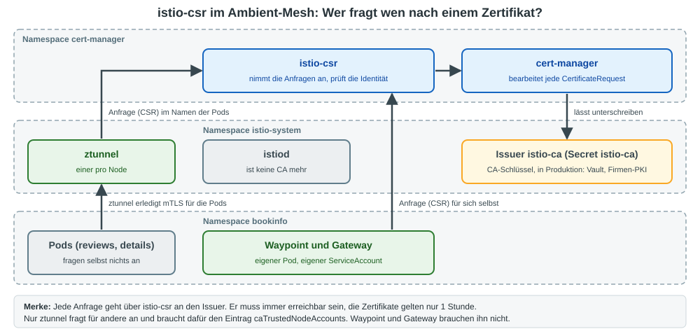

# Übung (Ambient): cert-manager als CA für das Mesh mit istio-csr

## Worum geht es?

In der Übung [Externe CA für Istio mit ArgoCD](../argocd/argocd-externe-ca.md) bleibt istiod die CA: Es bekommt eine
Zwischen-CA (Secret `cacerts`) und unterschreibt damit die Zertifikate der Workloads selbst.

Mit **istio-csr** ist istiod **keine CA mehr**. Jede Zertifikatsanfrage (CSR) geht an istio-csr,
cert-manager lässt sie vom Issuer unterschreiben. Im Cluster liegt dann kein CA-Schlüssel mehr bei istiod.



Die Übung zeigt zuerst den Weg von Hand (`helm`, `istioctl`), damit jeder Schritt sichtbar ist.
Wie du dasselbe mit ArgoCD ausrollst, steht im Abschnitt [Variante: Dasselbe mit ArgoCD](#variante-dasselbe-mit-argocd).

| | `cacerts` (Zwischen-CA) | istio-csr |
|---|---|---|
| Wer unterschreibt die Workload-Zertifikate? | istiod | der Issuer von cert-manager |
| Wie oft wird der Issuer gefragt? | einmal je Erneuerung der Zwischen-CA (z. B. alle 90 Tage) | bei **jedem** Workload-Zertifikat |
| Gültigkeit der Workload-Zertifikate | 24 Stunden | 1 Stunde |
| Issuer nicht erreichbar | fällt lange nicht auf | nach spätestens 1 Stunde gibt es keine neuen Zertifikate |
| Zusätzliche Komponente | keine (cert-manager nur zum Anlegen des Secrets) | cert-manager **und** istio-csr |

> **Merkkasten: Was ist istio-csr?**
>
> Ein eigenes Helm-Chart des cert-manager-Projekts (`cert-manager-istio-csr`). Es gehört weder zu Istio noch zum
> Chart von cert-manager und wird nur für diese Variante installiert.

> **Merkkasten: Let's Encrypt geht hier nicht**
>
> Die Zertifikate der Workloads tragen eine SPIFFE-ID (`spiffe://cluster.local/ns/bookinfo/sa/...`) statt eines
> öffentlichen DNS-Namens. Solche Zertifikate stellt Let's Encrypt (ACME) nicht aus. Du brauchst einen Issuer vom
> Typ `ca` (wie hier), Vault oder eine Firmen-PKI.

Getestet mit Istio 1.31.4 (Ambient), cert-manager v1.21.3, istio-csr v0.19.1, Kubernetes 1.37.

## ztunnel und Waypoint: Wer fragt für wen?

Stell dir das Zertifikat als Ausweis vor und die CA als Ausweisbehörde.

| Wer | Beantragt den Ausweis für | Braucht eine Sondererlaubnis? |
|-----|---------------------------|-------------------------------|
| Waypoint, Gateway | sich selbst (eigener ServiceAccount) | nein |
| ztunnel | die Pods auf seinem Node (z. B. `reviews`), je ServiceAccount einmal | **ja** |

ztunnel verlangt einen Ausweis auf einen fremden Namen. Das darf nicht jeder, sonst könnte sich jeder Pod als `reviews` ausgeben.
Die CA braucht deshalb eine Liste, wer für andere anfragen darf. Bei istio-csr ist das die Einstellung
`app.server.caTrustedNodeAccounts=istio-system/ztunnel` (bei istiod heißt sie `CA_TRUSTED_NODE_ACCOUNTS`).

Beide haben auch je eine eigene CA-Adresse: ztunnel die Variable `CA_ADDRESS`, Waypoint und Gateway `CA_ADDR`.

## Voraussetzungen

  * Istio Ambient und Bookinfo laufen (Namespace `bookinfo`, mit Waypoint und Gateway).
  * `helm` ist auf dem Client installiert.
  * cert-manager läuft (`kubectl -n cert-manager get pods`). Wenn nicht: Schritt 2 der Übung
    [Bookinfo mit HTTPS und Let's Encrypt](17-https-letsencrypt-bookinfo.md) ausführen.

> **Achtung: Umstellung im laufenden Mesh**
>
> cert-manager nennt den Einbau in ein laufendes Istio **nicht unterstützt**. Die Root-CA wechselt, deshalb kann
> mTLS während der Umstellung kurz brechen. Im Trainings-Cluster hat es funktioniert, in Produktion gehört
> istio-csr vor die Installation von Istio.

## Schritt 1: Ausgangslage ansehen

```bash
kubectl -n bookinfo get cm istio-ca-root-cert -o jsonpath='{.data.root-cert\.pem}' \
  | openssl x509 -noout -subject -issuer
```

```
subject=O = cluster.local
issuer=O = cluster.local
```

Wo holen ztunnel und Waypoint ihre Zertifikate?

```bash
kubectl -n istio-system get ds ztunnel \
  -o jsonpath='{range .spec.template.spec.containers[0].env[*]}{.name}={.value}{"\n"}{end}' | grep CA_ADDRESS
kubectl -n bookinfo get deploy waypoint \
  -o jsonpath='{range .spec.template.spec.containers[0].env[*]}{.name}={.value}{"\n"}{end}' | grep CA_ADDR
```

```
CA_ADDRESS=istiod.istio-system.svc:15012
CA_ADDR=istiod.istio-system.svc:15012
```

## Schritt 2: Issuer und Root-CA anlegen

```bash
cat <<'EOF' | kubectl apply -f -
apiVersion: cert-manager.io/v1
kind: Issuer
metadata:
  name: selfsigned
  namespace: istio-system
spec:
  selfSigned: {}
---
apiVersion: cert-manager.io/v1
kind: Certificate
metadata:
  name: istio-ca
  namespace: istio-system
spec:
  isCA: true
  commonName: Training Root CA
  subject:
    organizations:
      - Training
  secretName: istio-ca
  duration: 87600h        # 10 Jahre
  privateKey:
    algorithm: ECDSA
    size: 256
  issuerRef:
    kind: Issuer
    name: selfsigned
---
apiVersion: cert-manager.io/v1
kind: Issuer
metadata:
  name: istio-ca          # diesen Namen erwartet istio-csr
  namespace: istio-system
spec:
  ca:
    secretName: istio-ca
EOF
```

```bash
kubectl -n istio-system get issuer,certificate
```

```
NAME                                READY
issuer.cert-manager.io/istio-ca     True
issuer.cert-manager.io/selfsigned   True

NAME                                   READY   SECRET
certificate.cert-manager.io/istio-ca   True    istio-ca
```

Der Issuer `istio-ca` ist der Platzhalter für die externe CA. In Produktion zeigt er auf Vault oder die Firmen-PKI.

## Schritt 3: Zertifikat der Root-CA für istio-csr bereitstellen

istio-csr soll die Root-CA fest vorgegeben bekommen. Sonst übernimmt es, was der Issuer als Root-CA meldet.

```bash
kubectl -n istio-system get certificaterequest istio-ca-1 -o jsonpath='{.status.certificate}' \
  | base64 -d > ca.pem
openssl x509 -in ca.pem -noout -subject -issuer
```

```
subject=O = Training, CN = Training Root CA
issuer=O = Training, CN = Training Root CA
```

```bash
kubectl -n cert-manager create secret generic istio-root-ca --from-file=ca.pem=ca.pem
```

(In der Datei steht nur das öffentliche Zertifikat, kein Schlüssel.)

## Schritt 4: istio-csr installieren

```bash
helm upgrade --install cert-manager-istio-csr oci://quay.io/jetstack/charts/cert-manager-istio-csr \
  --version v0.19.1 --namespace cert-manager --wait \
  --set "app.tls.rootCAFile=/var/run/secrets/istio-csr/ca.pem" \
  --set "app.server.caTrustedNodeAccounts=istio-system/ztunnel" \
  --set "volumeMounts[0].name=root-ca" \
  --set "volumeMounts[0].mountPath=/var/run/secrets/istio-csr" \
  --set "volumes[0].name=root-ca" \
  --set "volumes[0].secret.secretName=istio-root-ca"
```

```bash
kubectl -n cert-manager get pods
kubectl -n istio-system get certificate
```

```
NAME                                   READY   SECRET
certificate.cert-manager.io/istio-ca   True    istio-ca
certificate.cert-manager.io/istiod     True    istiod-tls
```

istio-csr hat gleich ein Zertifikat für istiod angelegt (`istiod-tls`). istiod braucht es, weil es sich selbst keins mehr ausstellt.

> Mach jetzt zügig mit Schritt 5 weiter. Bis dahin überschreiben sich istiod und istio-csr gegenseitig die
> ConfigMap `istio-ca-root-cert` in allen Namespaces.

## Schritt 5: Istio auf istio-csr umstellen

```bash
cat > istio-csr-iop.yaml <<'EOF'
apiVersion: install.istio.io/v1alpha1
kind: IstioOperator
spec:
  profile: ambient
  values:
    global:
      # hier holen ztunnel, Waypoint und Gateway ihre Zertifikate
      caAddress: cert-manager-istio-csr.cert-manager.svc:443
  components:
    pilot:
      k8s:
        env:
          # istiod ist keine CA mehr
          - name: ENABLE_CA_SERVER
            value: "false"
EOF
istioctl install -f istio-csr-iop.yaml -y
```

```bash
kubectl -n istio-system rollout status deployment istiod
kubectl -n istio-system rollout status daemonset ztunnel
```

Du musst nichts von Hand neu starten: istiod und ztunnel werden durch die Änderung neu ausgerollt,
Waypoint und Gateway ebenfalls, weil sich ihre CA-Adresse ändert.

## Schritt 6: Prüfen

```bash
kubectl -n istio-system logs deploy/istiod | grep "x509 cert -" | head -n 1
```

```
x509 cert - Issuer: "CN=Training Root CA,O=Training", Subject: "CN=istiod.istio-system.svc", ...
```

```bash
kubectl -n bookinfo get cm istio-ca-root-cert -o jsonpath='{.data.root-cert\.pem}' \
  | openssl x509 -noout -subject -issuer
```

```
subject=O = Training, CN = Training Root CA
issuer=O = Training, CN = Training Root CA
```

```bash
kubectl -n istio-system get ds ztunnel \
  -o jsonpath='{range .spec.template.spec.containers[0].env[*]}{.name}={.value}{"\n"}{end}' | grep CA_ADDRESS
kubectl -n bookinfo get deploy waypoint \
  -o jsonpath='{range .spec.template.spec.containers[0].env[*]}{.name}={.value}{"\n"}{end}' | grep CA_ADDR
```

```
CA_ADDRESS=cert-manager-istio-csr.cert-manager.svc:443
CA_ADDR=cert-manager-istio-csr.cert-manager.svc:443
```

Zertifikate, die ztunnel für die Pods hält (ein ztunnel hält nur die Zertifikate der Pods auf seinem Node, deshalb den ztunnel auf dem Node von `productpage` nehmen):

```bash
NODE=$(kubectl -n bookinfo get pod -l app=productpage -o jsonpath='{.items[0].spec.nodeName}')
ZTUNNEL=$(kubectl -n istio-system get pod -l app=ztunnel --field-selector spec.nodeName=$NODE -o name)
istioctl ztunnel-config certificates -n istio-system $ZTUNNEL
```

```
CERTIFICATE NAME                                        TYPE   STATUS      VALID CERT   SERIAL NUMBER   NOT AFTER              NOT BEFORE
spiffe://cluster.local/ns/bookinfo/sa/bookinfo-details  Leaf   Available   true         d28ec5...       2026-11-11T05:45:22Z   2026-11-11T04:45:22Z
spiffe://cluster.local/ns/bookinfo/sa/bookinfo-details  Root   Available   true         581bc3...       2036-11-08T04:43:56Z   2026-11-11T04:43:56Z
```

Die Zertifikate gelten jetzt nur **1 Stunde**. Das Zertifikat, das der Waypoint für sich selbst hält:

```bash
istioctl proxy-config secret deploy/waypoint -n bookinfo
```

Funktioniert die Anwendung noch?

```bash
kubectl -n bookinfo exec deploy/productpage-v1 -- \
  python3 -c "import urllib.request as u; print(u.urlopen('http://reviews:9080/reviews/1').status)"
```

Erwartet: `200`.

> In der ersten Minute nach der Umstellung kann ztunnel im Log `invalid peer certificate: UnknownIssuer`
> gegenüber istiod melden. Das hört von selbst auf (`Stream established`).

## Schritt 7: Die Anfragen sichtbar machen

Normalerweise löscht istio-csr jede `CertificateRequest` sofort wieder. Zum Ansehen lassen wir sie stehen:

```bash
helm upgrade cert-manager-istio-csr oci://quay.io/jetstack/charts/cert-manager-istio-csr \
  --version v0.19.1 --namespace cert-manager --reuse-values --wait \
  --set "app.certmanager.preserveCertificateRequests=true"
```

Neue Anfragen auslösen:

```bash
kubectl -n istio-system rollout restart daemonset ztunnel
kubectl -n istio-system rollout status daemonset ztunnel
kubectl -n bookinfo rollout restart deployment waypoint
kubectl -n bookinfo rollout status deployment waypoint
```

```bash
kubectl -n istio-system get certificaterequest -o custom-columns='NAME:.metadata.name,ISSUER:.spec.issuerRef.name,READY:.status.conditions[?(@.type=="Ready")].status,IDENTITAET:.metadata.annotations.istio\.cert-manager\.io/identities'
```

```
NAME              ISSUER       READY   IDENTITAET
istio-ca-1        selfsigned   True    <none>
istio-csr-6gb6q   istio-ca     True    spiffe://cluster.local/ns/bookinfo/sa/bookinfo-ratings
istio-csr-d6gnv   istio-ca     True    spiffe://cluster.local/ns/bookinfo/sa/waypoint
istio-csr-kqdhb   istio-ca     True    spiffe://cluster.local/ns/bookinfo/sa/bookinfo-productpage
istio-csr-pn2q8   istio-ca     True    spiffe://cluster.local/ns/bookinfo/sa/bookinfo-reviews
istio-csr-wf7nm   istio-ca     True    istio-csr-serving
istio-csr-wnz6f   istio-ca     True    spiffe://cluster.local/ns/bookinfo/sa/bookinfo-details
istiod-1          istio-ca     True    <none>
```

  * `bookinfo-ratings`, `bookinfo-reviews` usw.: von **ztunnel** im Namen der Pods angefragt, je ServiceAccount eine Anfrage.
  * `waypoint`: vom **Waypoint** für sich selbst angefragt.
  * `istio-csr-serving` und `istiod-1`: die eigenen Zertifikate von istio-csr und istiod.

> `preserveCertificateRequests` ist nur zum Ansehen gedacht. Auf Dauer füllt es etcd mit Anfragen.

## Schritt 8 (optional): Gegenprobe ohne Erlaubnis für ztunnel

Was passiert, wenn ztunnel nicht für andere anfragen darf?

```bash
helm upgrade cert-manager-istio-csr oci://quay.io/jetstack/charts/cert-manager-istio-csr \
  --version v0.19.1 --namespace cert-manager --reuse-values --wait \
  --set "app.server.caTrustedNodeAccounts="
kubectl -n istio-system rollout restart daemonset ztunnel
kubectl -n istio-system rollout status daemonset ztunnel
```

```bash
kubectl -n cert-manager logs deploy/cert-manager-istio-csr --since=2m | grep impersonation | tail -n 2
```

```
warn	impersonation not allowed, as node authorizer (CA_TRUSTED_NODE_ACCOUNTS) is not configured
```

```bash
NODE=$(kubectl -n bookinfo get pod -l app=productpage -o jsonpath='{.items[0].spec.nodeName}')
ZTUNNEL=$(kubectl -n istio-system get pod -l app=ztunnel --field-selector spec.nodeName=$NODE -o name)
istioctl ztunnel-config certificates -n istio-system $ZTUNNEL
```

Die Liste ist leer, ztunnel hat keine Zertifikate. Der Aufruf von `reviews` aus Schritt 6 schlägt fehl,
das Gateway antwortet mit `503`.

Wieder erlauben:

```bash
helm upgrade cert-manager-istio-csr oci://quay.io/jetstack/charts/cert-manager-istio-csr \
  --version v0.19.1 --namespace cert-manager --reuse-values --wait \
  --set "app.server.caTrustedNodeAccounts=istio-system/ztunnel"
kubectl -n istio-system rollout restart daemonset ztunnel
kubectl -n istio-system rollout status daemonset ztunnel
```

Danach liefert der Aufruf aus Schritt 6 wieder `200`.

## Variante: Dasselbe mit ArgoCD

Bisher hast du Issuer, Root-CA und istio-csr von Hand angelegt (Schritt 2 bis 4). Mit ArgoCD liegen sie im Git,
und zwei Applications rollen sie aus. Die Manifeste liegen fertig in diesem Repo unter
[`istio/argocd/istio-csr/`](../argocd/istio-csr/). Du brauchst kein eigenes Git-Repo.

| Datei | Was | Ersetzt |
|-------|-----|---------|
| `ca/01-selfsigned-issuer.yaml`, `ca/02-root-ca.yaml`, `ca/03-istio-ca-issuer.yaml` | Issuer und Root-CA | Schritt 2 |
| `apps/istio-csr-ca-app.yaml` | Application `istio-csr-ca`, zeigt auf den Ordner `ca/` (Wave -4) | Schritt 2 |
| `apps/istio-csr-app.yaml` | Application `istio-csr`, Helm-Chart `cert-manager-istio-csr` (Wave -3) | Schritt 4 |

Voraussetzungen: ArgoCD ist installiert (siehe [ArgoCD-Übung](../argocd/argocd-istio-bookinfo.md), Abschnitt 4, Schritt 2),
cert-manager läuft, und der Stand von Hand ist aufgeräumt (Abschnitt "Aufräumen").

### ArgoCD Schritt 1: Die beiden Applications anlegen

Die Application für istio-csr:

```yaml
# istio-csr/apps/istio-csr-app.yaml
apiVersion: argoproj.io/v1alpha1
kind: Application
metadata:
  name: istio-csr
  namespace: argocd
  annotations:
    argocd.argoproj.io/sync-wave: "-3"
  finalizers:
    - resources-finalizer.argocd.argoproj.io
spec:
  project: default
  source:
    repoURL: https://charts.jetstack.io
    chart: cert-manager-istio-csr
    targetRevision: v0.19.1
    helm:
      releaseName: cert-manager-istio-csr
      values: |
        app:
          server:
            # ztunnel darf Zertifikate im Namen der Pods anfragen
            caTrustedNodeAccounts: istio-system/ztunnel
  destination:
    server: https://kubernetes.default.svc
    namespace: cert-manager
  syncPolicy:
    automated:
      selfHeal: true
    retry:
      limit: 5
      backoff:
        duration: 10s
        factor: 2
        maxDuration: 2m
```

```bash
REPO=https://raw.githubusercontent.com/jmetzger/training-istio-kubernetes/main/istio/argocd/istio-csr
kubectl apply -f $REPO/apps/istio-csr-ca-app.yaml
kubectl apply -f $REPO/apps/istio-csr-app.yaml
```

```bash
kubectl -n argocd get applications
```

```
NAME           SYNC STATUS   HEALTH STATUS
istio-csr      Synced        Healthy
istio-csr-ca   Synced        Healthy
```

Das dauert etwa eine halbe Minute.

```bash
kubectl -n istio-system get issuer,certificate
kubectl -n cert-manager get pods
```

> **Unterschied zum Weg von Hand: keine fest vorgegebene Root-CA**
>
> Schritt 3 (Secret `istio-root-ca`) ist ein Handgriff am Cluster und passt nicht zu GitOps. Die Application lässt
> ihn weg, istio-csr übernimmt die Root-CA dann vom Issuer. In Produktion ist das Zertifikat der Root-CA bekannt
> und öffentlich: Lege es als ConfigMap ins Git und binde es über `volumes`, `volumeMounts` und
> `app.tls.rootCAFile` ein (in dieser Übung nicht getestet).

### ArgoCD Schritt 2: Istio umstellen

**Istio ist mit `istioctl` installiert** (Normalfall im Training): Führe Schritt 5 von oben aus, danach Schritt 6 zum Prüfen.

> Schritt 7 und 8 ändern istio-csr mit `helm upgrade`. Unter ArgoCD geht das nicht, ArgoCD stellt den Stand aus dem
> Git wieder her (`selfHeal`). Solche Änderungen gehören dann in die `values` der Application.

**Istio wird selbst von ArgoCD ausgerollt** (wie in der [ArgoCD-Übung](../argocd/argocd-istio-bookinfo.md)):
Dann gehören die beiden Einstellungen in die Werte der Helm-Charts im Git-Repo.

```yaml
# apps/istio/values/istiod-values.yaml
profile: ambient
global:
  # hier holen Waypoint und Gateway ihre Zertifikate
  caAddress: cert-manager-istio-csr.cert-manager.svc:443
pilot:
  env:
    # istiod ist keine CA mehr
    ENABLE_CA_SERVER: "false"
```

```yaml
# apps/istio/ztunnel-app.yaml (Ausschnitt)
  source:
    chart: ztunnel
    helm:
      values: |
        # hier holt ztunnel die Zertifikate für die Pods
        caAddress: cert-manager-istio-csr.cert-manager.svc:443
```

Die Reihenfolge regeln die Sync Waves:

| Wave | Application | Inhalt |
|------|-------------|--------|
| -5 | `cert-manager` | Helm-Chart cert-manager ([`externe-ca/apps/cert-manager-app.yaml`](../argocd/externe-ca/apps/cert-manager-app.yaml)) |
| -4 | `istio-csr-ca` | Issuer und Root-CA |
| -3 | `istio-csr` | Helm-Chart istio-csr, legt auch `istiod-tls` an |
| -2 | `istio-base` | CRDs von Istio |
| -1 | `istiod` | startet gleich ohne eigene CA |
| 0 bis 2 | `istio-cni`, `ztunnel`, `bookinfo` | wie gehabt |

Das ist der Weg, den cert-manager vorsieht: istio-csr ist da, bevor Istio zum ersten Mal startet.

> Dieser zweite Fall ist **nicht** auf dem Trainings-Cluster ausgerollt. Geprüft ist nur, dass die Charts von
> Istio 1.31.4 mit diesen Werten `ENABLE_CA_SERVER=false` und die neue CA-Adresse erzeugen (`helm template`).
> Der Namespace `istio-system` muss in Wave -4 schon existieren, weil Issuer und Root-CA dort liegen.

### ArgoCD: Aufräumen

```bash
kubectl -n argocd delete application istio-csr istio-csr-ca
```

Das entfernt istio-csr, Issuer und Certificates. Die Secrets und das Lease bleiben liegen, deshalb von Hand:

```bash
kubectl -n istio-system delete secret istio-ca istiod-tls
kubectl -n istio-system delete lease istio-csr
rm -f istio-csr-iop.yaml
```

Danach Istio zurückstellen wie im Abschnitt "Aufräumen" (`istioctl install --set profile=ambient -y` und die Prüfungen).

## Gut zu wissen

| Thema | Hinweis |
|-------|---------|
| Verfügbarkeit | Ist istio-csr, cert-manager oder der Issuer länger als die Restlaufzeit der Zertifikate weg, bekommt kein Workload ein neues Zertifikat. In Produktion istio-csr mit mehreren Replicas betreiben. |
| Last | Jeder ServiceAccount je Node, jeder Waypoint und jedes Gateway fragt mindestens einmal pro Stunde an. Der Issuer muss das aushalten. |
| Reihenfolge | Vorgesehen ist: cert-manager, Issuer, istio-csr, **dann** Istio. Der nachträgliche Einbau wie hier ist laut cert-manager nicht unterstützt. |
| Root-CA | Sie wechselt bei der Umstellung. Das ist eine geplante Migration, kein Schalter für den laufenden Betrieb. |
| CA-Schlüssel | In der Übung liegt er als Secret `istio-ca` in `istio-system`. Mit Vault oder Firmen-PKI als Issuer liegt gar kein CA-Schlüssel mehr im Cluster. |
| Einfacher | Reicht es, dass das Mesh an der Firmen-PKI hängt, ist die Variante mit `cacerts` einfacher und hängt im Betrieb nicht am Issuer. |

## Aufräumen

(Hast du die ArgoCD-Variante benutzt, beginne mit "ArgoCD: Aufräumen" weiter oben.)

Zurück zur eigenen CA von istiod. Die Reihenfolge ist wichtig: `istiod-tls` muss weg sein, **bevor** istiod neu startet.

```bash
helm -n cert-manager uninstall cert-manager-istio-csr
kubectl -n istio-system delete certificate istio-ca
kubectl -n istio-system delete issuer istio-ca selfsigned
kubectl -n istio-system delete certificaterequest --all
kubectl -n istio-system delete secret istio-ca istiod-tls
kubectl -n istio-system delete lease istio-csr
kubectl -n cert-manager delete secret istio-root-ca
rm -f ca.pem istio-csr-iop.yaml
```

```bash
istioctl install --set profile=ambient -y
kubectl -n istio-system rollout status deployment istiod
kubectl -n istio-system rollout status daemonset ztunnel
```

Auch hier werden Waypoint und Gateway von selbst neu ausgerollt.

```bash
kubectl -n bookinfo get cm istio-ca-root-cert -o jsonpath='{.data.root-cert\.pem}' \
  | openssl x509 -noout -subject -issuer
# subject=O = cluster.local
```

```bash
kubectl -n bookinfo exec deploy/productpage-v1 -- \
  python3 -c "import urllib.request as u; print(u.urlopen('http://reviews:9080/reviews/1').status)"
```

Erwartet: `200`. cert-manager bleibt installiert.

## Quellen

  * cert-manager, istio-csr: https://cert-manager.io/docs/usage/istio-csr/
  * cert-manager, istio-csr installieren (mit Abschnitt zu Ambient): https://cert-manager.io/docs/usage/istio-csr/installation/
  * Helm-Chart: https://github.com/cert-manager/istio-csr
