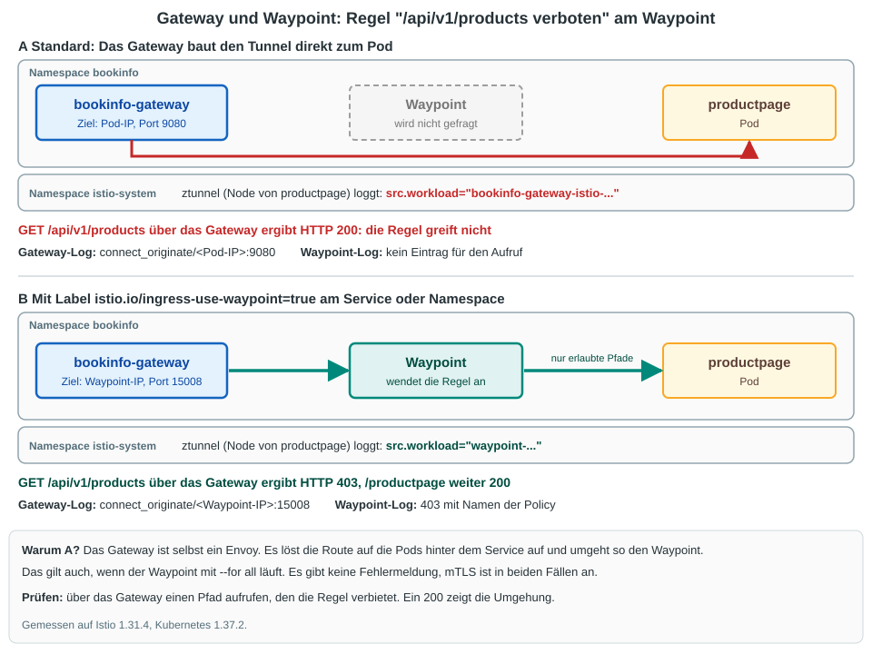

# Uebung (Ambient): Gateway umgeht den Waypoint - in den Logs erkennen und beheben

## Ziel

Du legst am Waypoint eine Layer-7-Regel an. Aus dem Mesh greift sie, ueber das Gateway von aussen aber nicht.
Es gibt dabei **keine Fehlermeldung**. Du lernst, die Umgehung in drei Logs zu erkennen, behebst sie mit einem Label
und pruefst in denselben Logs nach.

## Voraussetzung

  * Uebung [Bookinfo demo in ambient ausrollen](../installation/ambient/04-install-demo-app.md) ist durchgefuehrt
    (Namespace `bookinfo` mit Waypoint und `bookinfo-gateway`, alle Pods `1/1 Running`).
  * Im Namespace gibt es keine AuthorizationPolicies und das Label aus dieser Uebung ist noch nicht gesetzt:

```
kubectl -n bookinfo get authorizationpolicy
kubectl get namespace bookinfo --show-labels
kubectl -n bookinfo get service productpage --show-labels
```

Erwartet: `No resources found in bookinfo namespace.` und nirgends `istio.io/ingress-use-waypoint`

```
# zur Sicherheit führen wir das Kommando aus, um das Label zu entfernen, wenn es da ist
kubectl label namespace bookinfo istio.io/ingress-use-waypoint-
```

.

## Hintergrund



| Frage | Antwort |
|---|---|
| Warum umgeht das Gateway den Waypoint? | Das Gateway ist selbst ein Envoy. Es loest die Route auf die Pods hinter dem Service auf und baut den Tunnel (HBONE) direkt zum Pod. |
| Hilft ein Waypoint mit `--for all`? | Nein. Unser Waypoint laeuft mit `--for all`, das Gateway geht trotzdem daran vorbei. |
| Warum faellt das nicht auf? | Der Aufruf klappt (HTTP 200), mTLS ist an. Nur die Regel am Waypoint wird nicht gefragt. |
| Was hilft? | Das Label `istio.io/ingress-use-waypoint=true` am Service oder am Namespace. |

Die drei Spuren, die wir uns ansehen:

| Log | Umgehung (ohne Label) | Ueber den Waypoint (mit Label) |
|---|---|---|
| Gateway (Access-Log) | Ziel ist `<IP des Pods>:9080` | Ziel ist `<IP des Waypoints>:15008` |
| Waypoint (Access-Log) | kein Eintrag fuer den Aufruf | Eintrag, bei verbotenem Pfad `403` mit Namen der Policy |
| ztunnel auf dem Node des Ziel-Pods | `src.workload="bookinfo-gateway-istio-..."` | `src.workload="waypoint-..."` |

## Schritt 1: Vorbereitung

```
cd
mkdir -p manifests
cd manifests
mkdir gateway-waypoint
cd gateway-waypoint
```

Ein kleiner Client im Mesh fuer den Vergleich:

```
kubectl -n bookinfo apply -f ~/istio/samples/sleep/sleep.yaml
kubectl -n bookinfo rollout status deploy/sleep
```

Die Adresse des Gateways und der ztunnel auf dem Node von `productpage`:

```
GW=$(kubectl -n bookinfo get gateway bookinfo-gateway -o jsonpath='{.status.addresses[0].value}')
NODE=$(kubectl -n bookinfo get pod -l app=productpage -o jsonpath='{.items[0].spec.nodeName}')
ZT=$(kubectl -n istio-system get pod -l app=ztunnel --field-selector spec.nodeName=$NODE -o jsonpath='{.items[0].metadata.name}')
echo $GW $NODE $ZT
```

Die IP-Adressen, die gleich in den Logs auftauchen. Notiere dir die von `productpage` und die von `waypoint`:

```
kubectl -n bookinfo get pods -o wide | grep -E "NAME|productpage|waypoint"
```

## Schritt 2: Access-Logs einschalten

Gateway und Waypoint schreiben von sich aus nichts zu einzelnen Anfragen. Wir schalten das fuer beide ein:

```
# vi 01-telemetry.yml
apiVersion: telemetry.istio.io/v1
kind: Telemetry
metadata:
  name: waypoint-logging
spec:
  targetRefs:
  - kind: Gateway
    group: gateway.networking.k8s.io
    name: waypoint
  accessLogging:
  - providers:
    - name: envoy
---
apiVersion: telemetry.istio.io/v1
kind: Telemetry
metadata:
  name: gateway-logging
spec:
  targetRefs:
  - kind: Gateway
    group: gateway.networking.k8s.io
    name: bookinfo-gateway
  accessLogging:
  - providers:
    - name: envoy
```

```
kubectl -n bookinfo apply -f .
```

## Schritt 3: Regel am Waypoint

Der Pfad `/api/v1/products` von `productpage` soll gesperrt sein. Die Regel haengt per `targetRefs` am Service, also wertet sie der Waypoint aus:

```
# vi 02-api-verboten.yml
apiVersion: security.istio.io/v1
kind: AuthorizationPolicy
metadata:
  name: productpage-api-verboten
spec:
  targetRefs:
  - kind: Service
    group: ""
    name: productpage
  action: DENY
  rules:
  - to:
    - operation:
        ports: ["9080"]
        paths: ["/api/v1/products*"]
```

```
kubectl -n bookinfo apply -f .
sleep 10
```

## Schritt 4: Aus dem Mesh greift die Regel, ueber das Gateway nicht

Aufruf aus dem Mesh:

```
kubectl -n bookinfo exec deploy/sleep -- curl -s -o /dev/null -w "%{http_code}\n" productpage:9080/api/v1/products
```

Erwartet: `403`

Derselbe Pfad ueber das Gateway. Wir merken uns vorher die Uhrzeit, damit wir in den Logs nur die neuen Zeilen sehen
(das `sleep 2` trennt den Aufruf von eben sicher davon ab):

```
sleep 2
T0=$(date -u +%Y-%m-%dT%H:%M:%SZ)
for i in 1 2 3; do curl -s -o /dev/null -w "%{http_code}\n" http://$GW/api/v1/products; done
sleep 5
```

Erwartet: 3-mal `200`. **Die Regel greift nicht, und nichts weist darauf hin.**

## Schritt 5: Die Umgehung in den Logs erkennen

### Spur 1: Gateway-Log - wohin schickt das Gateway?

```
kubectl -n bookinfo logs deploy/bookinfo-gateway-istio --since-time=$T0 | grep "/api/v1/products" | tail -1
```

Erwartet (gekuerzt):

```
"GET /api/v1/products HTTP/1.1" 200 - via_upstream ... "envoy://connect_originate/192.168.93.138:9080" outbound|9080||productpage.bookinfo.svc.cluster.local ...
```

Nur das Ziel, einmal pro Adresse gezaehlt:

```
kubectl -n bookinfo logs deploy/bookinfo-gateway-istio --since-time=$T0 | grep "/api/v1/products" | grep -o 'connect_originate/[0-9.:]*' | sort | uniq -c
```

Erwartet: `3 connect_originate/<IP von productpage>:9080`. Das Gateway spricht **direkt mit dem Pod** (Port der Anwendung).

### Spur 2: Waypoint-Log - kam der Aufruf vorbei?

```
kubectl -n bookinfo logs deploy/waypoint --since-time=$T0 | grep -c "/api/v1/products"
```

Erwartet: `0`. Der Waypoint hat die drei Aufrufe nie gesehen.

Zum Vergleich der Aufruf aus dem Mesh von vorhin (der lag vor `T0`, deshalb mit `--since=5m`):

```
kubectl -n bookinfo logs deploy/waypoint --since=5m | grep "/api/v1/products" | tail -1
```

Erwartet (gekuerzt): `"GET /api/v1/products HTTP/1.1" 403 - rbac_access_denied_matched_policy[ns[bookinfo]-policy[productpage-api-verboten]-rule[0]] ...`

### Spur 3: ztunnel - wer kam beim Pod an?

```
kubectl -n istio-system logs $ZT --since-time=$T0 | grep 'dst.workload="productpage' | grep 'direction="inbound"' | tail -1
```

Erwartet (gekuerzt):

```
info  access  connection complete  src.workload="bookinfo-gateway-istio-..." src.identity="spiffe://cluster.local/ns/bookinfo/sa/bookinfo-gateway-istio" ... dst.hbone_addr=192.168.93.138:9080 dst.workload="productpage-v1-..." direction="inbound" ...
```

Nur die Quelle, gezaehlt:

```
kubectl -n istio-system logs $ZT --since-time=$T0 | grep 'dst.workload="productpage' | grep -o 'src.workload="[^"]*"' | sort | uniq -c
```

Erwartet: nur `src.workload="bookinfo-gateway-istio-..."`. Die Zahl ist kleiner als 3, weil das Gateway eine Verbindung fuer mehrere Anfragen nutzt.

So liest du die Zeile:

| Feld | Bedeutung hier |
|---|---|
| `direction="inbound"` | Sicht des Ziels (ztunnel auf dem Node von `productpage`) |
| `src.workload`, `src.identity` | **Das Gateway selbst kam an**, nicht der Waypoint |
| `dst.hbone_addr` | IP des Pods mit Port `9080` |

Hinweise:

  * Der ztunnel schreibt die Zeile erst, wenn die Verbindung endet. Beim Gateway dauert das etwa 2 Sekunden, deshalb das `sleep 5`.
  * Einen `outbound`-Eintrag vom Gateway gibt es nicht. Das Gateway baut den Tunnel selbst und laeuft nicht ueber den ztunnel (Label `istio.io/dataplane-mode=none`).

## Schritt 6: Beheben mit dem Label ingress-use-waypoint

```
kubectl -n bookinfo label service productpage istio.io/ingress-use-waypoint=true
sleep 10
```

```
T0=$(date -u +%Y-%m-%dT%H:%M:%SZ)
for i in 1 2 3; do curl -s -o /dev/null -w "%{http_code}\n" http://$GW/api/v1/products; done
curl -s -o /dev/null -w "%{http_code}\n" http://$GW/productpage
sleep 5
```

Erwartet: 3-mal `403`, danach `200` fuer `/productpage`. Die Regel greift jetzt auch von aussen, der Rest der Seite laeuft weiter.

## Schritt 7: Gegenprobe in denselben Logs

Gateway: Das Ziel ist jetzt der Waypoint, Port `15008` (HBONE):

```
kubectl -n bookinfo logs deploy/bookinfo-gateway-istio --since-time=$T0 | grep -o 'connect_originate/[0-9.:]*' | sort | uniq -c
```

Erwartet: `4 connect_originate/<IP des Waypoints>:15008`

Waypoint: Die Aufrufe sind da, mit Namen der Policy:

```
kubectl -n bookinfo logs deploy/waypoint --since-time=$T0 | grep "/api/v1/products" | tail -1
kubectl -n bookinfo logs deploy/waypoint --since-time=$T0 | grep -c "/api/v1/products"
```

Erwartet: `403 - rbac_access_denied_matched_policy[ns[bookinfo]-policy[productpage-api-verboten]-rule[0]]` und `3`

ztunnel: Beim Pod kommt jetzt der Waypoint an. Abgelehnte Aufrufe erreichen den Pod gar nicht, die Zeile stammt vom Aufruf auf `/productpage`:

```
kubectl -n istio-system logs $ZT --since-time=$T0 | grep 'dst.workload="productpage' | grep -o 'src.workload="[^"]*"' | sort | uniq -c
```

Erwartet: nur `src.workload="waypoint-..."`

## Schritt 8: Variante - Label am Namespace

Das Label am Service gilt nur fuer diesen Service. Am Namespace gilt es fuer alle Services darin:

```
kubectl -n bookinfo label service productpage istio.io/ingress-use-waypoint-
sleep 10
curl -s -o /dev/null -w "%{http_code}\n" http://$GW/api/v1/products
```

Erwartet: `200` (wieder die Umgehung)

```
kubectl label namespace bookinfo istio.io/ingress-use-waypoint=true
sleep 10
curl -s -o /dev/null -w "%{http_code}\n" http://$GW/api/v1/products
```

Erwartet: `403`

## Aufraeumen

```
kubectl label namespace bookinfo istio.io/ingress-use-waypoint-
kubectl -n bookinfo delete authorizationpolicy productpage-api-verboten
kubectl -n bookinfo delete telemetry waypoint-logging gateway-logging
kubectl -n bookinfo delete -f ~/istio/samples/sleep/sleep.yaml
```

```
sleep 10
curl -s -o /dev/null -w "%{http_code}\n" http://$GW/api/v1/products
kubectl -n bookinfo get pods
```

Erwartet: `200`, alle Bookinfo-Pods, das Gateway und der Waypoint `1/1 Running`, kein `sleep`.

## Zusammenfassung

| Aufruf auf `/api/v1/products` | Ohne Label | Mit `istio.io/ingress-use-waypoint=true` |
|---|---|---|
| Aus dem Mesh (`sleep`) | `403` | `403` |
| Ueber das Gateway | `200` (Regel umgangen) | `403` |
| Gateway-Log, Ziel | Pod-IP, Port `9080` | Waypoint-IP, Port `15008` |
| Waypoint-Log | kein Eintrag | `403` mit Namen der Policy |
| ztunnel am Ziel, `src.workload` | `bookinfo-gateway-istio-...` | `waypoint-...` |

Merksatz: **Eine Regel am Waypoint immer auch von aussen ueber das Gateway testen, und zwar mit einem Pfad, den sie verbietet.** Ein `200` auf dem verbotenen Pfad zeigt die Umgehung.

Gemessen mit Istio 1.31.4 und Kubernetes 1.37.2.

## Ref

  * https://istio.io/latest/docs/ambient/usage/waypoint/
  * https://istio.io/latest/docs/ambient/usage/troubleshoot-ztunnel/
  * [Uebung: Fehlersuche im Ambient-Mesh - ztunnel-Log und Waypoint-Log](18-ztunnel-log-debugging.md)
  * [Uebung: Kong als API-Gateway vor Istio Ambient](21-kong-api-gateway-ambient.md) (dort umgeht Kong den Waypoint, mit anderer Loesung)
