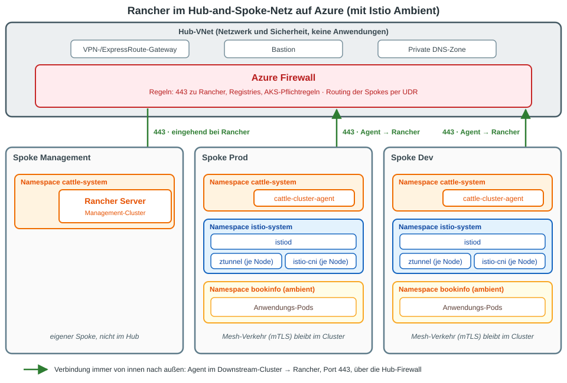

# Rancher auf Azure im Hub-and-Spoke-Netz (mit Istio Ambient)

Stand: 2026-11-09. Punkte mit **(ungeprueft)** stammen aus Erfahrungswissen und sind noch nicht
gegen die offizielle Doku der eingesetzten Versionen verifiziert.

Schwerpunkt ist **Rancher**: wo er in einem Hub-and-Spoke-Netz läuft, welche Verbindungen er braucht
und was das für Istio Ambient auf den Downstream-Clustern bedeutet.



## Kurzfassung

- Rancher gehört in einen **eigenen Spoke** ("Management" oder "Platform"), nicht in den Hub.
- Die Downstream-Cluster (Prod, Dev) liegen in eigenen Spokes und melden sich **von innen nach außen**
  über die Hub-Firewall bei Rancher (Port 443).
- Istio Ambient wird auf den Downstream-Clustern **genauso installiert wie sonst**. Der Mesh-Verkehr
  zwischen den Pods bleibt im Cluster und läuft nicht über den Hub.
- Fast alle Probleme liegen bei Firewall, Route oder DNS, nicht bei Rancher oder Istio.

## Hub and Spoke in einem Satz

Der **Hub** ist ein zentrales VNet mit Netzwerk- und Sicherheitsdiensten (Firewall, VPN-/ExpressRoute-
Gateway, Bastion, DNS). Die **Spokes** sind eigene VNets für Workloads, per Peering mit dem Hub
verbunden. Faustregel: Der Hub transportiert und kontrolliert, die Spokes führen aus.
Rancher ist ein Dienst, also kommt er in einen Spoke.

```
Hub (Firewall, VPN, DNS)
 ├── Spoke Management  → Rancher (Management-Cluster)
 ├── Spoke Prod        → Downstream-Cluster (AKS, Istio Ambient)
 └── Spoke Dev         → Downstream-Cluster (AKS, Istio Ambient)
```

Warum nicht im Hub: Er soll schlank und leicht prüfbar bleiben. Anwendungen und Cluster gehören dort
nicht hin.

Ausnahme: Bei einem einzelnen Cluster darf Rancher im selben Spoke wie die Workloads laufen.

## Welche Verbindungen Rancher braucht

| Von | Nach | Port | Wozu |
|-----|------|------|------|
| Downstream-Cluster (`cattle-cluster-agent`, `cattle-node-agent`) | Rancher-URL | 443 | Agent baut die Verbindung auf, Rancher wählt sich **nicht** in den Cluster ein |
| Rancher-Management-Cluster | Azure-APIs | 443 | nur wenn Rancher die AKS-Cluster selbst anlegt oder verwaltet (Azure Resource Manager, Entra ID) **(ungeprueft)** |
| Nutzer, Admins | Rancher-URL | 443 | Web-Oberfläche, API, `kubectl` über Rancher |
| Alle Cluster | Container-Registries | 443 | Rancher-, Istio- und Anwendungs-Images |

Wichtig für die Firewall-Regeln im Hub:

- Die Regel gilt **vom Spoke Prod/Dev zum Spoke Management**, mit Routing (UDR) über die Hub-Firewall
  in beide Richtungen, sonst kommt die Antwort nicht zurück (asymmetrisches Routing).
- Rancher muss unter einem **DNS-Namen** erreichbar sein, den die Downstream-Cluster auflösen können
  (private DNS-Zone, am Hub verlinkt). Die Agenten verwenden diesen Namen.
- **TLS-Inspection** der Firewall (z. B. Azure Firewall Premium) bricht die Agent-Verbindung, weil die
  Agenten das Zertifikat von Rancher prüfen. Für die Rancher-URL die Inspection ausnehmen
  **(ungeprueft)**.
- Zusätzlich braucht **AKS selbst** Pflicht-Egress-Regeln, wenn der Ausgang über die Firewall läuft
  (`outboundType: userDefinedRouting`). Ohne sie scheitert schon die Cluster-Erstellung. Siehe die
  Microsoft-Doku "Outbound network and FQDN rules for AKS" **(ungeprueft)**.

## Rancher und Istio Ambient auf den Downstream-Clustern

Die Reihenfolge ist: Cluster anlegen oder importieren, Agent verbindet sich mit Rancher, danach Istio
installieren. Istio ändert an der Rancher-Verbindung nichts.

- **Istio selbst installieren** (`istioctl` oder Helm, Profil `ambient`), wie im Training.
  Rancher bringt eine eigene Istio-App im Katalog mit. Ob sie Ambient unterstützt, ist offen
  **(ungeprueft)**. Nicht mit einer Eigeninstallation mischen: genau eine Istio-Installation pro Cluster.
- **Rancher-Namespaces nicht in das Mesh aufnehmen.** `cattle-system`, `cattle-fleet-system` und die
  System-Namespaces bekommen kein `istio.io/dataplane-mode=ambient`. Ambient nur für die eigenen
  Anwendungs-Namespaces setzen. Der Agent-Verkehr zu Rancher läuft sonst durch ztunnel, was ohne Not
  eine Fehlerquelle ist.
- **Project Network Isolation** (Netzwerkregeln pro Rancher-Projekt): Falls aktiv, muss
  **Port 15008 (HBONE)** zwischen den Nodes und Pods erlaubt sein, sonst funktioniert ztunnel nicht
  **(ungeprueft)**.
- **Zuständigkeit:** Rancher verwaltet Cluster und Zugriffsrechte (Projekte, Nutzer, RBAC). Istio
  verwaltet den Verkehr zwischen Services (mTLS, Routen, Policies). Das ergänzt sich, überschneidet sich
  aber nicht.
- **Mehrere Cluster in einem Mesh** (Multi-Cluster): nicht nötig für den Anfang. Der Verkehr zwischen
  den Spokes liefe über den Hub, und der Reifegrad von Multi-Cluster-Ambient ist vor einer Planung in der
  Istio-Doku zu prüfen. Rancher ersetzt kein Multi-Cluster-Mesh.

## Typische Fehlerbilder

| Symptom | Wahrscheinliche Ursache |
|---------|-------------------------|
| Cluster in Rancher bleibt "Unavailable" oder "Waiting" | Firewall-Regel oder Route zu Rancher (443) fehlt, DNS-Name nicht auflösbar, TLS-Inspection |
| `cattle-cluster-agent` im Zustand `CrashLoopBackOff` | wie oben: `kubectl -n cattle-system logs deploy/cattle-cluster-agent` zeigt, ob die Rancher-URL erreichbar ist |
| `ImagePullBackOff` im Spoke | Registry in der Firewall nicht freigegeben |
| AKS-Erstellung hängt oder schlägt fehl | Pflicht-Egress-Regeln von AKS fehlen |
| Antworten kommen nicht zurück | Route nur in eine Richtung, Peering nicht transitiv |

Merksatz: Die Fehlersuche hat eine Ebene mehr als bei einem normalen Cluster. Zuerst Firewall, Route
und DNS prüfen, dann erst Rancher und Istio.

## Prüfen vom Spoke aus

```
# Rancher-URL aus dem Downstream-Cluster erreichbar?
kubectl run -it --rm nettest --image=curlimages/curl --restart=Never -- \
  curl -sS -o /dev/null -w '%{http_code}\n' https://<rancher-url>/ping
```

Erwartet: `200`. Kommt ein Zertifikatsfehler oder ein Timeout, liegt es am Netz, nicht an Rancher.

## Quellen

- [Azure Architecture Center: Hub-and-Spoke-Netzwerktopologie](https://learn.microsoft.com/azure/architecture/networking/architecture/hub-spoke)
- [Rancher-Doku: Port-Anforderungen](https://ranchermanager.docs.rancher.com/getting-started/installation-and-upgrade/installation-requirements/port-requirements)
- [Microsoft Learn: Outbound network and FQDN rules for AKS](https://learn.microsoft.com/azure/aks/outbound-rules-control-egress)
