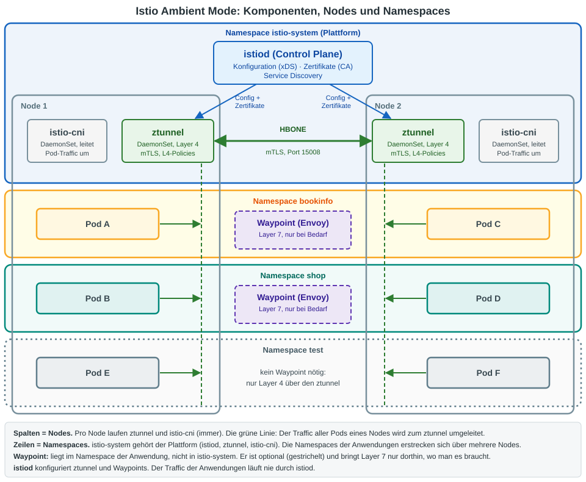
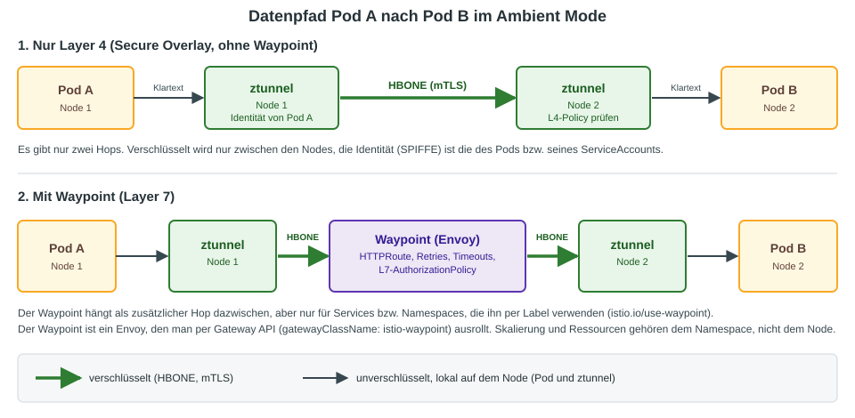
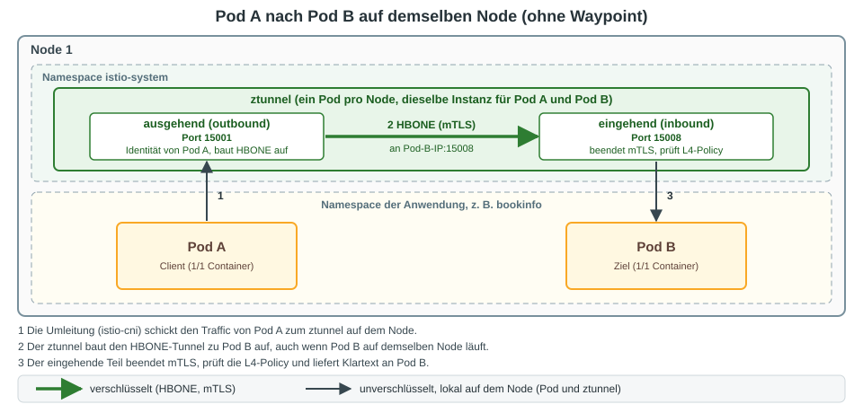
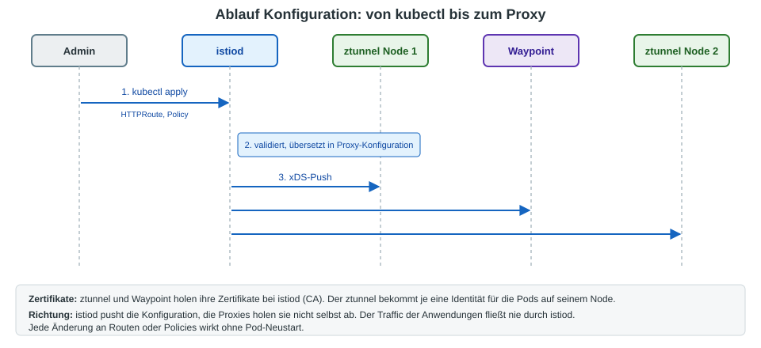
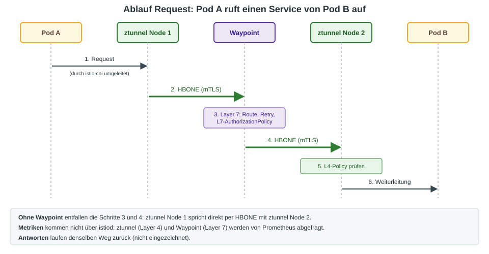

# Architektur & Komponenten von Istio (Ambient Mode)

Im Ambient Mode steckt kein Envoy-Sidecar mehr in jedem Pod. Die Aufgaben sind stattdessen auf **zwei Ebenen** verteilt:

| Ebene | Was | Wo |
|---|---|---|
| **Layer 4 (immer)** | mTLS, Identität, L4-Policies, TCP-Metriken | `ztunnel`, ein Agent pro Node |
| **Layer 7 (nur bei Bedarf)** | Routing, Retries, Timeouts, L7-Policies, HTTP-Metriken | `Waypoint`, ein Envoy pro Namespace |

Dazu kommen der `istiod` als Control Plane und `istio-cni`, der den Traffic der Pods zum ztunnel umleitet.

## Überblick

Die Grafik hat zwei Achsen: Die **Spalten** sind die Nodes, die **Zeilen** die Namespaces. `istio-system` gehört der Plattform (istiod, ztunnel, istio-cni).
Die Anwendungs-Namespaces erstrecken sich über mehrere Nodes, und ein Waypoint liegt in dem Namespace, für den er Layer 7 bereitstellt.



## Die Komponenten im Einzelnen

| Komponente | Läuft als | Aufgabe | Zuständig (bei Plattform-Betrieb) |
|---|---|---|---|
| **istiod** | Deployment, `istio-system` | Verteilt Konfiguration per xDS, stellt Zertifikate aus (CA), Service Discovery | Plattform |
| **istio-cni** | DaemonSet, ein Pod pro Node, `istio-system` | Richtet die Umleitung des Pod-Traffics zum ztunnel ein. Dafür sind keine `NET_ADMIN`-Rechte in den Anwendungs-Pods nötig | Plattform |
| **ztunnel** | DaemonSet, ein Pod pro Node, `istio-system` | Layer 4: baut mTLS-Tunnel (HBONE) auf, prüft L4-Policies, liefert TCP-Metriken. Hat pro Pod auf dem Node eine eigene Identität (SPIFFE) | Plattform |
| **Waypoint** | Deployment im Namespace der Anwendung, per Gateway API (`gatewayClassName: istio-waypoint`) | Layer 7: HTTPRoute, Retries, Timeouts, Fault Injection, L7-`AuthorizationPolicy`, HTTP-Metriken | **Namespace-Team** |
| **Ingress Gateway** | Deployment, per Gateway API (`gatewayClassName: istio`) | Eingang von außen in das Mesh | Namespace-Team oder Plattform |

Die Spalte ganz rechts ist für das Training wichtig ("Istio als Mieter"): ztunnel, istio-cni, istiod und die CRDs gehören zur Plattform.
Im eigenen Namespace sind nur das **Label** (`istio.io/dataplane-mode=ambient`), der **Waypoint**, die **Routen** und die **Policies** Sache des Teams.

### HBONE in zwei Sätzen

HBONE (HTTP-Based Overlay Network Environment) ist der Tunnel zwischen den ztunnels: HTTP/2 `CONNECT` über mTLS auf **Port 15008**.
Mehrere Verbindungen zwischen zwei Nodes laufen gemultiplext durch denselben Tunnel, und die Identität des Absenders (SPIFFE) reist im Zertifikat mit.

## Datenpfad: ohne und mit Waypoint



* **Ohne Waypoint** (Secure Overlay): zwei Hops, nur Layer 4. Reicht für mTLS und einfache Policies (wer darf mit wem sprechen).
* **Mit Waypoint:** ein zusätzlicher Hop für alles, was HTTP-Wissen braucht. Man aktiviert ihn gezielt pro Namespace oder Service (`istio.io/use-waypoint`).
* Beides kann im selben Cluster nebeneinander laufen, Namespace für Namespace.

### Sonderfall: Pod und Ziel auf demselben Node

Auch wenn beide Pods auf demselben Node laufen, geht der Traffic **über ztunnel und HBONE**. Es gibt keine Abkürzung am ztunnel vorbei.
Der Grund: mTLS, Identität und L4-Policies sollen unabhängig davon gelten, wo der Scheduler die Pods hingelegt hat.



* Quell- und Ziel-Pod teilen sich **denselben ztunnel** (ein Pod pro Node). Er ist in dem Fall Absender und Empfänger zugleich.
* Im ztunnel gibt es zwei Seiten: **ausgehend** nimmt den umgeleiteten Traffic des Pods auf Port **15001** an, **eingehend** nimmt HBONE auf Port **15008** an. (Klartext von Pods außerhalb des Meshes landet auf Port 15006.)
* Das Paket verlässt den Node nicht, wird aber trotzdem verschlüsselt (HBONE auf Port 15008 der Ziel-Pod-IP) und gegen die L4-Policy geprüft.
* Ist ein Waypoint konfiguriert, ändert sich nur der Weg: Pod A → ztunnel → Waypoint → ztunnel → Pod B. Jeder Hop ist ein HBONE-Tunnel, auch wenn alle Teilnehmer auf einem Node liegen.
* Der Vorteil für Betrieb und Fehlersuche: Das Verhalten ist auf einem Node und über Nodes hinweg identisch.

Im ztunnel-Log sieht man das Beispiel direkt. Hier ruft `reviews-v2` den Service `ratings` auf, und reviews, ratings und der Waypoint liegen alle auf demselben Node (gekürzt):

```
# ausgehend: reviews-v2 spricht per HBONE mit dem Waypoint (Port 15008)
src.workload="reviews-v2-..." src.identity="spiffe://cluster.local/ns/bookinfo/sa/bookinfo-reviews"
dst.addr=192.168.11.96:15008 dst.hbone_addr=10.108.46.136:9080 dst.workload="waypoint-..." direction="outbound"

# eingehend: der Waypoint spricht per HBONE mit ratings (Port 15008)
src.workload="waypoint-..." src.identity="spiffe://cluster.local/ns/bookinfo/sa/waypoint"
dst.addr=192.168.11.98:15008 dst.hbone_addr=192.168.11.98:9080 dst.workload="ratings-v1-..." direction="inbound"
```

Selbst nachsehen:

```bash
# Auf welchem Node liegt welcher Pod? (gleiche Spalte NODE = gleicher Node)
kubectl get pods -n bookinfo -o wide

# ztunnel-Pod des Nodes finden und dessen Access-Log lesen
kubectl get pods -n istio-system -o wide | grep ztunnel
kubectl logs -n istio-system <ztunnel-pod-auf-dem-node> | grep "connection complete"

# Spricht der Ziel-Pod HBONE? (Spalte PROTOCOL)
istioctl ztunnel-config workload
```

## Ablauf: Konfiguration



1. Der Admin legt eine Route oder Policy an (`kubectl apply`).
2. istiod validiert sie und übersetzt sie in Proxy-Konfiguration.
3. istiod schickt die Konfiguration per xDS an ztunnel und Waypoint.

Die ztunnels holen dabei auch die Zertifikate für die Pods auf ihrem Node, der Waypoint holt seines bei istiod (CA).
Änderungen wirken ohne Pod-Neustart.

## Ablauf: Request



1. Ein Pod ruft einen Service auf. `istio-cni` hat den Traffic zum lokalen ztunnel umgeleitet.
2. Der ztunnel schickt ihn per HBONE (mTLS) weiter, mit Waypoint zuerst dorthin.
3. Der Waypoint wendet die Layer-7-Regeln an (Routing, Retries, L7-Policies).
4. Weiter geht es per HBONE zum ztunnel auf dem Ziel-Node.
5. Der ztunnel prüft die L4-Policy.
6. Er übergibt den Request an den Ziel-Pod.

Ohne Waypoint entfallen die Schritte 3 und 4: Der ztunnel auf Node 1 spricht direkt mit dem ztunnel auf Node 2.

## Ambient im Vergleich zu Sidecar

| | **Sidecar** | **Ambient** |
|---|---|---|
| Wo läuft der Proxy? | Envoy in **jedem Pod** | ztunnel **pro Node**, Waypoint **pro Namespace** (optional) |
| Pod-Neustart zum Aktivieren? | Ja, der Sidecar wird injiziert | Nein, Label setzen genügt |
| Ressourcen | CPU/RAM pro Pod | deutlich weniger Overhead |
| Layer 7 | immer (Envoy im Pod) | nur mit Waypoint |
| mTLS | Sidecar zu Sidecar | ztunnel zu ztunnel (HBONE) |
| Upgrade von Istio | Pods müssen neu starten | ztunnel/CNI als DaemonSet, Anwendungs-Pods bleiben unberührt |
| Koexistenz | ja, beide Modi können im selben Cluster laufen | |

Die klassische Sidecar-Architektur steht in [overview-classic-sidecar.md](overview-classic-sidecar.md) und
[07-istio-proxy-concepts-sidecar.md](07-istio-proxy-concepts-sidecar.md).

## Selbst nachschauen (auf dem eigenen Cluster)

```bash
# Control Plane und Node-Agents: je 1 ztunnel und 1 istio-cni pro Node, 1 istiod
kubectl get deploy,ds -n istio-system
kubectl get pods -n istio-system -o wide

# Die Anwendungs-Pods zeigen nur ihren eigenen Container (1/1)
kubectl get pods -n bookinfo

# Ist der Namespace im Mesh, und nutzt er einen Waypoint?
kubectl get ns bookinfo --show-labels
kubectl get gateway -n bookinfo

# Was weiß ztunnel? Welcher Pod spricht HBONE, welcher hat einen Waypoint?
istioctl ztunnel-config workload
```

## Merksätze

* **ztunnel = Layer 4, pro Node, immer da.** Er verschlüsselt und prüft, wer mit wem sprechen darf.
* **Waypoint = Layer 7, pro Namespace, nur wenn man ihn braucht.** Er routet und wiederholt Requests.
* **istiod verteilt nur Konfiguration und Zertifikate**, der Traffic fließt nie durch ihn.
* Ambient verändert die Pods nicht, deshalb ist der Einstieg ein Label und der Ausstieg ebenfalls.
