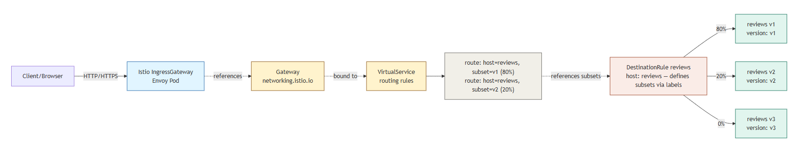
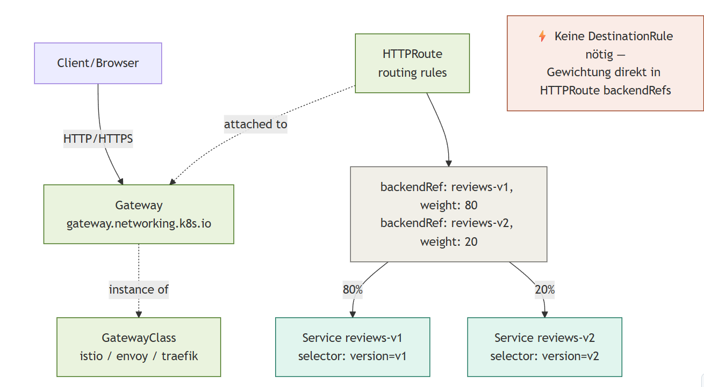
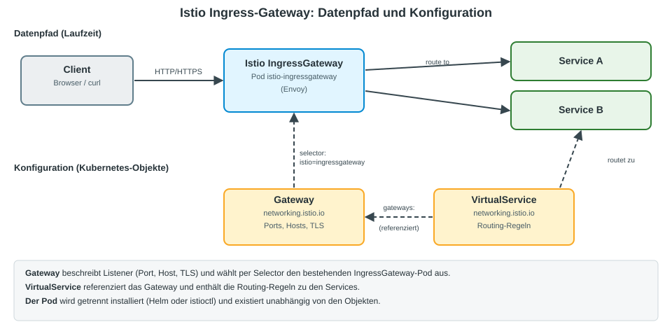
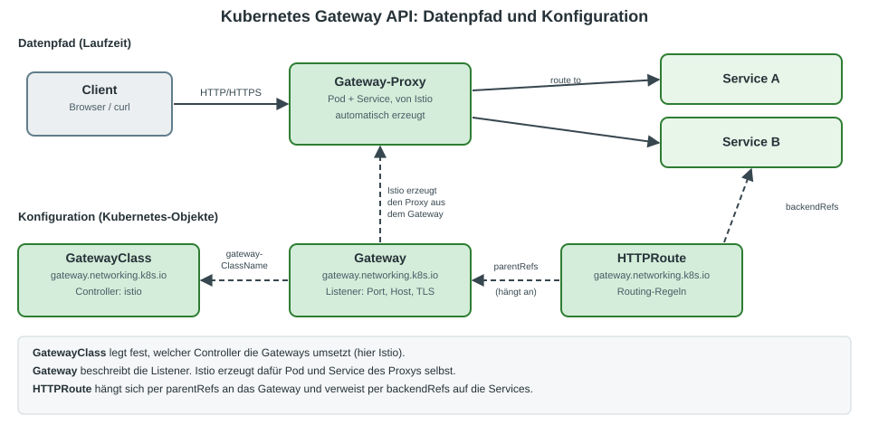

# Ingress Istio-Gateway vs. Kubernetes Gateway API 

## Istio Ingress-Gateway-Flow (bookinfo/productpage) 

## Gateway API -> Gateway Flow (bookinfo/productpage)

 * Achtung:  VirtualService und DestinationRule werden teilweise immer noch benötigt, auch wenn man mit der Gateway API arbeitet,
     um bestimmte Feature abzubilden  

## Schema: Istio Ingress-Gateway

## Schema: Kubernetes Gateway API

