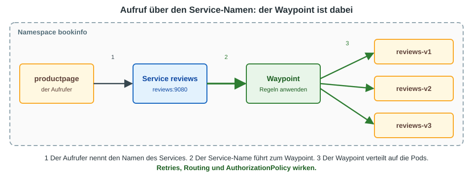
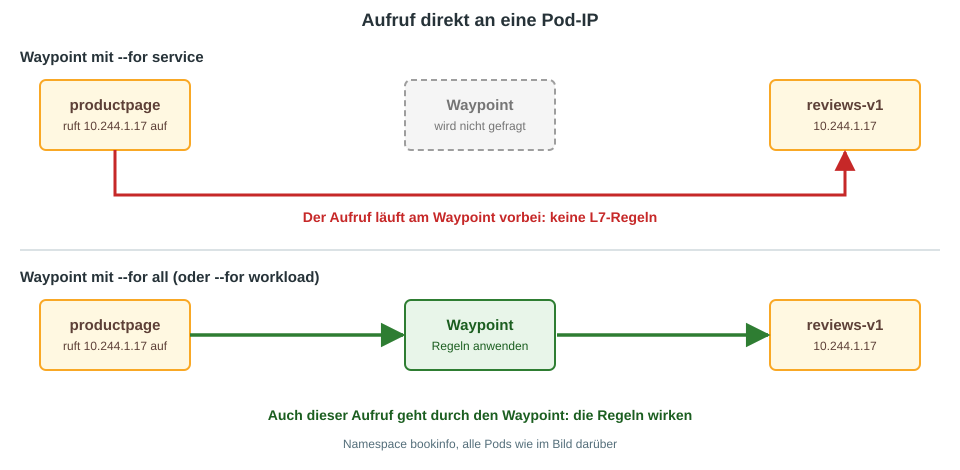
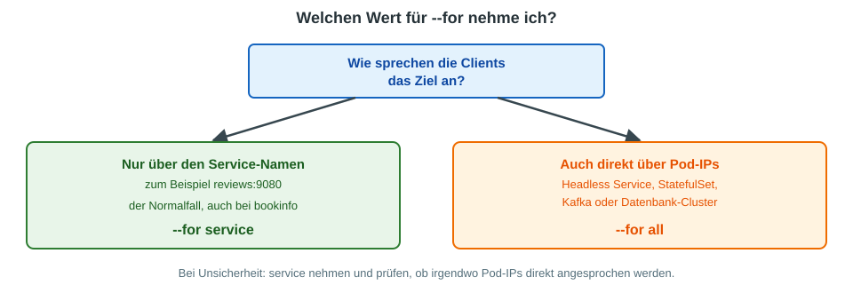

# Waypoint: was bedeutet `--for service`, `--for workload` und `--for all`?

Beim Erzeugen eines Waypoints gibt es eine Option, über die oft gestolpert wird:

```
istioctl waypoint generate --namespace bookinfo --for service
```

Die Option `--for` legt fest, **für welchen Traffic der Waypoint zuständig ist**.
Der Unterschied hängt davon ab, **wie ein Client sein Ziel anspricht**.

## Die einfache Erklärung

Ein Pod kann ein anderes Ziel auf zwei Arten erreichen:

| Der Client ruft auf | Beispiel | Das ist ein Aufruf an |
|---|---|---|
| den **Namen eines Services** | `http://reviews:9080` | einen **Service** |
| die **IP-Adresse eines Pods** | `http://10.244.1.17:9080` | einen **Workload** (Pod) |

Der Waypoint kann sich auf eine Art, auf beide oder auf keine festlegen:

| Wert | Der Waypoint bearbeitet |
|---|---|
| `service` (Standard) | Aufrufe an einen **Service-Namen** |
| `workload` | Aufrufe an eine **Pod-IP** |
| `all` | **beides** |

Es gibt noch den Wert `none`. Er ist für Sonderfälle gedacht und spielt im Training keine Rolle.

## Fall 1: Aufruf über den Service-Namen (der Normalfall)

Fast jede Anwendung ruft andere Anwendungen über den Service-Namen auf, bei Bookinfo zum Beispiel `reviews:9080`.
Dann ist `--for service` genau richtig: Der Aufruf geht zum Waypoint, der Waypoint wendet seine Regeln an und verteilt auf die Pods.



Der Waypoint ist hier der Ort, an dem Layer-7-Regeln wirken. Das sind zum Beispiel:

* Routing (`HTTPRoute`), also Header-basiert, pfadbasiert oder Traffic-Shifting
* Retries und Timeouts
* `AuthorizationPolicy` auf HTTP-Ebene

Die Pods in der Grafik liegen im selben Namespace wie der Waypoint. Der ztunnel auf dem Weg ist weggelassen, weil er für diese Frage keine Rolle spielt.

## Fall 2: Aufruf direkt an die Pod-IP

Ruft ein Client direkt eine Pod-IP auf, gilt Folgendes:

* Mit `--for service` wird der Waypoint **nicht gefragt**. Der Aufruf geht am Waypoint vorbei und bekommt nur Layer 4, also mTLS durch den ztunnel.
* Mit `--for workload` oder `--for all` geht auch dieser Aufruf durch den Waypoint, und die Regeln wirken.



Wichtig dabei: Eine L7-Regel, die du am Waypoint definierst, gilt dann nur für den Traffic, der auch wirklich durch den Waypoint läuft.

## Wann ruft ein Client eine Pod-IP direkt auf?

Das ist selten, kommt aber vor:

* **Headless Services** (`clusterIP: None`). DNS liefert dort direkt die Pod-IPs. Das ist typisch bei StatefulSets.
* **Anwendungen, die ihre Partner selbst suchen**, zum Beispiel Kafka, Datenbank-Cluster oder Protokolle, die sich gegenseitig melden.
* **Clients, die Pod-IPs aus der Service-Discovery** (Endpoints) lesen und direkt ansprechen.

## Was nehme ich?



In der Praxis gilt:

* **Meistens reicht `--for service`.** Es ist auch der Standard.
* **`--for all`** nimmst du, wenn du sicher auch den direkten Weg über Pod-IPs abdecken willst, oder wenn du nicht sicher weißt, wie deine Clients die Ziele ansprechen.
* **`--for workload`** allein ist selten sinnvoll, weil dann der normale Aufruf über den Service-Namen am Waypoint vorbeigeht.

In unserer Übung [Bookinfo demo in ambient ausrollen](../installation/ambient/04-install-demo-app.md) steht `--for all`.
Das funktioniert. Bookinfo ruft aber nur über Service-Namen auf, deshalb würde dort auch `--for service` genügen.

## Wie sehe ich, was eingestellt ist?

Die Option setzt ein Label am Waypoint-Gateway:

```
# Label am Waypoint anschauen
kubectl -n bookinfo get gateway waypoint -o jsonpath='{.metadata.labels}'
```

Dort steht `istio.io/waypoint-for` mit dem gewählten Wert. Das fertige YAML siehst du schon vor dem Ausrollen:

```
istioctl waypoint generate --namespace bookinfo --for service
```

## Selbst-Check

1. Ein Client ruft `http://reviews:9080` auf. Der Waypoint wurde mit `--for service` erzeugt. Geht der Aufruf durch den Waypoint?
2. Derselbe Client ruft `http://10.244.1.17:9080` auf, die IP eines reviews-Pods. Geht der Aufruf durch den Waypoint?
3. Welchen Wert nimmst du, wenn ein StatefulSet mit Headless Service im Namespace liegt und dort auch L7-Regeln gelten sollen?

<details>
<summary>Lösung</summary>

1. Ja. Der Aufruf geht an einen Service, und dafür ist der Waypoint zuständig.
2. Nein. Das ist ein Aufruf an einen Workload, und `--for service` deckt ihn nicht ab.
3. `--for all`, weil Aufrufe an die Pod-IPs des Headless Service ebenfalls durch den Waypoint laufen sollen.

</details>
