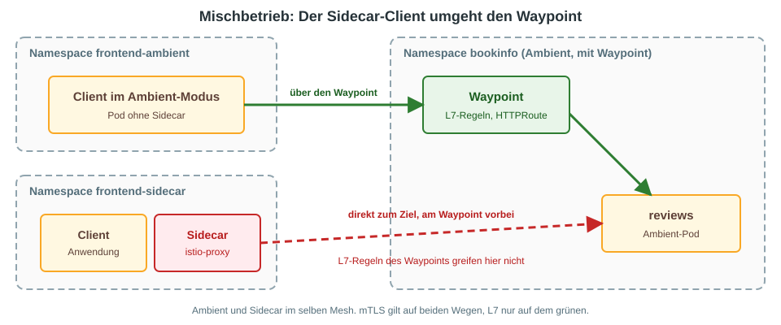

# Was Ambient (noch) nicht kann, was Sidecar kann

**Stand: 10.11.2026.** Grundlage ist die Istio-Dokumentation zu Version 1.32 (1.32.0 ist seit 09.11.2026 draußen).
Im Training läuft Istio **1.31.4**. Die Aussagen gelten vermutlich auch dafür, abgeglichen ist das nicht.

## Die Kurzfassung

Für **einen einzelnen Kubernetes-Cluster** mit Gateway API, ztunnel und Waypoint (unser Aufbau) fehlt fast nichts.
Die Lücken liegen bei VMs, EnvoyFilter, SPIRE und Multi-Cluster.

## Was es nur mit Sidecar gibt

| Thema | Sidecar | Ambient |
|---|---|---|
| **VMs im Mesh** | geht | nicht möglich |
| **EnvoyFilter** | geht | wird nicht unterstützt, auch nicht auf Waypoints |
| **SPIRE-Integration** | geht | nicht unterstützt |
| **PeerAuthentication `DISABLE`** | geht | wird ignoriert |
| **Multi-Cluster** | stabil | nur Multi-Primary, Primary-Remote geht nicht |
| **Multi-Network** | stabil | laut Doku in Beta |
| **Sidecar-Client zu Waypoint** | geht | Verkehr umgeht den Waypoint (siehe unten) |

## Was Ambient nur eingeschränkt kann

* **Layer 7 braucht einen Waypoint.** Ohne Waypoint gibt es nur mTLS, L4-Autorisierung und L4-Telemetrie.
  Mit nur ztunnel gilt: Load Balancing nur auf Verbindungsebene, Circuit Breaking nur für TCP, Metriken nur TCP (Bytes, Pakete), kein Tracing auf L4.
* **`VirtualService`** ist in Ambient noch Alpha. Empfohlen ist `HTTPRoute` (Gateway API).
  `VirtualService` und `HTTPRoute` dürfen nicht für denselben Workload gemischt werden.
* **Ingress-Gateways** nutzen den Waypoint standardmäßig nicht. Mit dem Label `istio.io/ingress-use-waypoint` am Service oder Namespace (und `ENABLE_INGRESS_WAYPOINT_ROUTING` in istiod) geht es doch.
* **Plattform:** nur Kubernetes, jede CNI.
* **Sicherheitsmodell:** laut Doku "stark", Sidecar "am stärksten". Der ztunnel hält pro Node die Schlüssel der dortigen Workloads, der Sidecar pro Pod.

## Ersatz für EnvoyFilter: `TrafficExtension` (Alpha)

Einen 1:1-Ersatz gibt es nicht. Erweiterungen laufen nur **auf dem Waypoint**, mit Wasm oder Lua.
Beide Varianten sind in der Doku als **Alpha** markiert und für Entwickler und Experten gedacht.

```yaml
apiVersion: extensions.istio.io/v1alpha1
kind: TrafficExtension
metadata:
  name: basic-auth-at-waypoint
spec:
  targetRefs:
    - kind: Gateway
      group: gateway.networking.k8s.io
      name: waypoint
  phase: AUTHN
  wasm:
    url: oci://ghcr.io/istio-ecosystem/wasm-extensions/basic_auth:1.12.0
```

* `targetRefs` zeigt auf den Waypoint oder einen einzelnen Service. Es ersetzt den Label-`selector` aus dem Sidecar-Modus.
* Für Lua steht das Skript unter `lua.inlineCode` statt `wasm`.
* Wasm und Lua sind HTTP-Filter. Alles, was `EnvoyFilter` darüber hinaus kann (Cluster, Listener, Filterketten patchen), geht in Ambient nicht.
* Im ztunnel gibt es keine Erweiterungen, ohne Waypoint also auch nicht.

Ob in 1.31 noch `WasmPlugin` der richtige Weg ist, ist nicht geprüft.

## Mischbetrieb: Sidecar-Client zu Ambient-Ziel

Sidecar und Ambient können im selben Mesh laufen. Es gibt aber eine Falle, die direkt aus der Doku kommt:

> Traffic from sidecar mode workloads bypasses waypoint proxies.



Der Verkehr geht dann direkt zum Ziel. Es gibt keinen Fehler, die Anfrage kommt an, aber **L7-Policies, HTTPRoute-Routing und L7-Telemetrie des Waypoints greifen nicht**.

| Pfad | L7 |
|---|---|
| Sidecar zu Sidecar | wie gewohnt |
| Ambient zu Ambient mit Waypoint | greift am Waypoint |
| Ambient zu Sidecar | vermutlich ja, am Ziel-Sidecar (nicht getestet) |
| **Sidecar zu Ambient mit Waypoint** | **Waypoint wird umgangen** |

### Was das für die Migration bedeutet

* **Nur mTLS und L4-Policies:** kein Problem, das macht der ztunnel ohne Waypoint.
* **Mit L7-Policies:** Kein Sidecar-Client darf auf ein Ambient-Ziel mit L7-Regeln zugreifen.
  Ziel und seine Clients also **zusammen** umstellen, nicht einzelne Services quer durch den Aufrufgraphen.
* **Zero-Downtime ist mit L7-Policies nicht möglich.** Die alten selektorbasierten Policies müssen weg, bevor die waypoint-basierten greifen. Dazwischen gibt es ein Fenster ohne L7-Durchsetzung. Dafür ein Wartungsfenster einplanen.
* **Abhängigkeiten vorher prüfen:** Wer ruft den Service auf? In Kiali oder den Metriken nachsehen, auch Jobs, Cronjobs und andere Namespaces.
* **Waypoint erzwingen:** Eine `AuthorizationPolicy`, die nur die Identität des Waypoints zulässt, lässt umgangenen Verkehr sichtbar scheitern. In der Mischphase bricht das alle Sidecar-Clients auf dieses Ziel ab, also bewusst einsetzen.
* **Als Dauerzustand ist der Mischbetrieb fragil.** Ein neuer Client mit Sidecar genügt, und die L7-Regel wirkt nicht mehr. Besser als Übergang nutzen.

Empfohlene Reihenfolge laut Doku: Ambient-Komponenten installieren, Policies migrieren (bei reinem L4 entfällt das), dann Namespace für Ambient labeln, Waypoints aktivieren, Sidecar-Injection entfernen und Pods neu starten. Jeder Schritt lässt sich einzeln zurücknehmen.

## Chaos-Tests und Fault Injection (Delay, Abort)

**Nicht verifiziert:** In der offiziellen Doku habe ich keine bestätigte Aussage dazu gefunden.

* Die offizielle Aufgabe "Fault Injection" ([istio.io](https://istio.io/latest/docs/tasks/traffic-management/fault-injection/)) arbeitet mit **`VirtualService`** (`fault.delay`, `fault.abort`) und enthält keine Ambient- oder Waypoint-Anleitung.
* Die Seite zu L7-Features im Ambient-Modus nennt für `HTTPRoute` (Beta), `TLSRoute` und `TCPRoute` (Alpha) keine Fault Injection.
  `VirtualService` ist dort **Alpha**, und das Mischen mit Gateway-API-Konfiguration "will lead to undefined behavior".
* Auf L4 (nur ztunnel) gibt es laut Vergleichstabelle keine Fault Injection, weil Delay und Abort auf TCP-Verbindungen nicht konfigurierbar sind.
* Blog-Beiträge (keine offizielle Quelle) nennen als Weg: `VirtualService` am Waypoint, und der Standard-`HTTPRoute` hat kein Feld für Fault Injection.

Vorsicht für das Training: Der Chaos-Link in der Agenda führt auf eine Seite aus der Sidecar-Welt.
Bevor das im Ambient-Cluster gezeigt wird, auf dem Cluster einmal ausprobieren, ob ein `VirtualService` mit `fault` am Waypoint wirkt.

## Gateway API wird intern in `VirtualService` übersetzt

`HTTPRoute`, `GRPCRoute`, `TCPRoute` und `TLSRoute` werden in istiod intern in `VirtualService`-Objekte übersetzt
(`pilot/pkg/config/kube/gateway/route_collections.go` im Istio-Repo, Branch `master`).
Diese internen Objekte existieren nur im Speicher von istiod, `kubectl get virtualservice` zeigt sie nicht.
Einen Hinweis auf eine Änderung gibt es nicht. Für Waypoints ist das nicht gesondert geprüft.

## Wann bleibt man bei Sidecar?

Wenn eines davon zutrifft: VMs im Mesh, `EnvoyFilter`, SPIRE, Multi-Cluster mit Primary-Remote.
Das sind die Gründe, die laut Doku wirklich gegen Ambient sprechen.

## Quellen

* [Istio: Sidecar or ambient?](https://istio.io/latest/docs/overview/dataplane-modes/)
* [Istio: Migrate from Sidecar to Ambient](https://istio.io/latest/docs/ambient/migrate/)
* [Istio: Waypoint-Nutzung](https://istio.io/latest/docs/ambient/usage/waypoint/)
* [Istio: Extend waypoints with Wasm](https://istio.io/latest/docs/ambient/usage/extend-waypoint-wasm/)
* [Istio: Extend waypoints with Lua](https://istio.io/latest/docs/ambient/usage/extend-waypoint-lua/)
* [Istio 1.32 Ankündigung](https://istio.io/latest/news/releases/1.32.x/announcing-1.32/)
