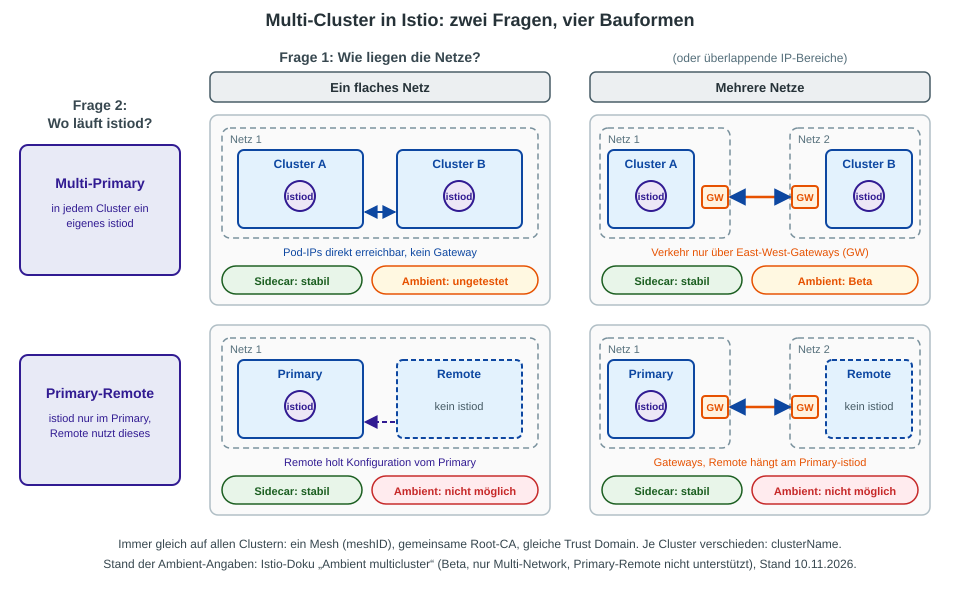
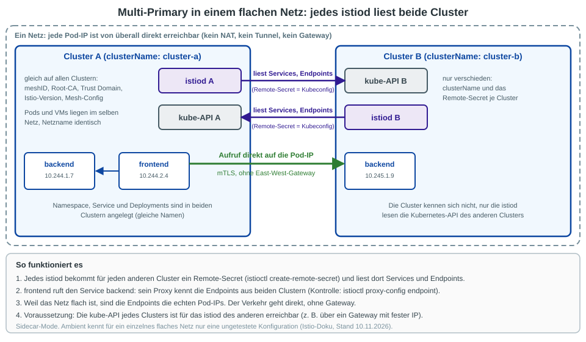
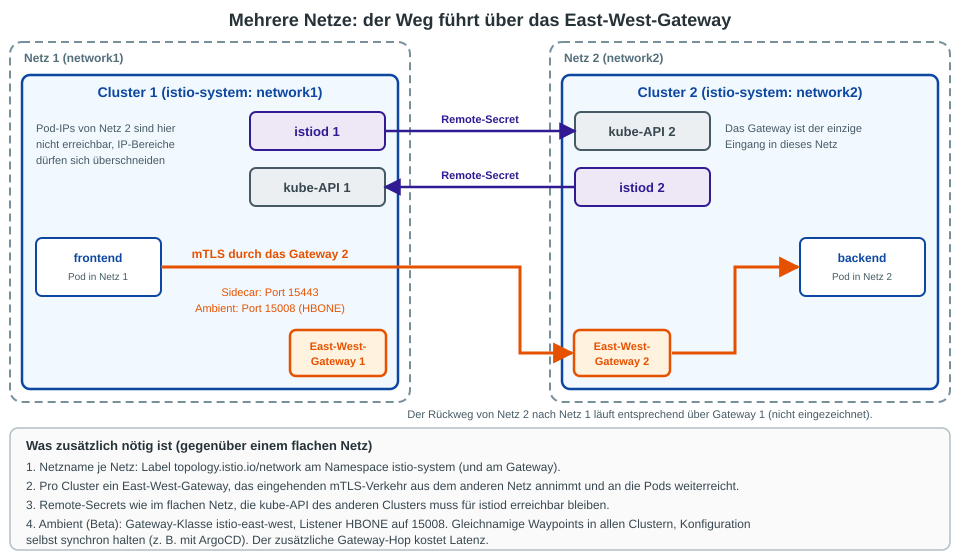
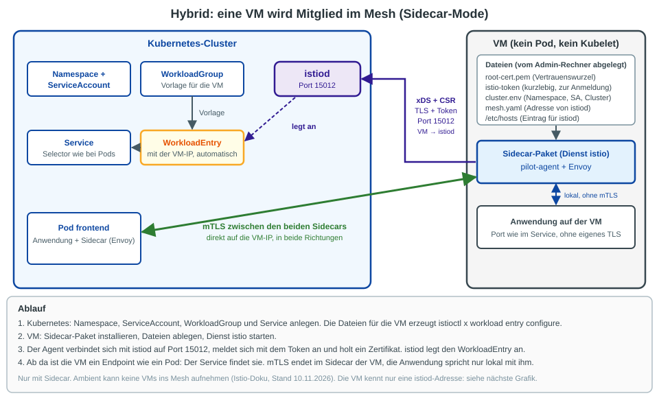
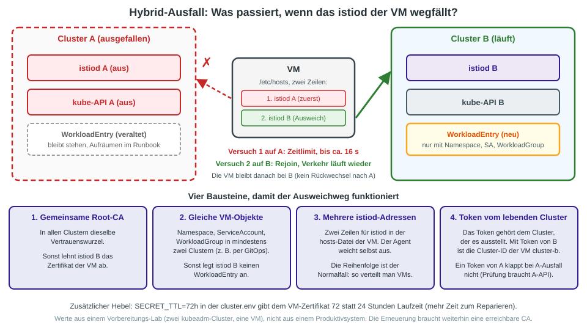

# Multi-Cluster und Hybrid mit Istio: ein Überblick

Stand: 2026-11-10. Reine Theorie, nichts davon wird im Training auf den Teilnehmer-Clustern aufgebaut.
Die Ambient-Aussagen stammen aus der Istio-Doku (siehe Quellen), die Zahlen zum VM-Ausfall aus einem
Vorbereitungs-Lab (zwei kubeadm-Cluster, eine VM). Auf unseren 16 Trainings-Clustern wurde nichts davon getestet.

## Kurzfassung

- **Zwei Fragen bestimmen die Bauform:** Liegen die Cluster in einem flachen Netz oder in mehreren Netzen? Und hat jeder Cluster sein eigenes istiod (Multi-Primary) oder hängen Cluster an einem fremden istiod (Primary-Remote)?
- **Ein flaches Netz** braucht keine Gateways: Pod-IPs sind direkt erreichbar. **Mehrere Netze** brauchen pro Cluster ein East-West-Gateway.
- **Immer gleich** auf allen Clustern: `meshID`, Root-CA, Trust Domain. **Immer verschieden:** `clusterName`.
- **Ambient** kann Multi-Cluster nur als Multi-Primary über mehrere Netze (Beta). **VMs im Mesh** gehen nur mit Sidecar.

## 1. Die vier Bauformen

| Bauform | Sidecar | Ambient |
|---|---|---|
| Multi-Primary, ein Netz | stabil | ungetestet, laut Doku möglicherweise fehlerhaft |
| Multi-Primary, mehrere Netze | stabil | Beta, laut Doku produktionsreif mit Einschränkungen |
| Primary-Remote, ein Netz | stabil | nicht unterstützt |
| Primary-Remote, mehrere Netze | stabil | nicht unterstützt |

Wann Multi-Cluster überhaupt? Für Ausfallsicherheit (ein Cluster fällt aus, der andere übernimmt), für
Trennung nach Teams oder Regionen und für standortnahes Routing. Der Preis ist mehr Betriebsaufwand.
Mehrere Control Planes (Multi-Primary) sind laut Doku die ausfallsicherste Variante, weil ein
istiod-Ausfall nur die Workloads seines eigenen Clusters trifft.

## 2. Multi-Primary in einem flachen Netz

- Jedes istiod bekommt ein **Remote-Secret** (Kubeconfig mit ServiceAccount-Token) für jeden anderen Cluster
  (`istioctl create-remote-secret`). Damit liest es dort Services und Endpoints.
- Der Proxy eines Clients kennt danach die Endpoints **aller** Cluster (Kontrolle: `istioctl proxy-config endpoint <pod>`).
- Weil alle Pod-IPs direkt erreichbar sind, geht der Verkehr **ohne Gateway** auf die Pod-IP.
- Service-Namen müssen in jedem Cluster existieren, der sie aufruft, auch wenn dort keine Pods laufen (DNS).
- Voraussetzung: Die Pod- und Service-Bereiche der Cluster dürfen sich nicht überschneiden.

## 3. Mehrere Netze: East-West-Gateway

- Jedes Netz bekommt einen Namen: Label `topology.istio.io/network` am Namespace `istio-system`.
- Der Verkehr in das andere Netz geht **nur über dessen East-West-Gateway**. Pod-IPs des fremden Netzes sind nicht erreichbar,
  dafür dürfen sich IP-Bereiche überschneiden.
- **Sidecar:** mTLS-Verkehr auf Port 15443 (SNI-Passthrough). **Ambient:** Gateway-Klasse `istio-east-west`, Listener `HBONE` auf Port 15008.
- Remote-Secrets wie im flachen Netz: Die Kubernetes-API des anderen Clusters muss für das istiod erreichbar bleiben.
- Der zusätzliche Gateway-Hop kostet Latenz. Mit Locality Load Balancing bleibt der Verkehr nach Möglichkeit im eigenen Cluster oder in der eigenen Zone.

### Grenzen bei Ambient (laut Doku)

- Nur Multi-Network wird unterstützt, Primary-Remote nicht.
- Waypoints müssen in allen Clustern **gleich heißen**, ihre Konfiguration muss man selbst synchron halten (z. B. mit ArgoCD).
- Es zählt nur die Konfiguration des **lokalen** Clusters. Globale Waypoints können ungewollten Verkehr zwischen Clustern erzeugen.
- Beim Failover in ein anderes Netz kann ein einzelner Endpoint überproportional viele Anfragen bekommen.
- Die Doku rät davon ab, Ambient-Multicluster in einer bestehenden produktiven Sidecar-Umgebung einzuschalten.

## 4. Hybrid: eine VM im Mesh

Eine VM ist ein **Workload ohne Kubelet**. Istio ist es egal, ob der Sidecar in einem Pod oder auf einer VM läuft,
er braucht nur drei Dinge: istiod erreichen, ein Token zur Anmeldung, das Root-Zertifikat.

| Seite | Was nötig ist |
|---|---|
| Kubernetes | Namespace, ServiceAccount, `WorkloadGroup` (Vorlage), `Service` mit Selector |
| VM | Sidecar-Paket (Dienst `istio`: `pilot-agent` + Envoy), `root-cert.pem`, `istio-token` (kurzlebig), `cluster.env`, `mesh.yaml`, `/etc/hosts`-Eintrag für istiod |
| Erzeugung der Dateien | `istioctl x workload entry configure -f <WorkloadGroup> -o <Ordner> --clusterID <Cluster> ...` |

Beim Start verbindet sich der Agent mit istiod (Port **15012**, TLS plus Token), holt ein Zertifikat, und istiod legt
den `WorkloadEntry` mit der VM-IP an (Auto-Registration). Ab da ist die VM ein Endpoint wie ein Pod.
Der Verkehr läuft mit mTLS in beide Richtungen direkt auf die IP, wenn das Netz das erlaubt (sonst über ein East-West-Gateway).

**Nur mit Sidecar.** Ambient kann keine VMs ins Mesh aufnehmen (siehe [Was Ambient noch nicht kann](11-ambient-grenzen-gegenueber-sidecar.md)).

## 5. Hybrid: was passiert, wenn istiod ausfällt?

Die VM kennt standardmäßig **genau eine** istiod-Adresse. Fällt dieser Cluster aus, bekommt der Sidecar keine
Konfigurationsänderungen mehr und kann sich nicht neu anmelden. Das VM-Zertifikat gilt standardmäßig 24 Stunden und
wird nach der Hälfte erneuert. Ohne erreichbare CA fällt die VM nach Ablauf aus dem Mesh.

Ergebnisse aus dem Lab (zwei Cluster A und B, Multi-Primary, gemeinsame Root-CA, VM mit zwei istiod-Adressen):

| Situation | Ergebnis |
|---|---|
| istiod A aus, API von A erreichbar, Zertifikat gültig | VM wechselt nach etwa 5 s zu istiod B |
| Cluster A komplett aus, Agent neu gestartet, Zertifikat gültig | Rejoin über B nach etwa 16 s (erster Versuch läuft in ein Zeitlimit) |
| A aus, Zertifikat entfernt, **Token von A** | Kein Rejoin (`Unauthenticated`), B kann das Token ohne die API von A nicht prüfen |
| A aus, Zertifikat entfernt, **Token von B** (Cluster-ID `cluster-b`) | Rejoin nach etwa 4 s |

Die vier Bausteine für den Ausweichweg stehen in der Grafik. Offen bleiben: Die VM wechselt nicht von selbst zurück
nach A, und der veraltete `WorkloadEntry` in A bleibt stehen, ein Aufräumen gehört ins Runbook.
Nicht getestet: Ausfall während eines laufenden Token-Wechsels, mehr als zwei Cluster, IPv6, `istio-csr` statt Istio-eigener CA.

## Wo passt das zu unserem Training?

- Wir bauen **einen** Cluster pro Teilnehmer mit Ambient, also weder Multi-Cluster noch VMs.
- Für den Kunden-Alltag gilt: Multi-Cluster mit Ambient nur als Multi-Primary über mehrere Netze (Beta). Wer **VMs im Mesh** oder
  **Primary-Remote** braucht, bleibt beim Sidecar-Mode.
- Hub-and-Spoke auf Azure mit Rancher: der Mesh-Verkehr bleibt im Cluster, siehe
  [Rancher im Hub-and-Spoke-Netz](../installation/openshift/03-hub-spoke-rancher-azure.md).

## Quellen

* [Istio: Multicluster installieren](https://istio.io/latest/docs/setup/install/multicluster/)
* [Istio: Ambient multicluster](https://istio.io/latest/docs/ambient/install/multicluster/) und [Multi-Primary über zwei Netze](https://istio.io/latest/docs/ambient/install/multicluster/multi-primary_multi-network/)
* [Istio: Deployment-Modelle](https://istio.io/latest/docs/ops/deployment/deployment-models/)
* [Istio: Virtuelle Maschinen installieren](https://istio.io/latest/docs/setup/install/virtual-machine/)

Nicht gegen die Doku geprüft (aus Istio-Wissen): Port 15443 beim Sidecar-East-West-Gateway, Standardlaufzeit 24 h des VM-Zertifikats, Auto-Registration als Standard.
