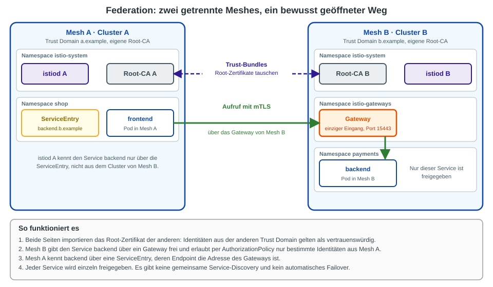

# Istio Federation und Cross-Cluster-Traffic

**Stand: 10.11.2026.** Grundlage sind die Istio-Doku zu den Deployment-Modellen und die Doku zu Ambient Multicluster. Im Training läuft Istio **1.31.4**.

## Cross-Cluster-Traffic: was ist das?

**Cross-Cluster-Traffic** ist jeder Aufruf, bei dem ein Pod in Cluster A einen Service in Cluster B erreicht.
Es gibt zwei Wege dorthin. Der Unterschied ist, ob beide Cluster **ein Mesh** bilden oder **zwei getrennte Meshes** bleiben.

| | **Multi-Cluster (ein Mesh)** | **Federation (mehrere Meshes)** |
|---|---|---|
| Aufbau | ein Mesh über mehrere Cluster | jeder Cluster ist ein eigenes Mesh |
| Trust Domain und Root-CA | gleich | verschieden |
| Service-Discovery | automatisch, istiod liest die Services des anderen Clusters | keine, jeder Service wird einzeln eingetragen |
| Welche Services sind sichtbar? | alle (mit gleichem Namen und Namespace) | nur die, die du freigibst |
| Failover zwischen Clustern | ja | nein |
| Typischer Fall | ein Team, Hochverfügbarkeit | getrennte Teams, Firmen oder Sicherheitszonen |

## Was ist Federation?

Federation heißt: **Zwei Meshes bleiben getrennt und öffnen gezielt einen Weg füreinander.**
Jedes Mesh behält seinen eigenen istiod, seine eigene Root-CA und seine eigene Trust Domain.
Sie tauschen nur zwei Dinge aus: **Vertrauen** (die Root-Zertifikate) und **die Adresse eines freigegebenen Services**.

## Was kann Federation?

* **mTLS über die Meshgrenze.** Weil beide Seiten das Root-Zertifikat der anderen kennen, prüft jede Seite die Identität der Gegenseite.
* **Freigabe einzelner Services.** Mesh B macht nur `backend` sichtbar, alles andere bleibt unsichtbar.
* **Zugriffsregeln pro Identität.** Mesh B erlaubt per `AuthorizationPolicy` nur bestimmten Identitäten aus Mesh A den Zugriff (`principals: ["a.example/ns/shop/sa/frontend"]`).
* **Gleiche Namen in beiden Meshes.** Namespaces und Services dürfen in beiden Meshes gleich heißen. Eine eindeutige Mesh-ID sorgt für verschiedene FQDNs.

## Wie läuft ein Aufruf?

Das ist das übliche Muster. **Istio liefert dafür kein fertiges Werkzeug.** Die Doku beschreibt nur das Prinzip (Identitäten und Trust-Bundles föderieren), die Bausteine setzt du selbst zusammen.

1. **Trust austauschen.** Jedes Mesh importiert die Root-Zertifikate des anderen, zum Beispiel über `meshConfig.caCertificates` und `trustDomainAliases`. Der Austausch läuft manuell oder per SPIFFE Trust Domain Federation.
2. **Service freigeben.** Mesh B stellt ein Gateway bereit (TLS-Passthrough, Port 15443), das den Verkehr an `backend` weiterreicht.
3. **Service importieren.** In Mesh A legst du eine `ServiceEntry` an. Der Host ist zum Beispiel `backend.b.example`, der Endpoint ist die Adresse des Gateways von Mesh B.
4. **Zugriff erlauben.** Mesh B schränkt per `AuthorizationPolicy` ein, wer durch das Gateway darf.

Eine **einfachere Variante** gibt es auch: Mesh A behandelt Mesh B wie eine **externe API** (`ServiceEntry` plus TLS am Ingress-Gateway von B). Dann gibt es keine Identitäts-Föderation, aber auch kein Zertifikats-Management zwischen den Meshes.

## Wann setze ich Federation ein?

**Ja, wenn:**

* die Meshes **verschiedenen Teams oder Firmen** gehören und keiner dem anderen die Kontrolle über istiod oder die CA geben will,
* **Test und Produktion** strikt getrennt bleiben sollen, aber ein einzelner Service geteilt wird,
* nach einer **Fusion oder bei Partnern** zwei bestehende Meshes mit eigener CA zusammenarbeiten müssen,
* nur **wenige, genau definierte Services** den Cluster verlassen sollen.

**Nein, wenn:**

* es um **Hochverfügbarkeit** oder **Failover** eines Teams geht. Dann ist Multi-Cluster mit einem Mesh der richtige Weg.
* alle Services überall sichtbar sein sollen. Mit Federation müsstest du jeden einzeln freigeben.
* du keine Zeit für den laufenden Betrieb der Trust-Bundles hast.

## Vorteile

* **Starke Isolation.** Ein Fehler oder eine Kompromittierung in Mesh A erreicht Mesh B nur über den freigegebenen Weg.
* **Klare Verantwortung.** Jedes Team betreibt seinen eigenen istiod, seine CA und seine Policies.
* **Freigabe nach dem Minimalprinzip.** Es ist nur sichtbar, was ausdrücklich eingetragen ist.
* **Keine Abstimmung bei Namen, Versionen und Konfiguration.** Die Meshes können verschiedene Istio-Versionen und Mesh-Configs haben.

## Nachteile

* **Viel Handarbeit.** Trust-Bundles, `ServiceEntry`, Gateway und `AuthorizationPolicy` pflegst du selbst. Istio bringt dafür keine Automatik mit.
* **Zertifikate laufen ab.** Wird eine Root-CA erneuert, müssen alle Partner das neue Zertifikat bekommen. Sonst bricht der Verkehr ab.
* **Kein Failover und keine automatische Discovery.** Fällt der Service in Mesh B aus, springt Mesh A nicht von selbst auf eine andere Kopie.
* **Zusätzlicher Hop.** Jeder Aufruf geht über das Gateway. Das kostet Latenz.
* **Zwei Stellen für Beobachtung und Fehlersuche.** Traces und Metriken enden an der Meshgrenze, außer du verbindest sie.

## Und Multi-Cluster mit einem Mesh?

Das ist der andere Weg für Cross-Cluster-Traffic: automatische Service-Discovery und Failover, dafür mehr Komplexität.
Die Istio-Doku sagt: *"Multicluster deployments give you a greater degree of isolation and availability but increase complexity."*
Die Bauformen, die Gateways und der Stand unter Ambient stehen auf der Seite [Multi-Cluster und Hybrid im Überblick](13-multi-cluster-hybrid-ueberblick.md).

**Federation unter Ambient:** Dazu habe ich in der Istio-Doku keine Anleitung gefunden. Plane das nur mit einem Test auf deinem Cluster ein.

## Merksatz

* **Ein Team, ein Ziel, Ausfallsicherheit:** Multi-Cluster mit einem Mesh.
* **Getrennte Verantwortung, wenige Services teilen:** Federation.

## Quellen

* [Istio: Deployment Models (Multiple Meshes, Multiple Clusters)](https://istio.io/latest/docs/ops/deployment/deployment-models/)
* [Istio: Ambient Multicluster installieren](https://istio.io/latest/docs/ambient/install/multicluster/)
