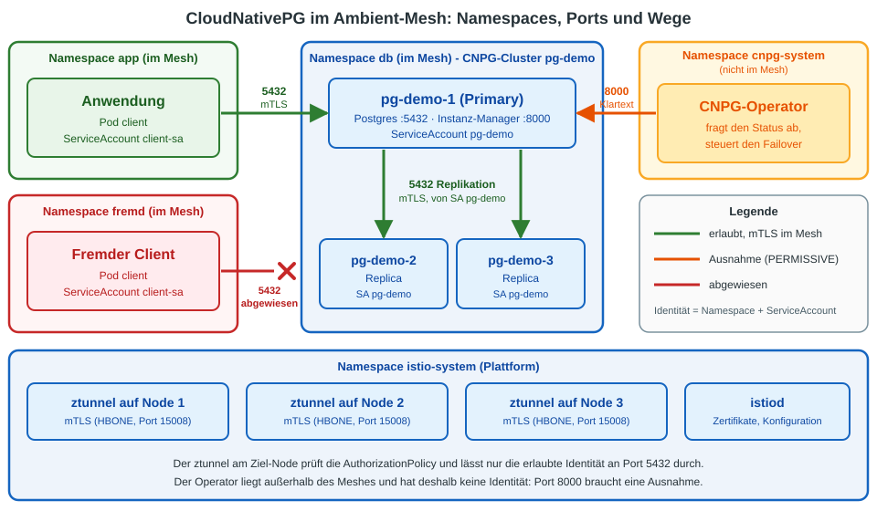
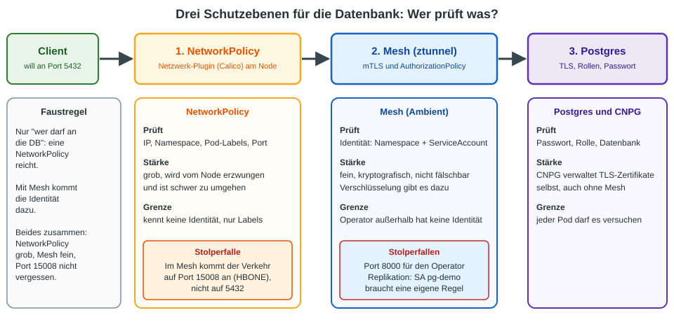
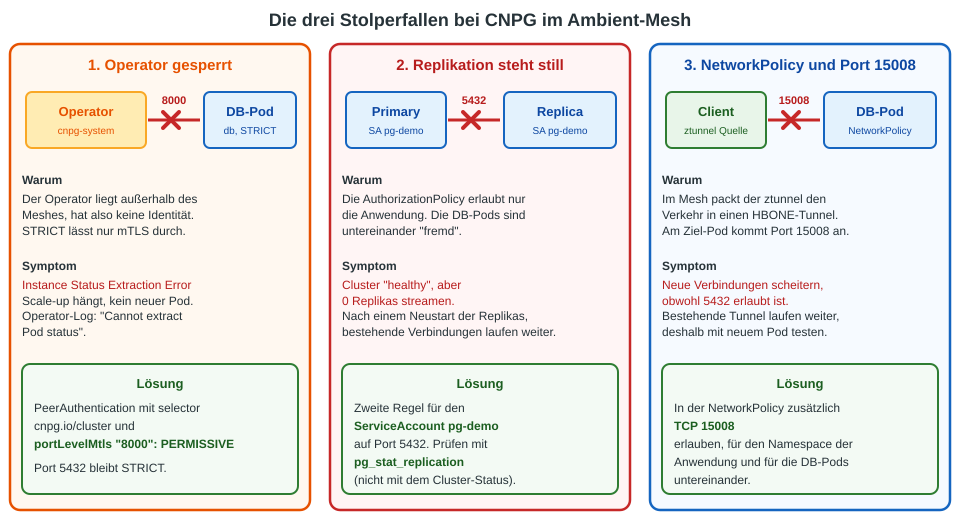

# CloudNativePG (Postgres) im Ambient-Mesh: Überblick

## Worum geht es?

  * **CloudNativePG (CNPG)** betreibt Postgres-Datenbanken in Kubernetes: Replikas, Failover, Backups.
  * Das **Mesh (Istio Ambient)** sichert den Netzwerkverkehr zwischen den Pods ab und macht ihn sichtbar.

Die Frage: **Soll der Verkehr zur Datenbank zusätzlich durchs Mesh laufen?**

Antwort in einem Satz: Das geht mit Ambient gut, bringt aber nur dann etwas, wenn du die **Identität** des Absenders prüfen willst.
Für die reine Frage "wer darf an die Datenbank" reicht eine NetworkPolicy.

## Das Gesamtbild

Die Grafik zeigt, **in welchem Namespace was läuft** und welche Wege der Verkehr nimmt.
Die Datenbank (`db`) und die Anwendung (`app`) liegen im Mesh, der Operator (`cnpg-system`) bleibt draußen.

| Weg | Port | Was passiert |
|---|---|---|
| Anwendung → Primary | 5432 | mTLS im Mesh, erlaubt durch die `AuthorizationPolicy` |
| Fremder Client → Primary | 5432 | wird vom ztunnel abgewiesen (falsche Identität) |
| Primary → Replicas | 5432 | Replikation, mTLS, Identität `pg-demo` |
| Operator → DB-Pods | 8000 | Status und Failover, Ausnahme (PERMISSIVE) nötig |

## Drei Schutzebenen

Eine Verbindung zur Datenbank läuft durch drei Prüfungen. Jede sieht etwas anderes.

  * **NetworkPolicy:** grob und robust, kennt aber nur IP, Namespace, Labels und Port.
  * **Mesh:** fein, weil es den **ServiceAccount** prüft (kryptografisch, nicht fälschbar).
  * **Postgres und CNPG:** Passwort, Rollen und TLS. CNPG verwaltet die Zertifikate selbst.

## Vorteile und Nachteile

| | Vorteil | Nachteil |
|---|---|---|
| Zugriff | Nur ein bestimmter ServiceAccount kommt an die DB, andere werden vor dem Passwort abgewiesen | Mehr Regeln, die zusammenpassen müssen |
| Verschlüsselung | kommt ohne Konfiguration | kein echter Gewinn, CNPG verschlüsselt schon selbst |
| Sichtbarkeit | TCP-Metriken wie bei allen anderen Diensten | Zusätzliche Fehlerquelle: bei Problemen ist unklar, ob Postgres, CNPG oder das Mesh schuld ist |
| Betrieb mit Ambient | Kein Sidecar: Join-Pods und Failover laufen ohne Sonderbehandlung | Es gibt **keine offizielle Unterstützung** durch CNPG, du bist auf Community-Wissen angewiesen |
| Netzwerk | | Port 8000 braucht eine Ausnahme, Port 15008 muss in NetworkPolicies erlaubt sein |

**Sidecar-Modus für Datenbank-Pods:** nicht empfohlen. Die Bootstrap-Pods erben keine Annotationen von CNPG, und mit Sidecars gibt es Probleme mit Start und Beenden.

## Die drei Stolperfallen

Alle drei wurden auf einem Ambient-Cluster nachgestellt (Istio 1.31.4, CNPG 1.30.1, Postgres 17, Calico).

Die zweite Falle ist die gefährlichste: CNPG meldet `Cluster in healthy state`, obwohl keine Replika mehr Daten bekommt.
**Deshalb nach jeder Policy die Replikation mit `pg_stat_replication` prüfen, nicht den Cluster-Status.**

## Empfehlung

| Situation | Empfehlung |
|---|---|
| Kein Mesh im Einsatz und keins geplant | CNPG allein, dazu eine **NetworkPolicy** |
| Ambient wird ohnehin betrieben, nur "wer darf an die DB" | **NetworkPolicy** reicht |
| Ambient wird betrieben und die **Identität** soll geprüft werden (zum Beispiel für Zero Trust oder Audit) | CNPG im Ambient-Mesh, mit `AuthorizationPolicy`, und die drei Stolperfallen beachten |
| Datenbank-Pods mit Sidecar | vermeiden |

Wenn du beides kombinierst: **NetworkPolicy grob, Mesh fein**, und Port 15008 nicht vergessen.

## Noch nicht getestet

  * Der Operator selbst im Ambient-Mesh (Port 9443 für die Webhooks unter STRICT).
  * Waypoint (Layer 7) für Postgres, Backups und der Pooler (PgBouncer).

## Übung

  * [Übung (Ambient): CloudNativePG im Ambient-Mesh absichern](../exercises/22-cnpg-postgres-ambient.md)

## Quellen

  * [CNPG-Diskussion #1280: Operator und Cluster unter Istio](https://github.com/cloudnative-pg/cloudnative-pg/discussions/1280) (Sidecar-Modus: Operator greift per Pod-IP auf Port 8000 zu, Bootstrap-Pods erben keine Annotationen)
  * [Istio: Ambient und NetworkPolicy](https://istio.io/latest/docs/ambient/usage/) (HBONE-Port 15008)
