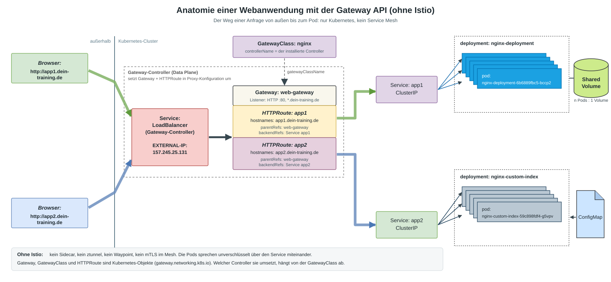

# Anatomie einer Webanwendung mit der Gateway API (ohne Istio)

Bevor Istio ins Spiel kommt, hier der Weg einer Anfrage von außen bis zum Pod, nur mit Kubernetes-Bordmitteln und der **Gateway API**.
Das Schaubild entspricht der klassischen "Anatomie einer Webanwendung" mit Ingress, nur dass die Ingress-Objekte durch Gateway-API-Objekte ersetzt sind.



## Der Weg einer Anfrage

| Schritt | Was passiert | Objekt |
|---|---|---|
| 1 | Der Browser löst `app1.dein-training.de` auf und landet auf der **EXTERNAL-IP** | DNS, `Service` vom Typ `LoadBalancer` (gehört zum Gateway-Controller) |
| 2 | Der Gateway-Controller nimmt die Anfrage am **Listener** (Port 80) an | `Gateway` |
| 3 | Anhand des Hostnamens wählt er die passende Route | `HTTPRoute` (`hostnames`, `parentRefs`) |
| 4 | Die Route verweist auf einen Service | `backendRefs` auf `Service` (`ClusterIP`) |
| 5 | Der Service verteilt auf die Pods des Deployments | `Deployment`, `Pod` |
| 6 | Die Pods lesen Konfiguration oder Daten | `ConfigMap`, `PersistentVolume` (gemeinsam genutzt, n Pods : 1 Volume) |

## Die Objekte im Einzelnen

| Objekt | Aufgabe | Wer legt es an |
|---|---|---|
| `GatewayClass` | Legt fest, **welcher Controller** (z. B. NGINX Gateway Fabric, Envoy Gateway, Istio) die Gateways umsetzt | Plattform (einmal pro Cluster) |
| `Gateway` | Der Eingang: Listener mit Port, Protokoll, Hostname, optional TLS | Plattform oder Team |
| `HTTPRoute` | Regeln: Hostname, Pfad, Header, Ziel-Service | Team (im eigenen Namespace) |
| `Service` (`ClusterIP`) | Stabile interne Adresse und Lastverteilung auf die Pods | Team |
| `Deployment` | Hält die gewünschte Zahl Pods am Laufen | Team |

Der **Gateway-Controller** ist die eigentliche Software, die Datenverkehr verarbeitet. Er liest `Gateway` und `HTTPRoute` und setzt sie in die Konfiguration seines Proxys um.
`Gateway`, `GatewayClass` und `HTTPRoute` sind nur Beschreibungen (API-Gruppe `gateway.networking.k8s.io`).

## Beispiel: Gateway und HTTPRoute

Der Wert von `gatewayClassName` hängt vom installierten Controller ab (`kubectl get gatewayclass`).

```yaml
apiVersion: gateway.networking.k8s.io/v1
kind: Gateway
metadata:
  name: web-gateway
spec:
  gatewayClassName: nginx
  listeners:
    - name: http
      port: 80
      protocol: HTTP
      hostname: "*.dein-training.de"
      allowedRoutes:
        namespaces:
          from: Same
---
apiVersion: gateway.networking.k8s.io/v1
kind: HTTPRoute
metadata:
  name: app1
spec:
  parentRefs:
    - name: web-gateway
  hostnames:
    - app1.dein-training.de
  rules:
    - backendRefs:
        - name: app1
          port: 80
```

## Was Istio später ergänzt

Ohne Istio gibt es kein Sidecar, keinen ztunnel und keinen Waypoint. Die Pods sprechen unverschlüsselt über den Service miteinander,
und es gibt keine Identität pro Workload. Genau diese Lücken schließt Istio im weiteren Verlauf des Trainings (mTLS, Autorisierung, Resilience, Observability).
Die Gateway API bleibt dabei dieselbe: Istio kann als Controller hinter einer `GatewayClass` stehen.
